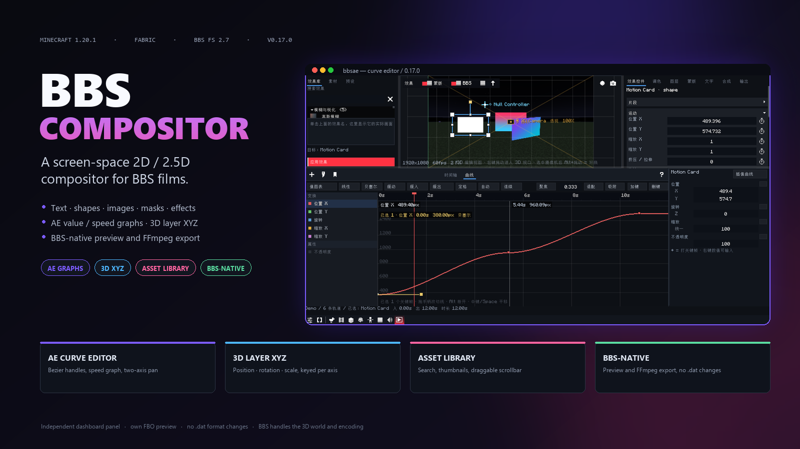
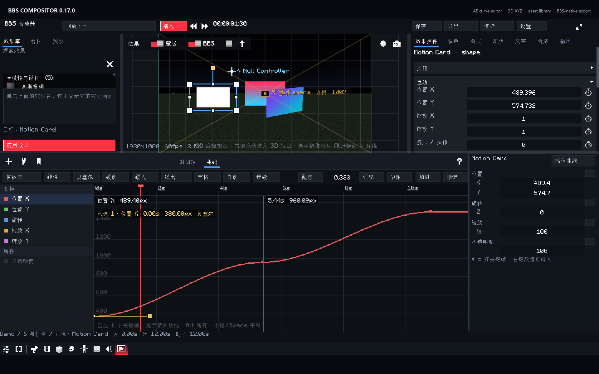
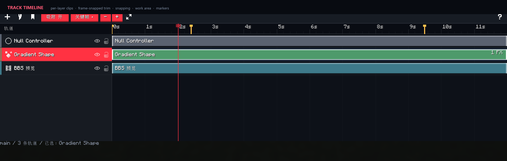
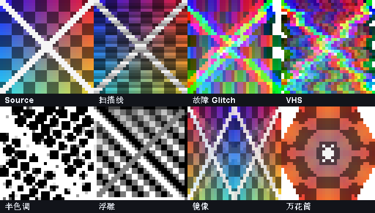
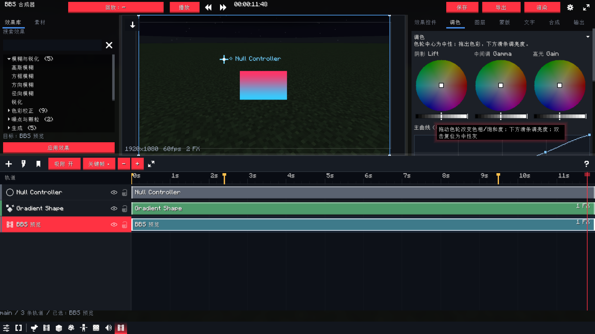
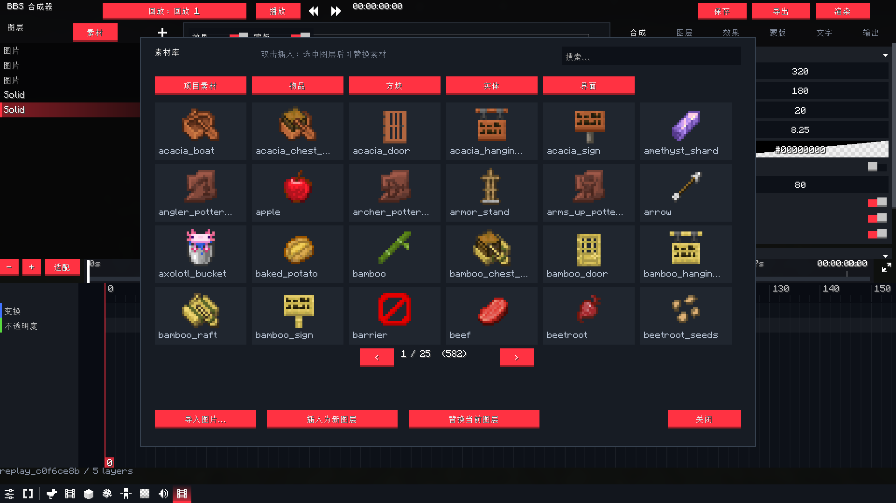
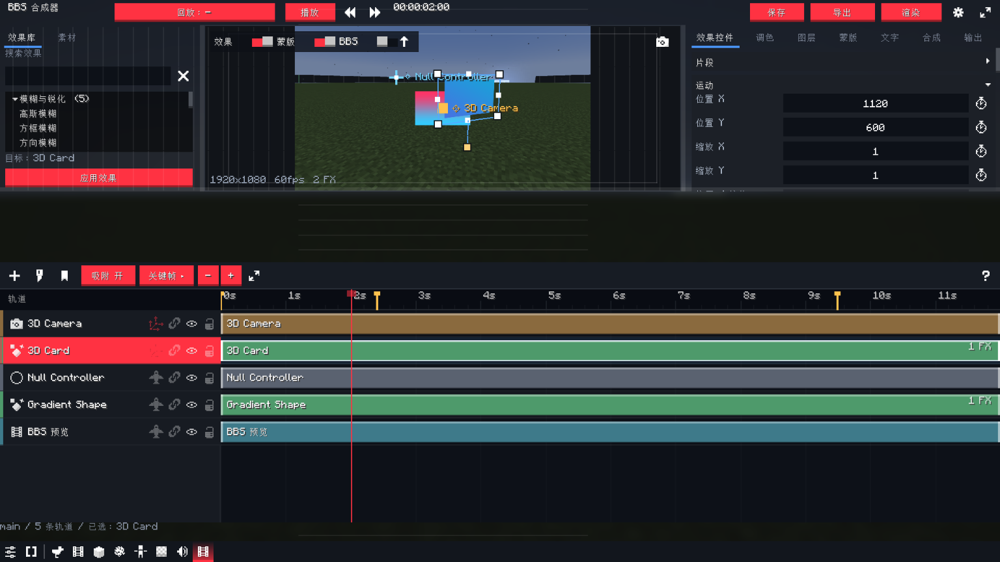
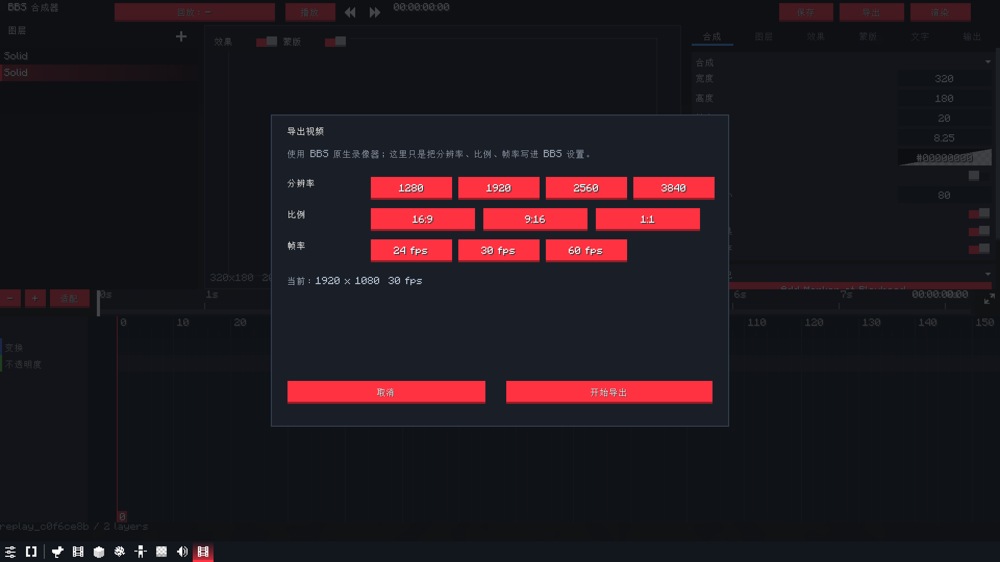
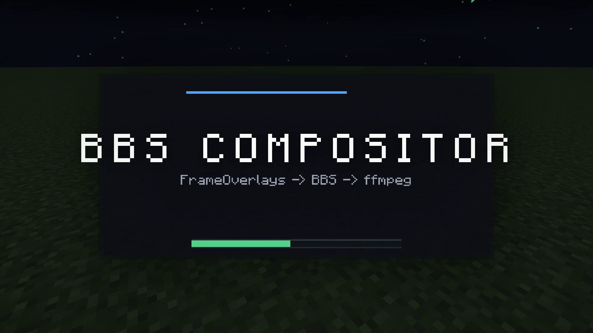

# BBS Compositor (`bbsae`)

> 交接文档：**[docs/HANDOFF.zh.md](docs/HANDOFF.zh.md)**（当前架构、已实现功能、关键 bug、未完成项、构建/重映射流程）。

- **Source:** <https://github.com/zhongend/bbsae>
- **Issues:** <https://github.com/zhongend/bbsae/issues>
- **Feature matrix:** [`docs/features.zh.md`](docs/features.zh.md)
- **UI architecture:** [`docs/ui-architecture.zh.md`](docs/ui-architecture.zh.md)
- **Photon research:** [`docs/photon-research.zh.md`](docs/photon-research.zh.md)
- **Developer handoff:** [`docs/HANDOFF.zh.md`](docs/HANDOFF.zh.md)
- **中文图文介绍 / Chinese gallery:** [`docs/GALLERY.zh.md`](docs/GALLERY.zh.md)
- **Round 8 (Alight Motion PIXEL effects):** [`docs/ROUND8-01-AUDIT.zh.md`](docs/ROUND8-01-AUDIT.zh.md),
  [`docs/ROUND8-02-PIXEL.zh.md`](docs/ROUND8-02-PIXEL.zh.md),
  [`docs/ROUND8-03-VERIFY.zh.md`](docs/ROUND8-03-VERIFY.zh.md),
  [`docs/ROUND8-04-PUBLISH.zh.md`](docs/ROUND8-04-PUBLISH.zh.md)
- **Round 9 (export fidelity / 12 s duration / icon):** [`docs/ROUND9-EXPORT-SYNC.zh.md`](docs/ROUND9-EXPORT-SYNC.zh.md)

<p align="center">
  
</p>

> This repository does **not** redistribute the BBS FS jar. Download BBS FS 2.7-1.20.1 from its
> official Modrinth page and put `bbs-2.7-1.20.1.jar` in `libs/` before building.

A screen-space compositor for **BBS FS** films, built as a BBS addon for **Minecraft 1.20.1 / Fabric**.

The compositor adds a 2D/2.5D layer on top of BBS's finished 3D frame: text, shapes, images,
solid layers, nulls, adjustment layers, precomps, masks, feathered mattes, effects, layer styles,
parenting, tracked bindings and a native-keyframe timeline. The result is drawn through BBS's
official `RegisterFrameOverlaysEvent`, so it is included in BBS's preview **and in its FFmpeg film
export** without touching the `.dat` film format.

## Download / Install

1. Download [`bbsae-0.1.0.jar`](https://github.com/zhongend/bbsae/releases/download/v0.1.0/bbsae-0.1.0.jar)
   from the **v0.1.0** release (the asset is updated with each source push).
2. Install **Minecraft 1.20.1**, **Fabric Loader 0.16.14+**, **Fabric API 0.92.1+1.20.1** and
   **BBS FS 2.7-1.20.1**.
3. Put `bbsae-0.1.0.jar` and the BBS FS jar into the game's `mods/` folder.
4. Launch the game, open a film in BBS, select a replay, then use
   **Replay properties → Compositor → Open Film Compositor**.

## Gallery

> 中文版图文介绍（含逐张说明）见 **[docs/GALLERY.zh.md](docs/GALLERY.zh.md)**。

### The editor, not an overlay

<p align="center">
  
</p>

BBS Compositor opens as an **independent BBS dashboard panel**, not a transparent overlay on the
film editor. The layout follows a Premiere-style information architecture:

1. **Effects library** — search, categories and a recent list; double-click applies to the selected track.
2. **Live FBO preview** — the compositor renders into its own framebuffer with selection handles,
   safe-area/grid overlays, and **FX / Mask / BBS-world** toggles for A/B comparison.
3. **Effect Controls** — motion, opacity, blend mode, the applied-effect stack, layer styles,
   masks, text, grade, and the context-sensitive Layer/Comp/Output pages.
4. **Track timeline** — one row per layer, movable/trimable clips, frame snapping, work-area
   shading, markers and a BBS-native keyframe drawer.

<p align="center">
  
</p>

### 53 effects, including the Alight Motion PIXEL family

The compositor ships a curated catalogue rather than a wall of half-implemented effects. It covers
blur, colour, keying, generate, distort, stylize, transitions and depth. Round 8 added seven
screen/retro effects built on the shared PIXEL shader:

**Scanlines · Glitch · VHS · Halftone · Emboss · Mirror · Kaleidoscope**

<p align="center">
  <a href="docs/verify/round8-pixel-effects.png">
    
  </a>
</p>

Halftone uses Alight Motion-style properties (dots across the project width, strength, angle, row
phase, ink/paper colours); Mirror overlays a mirrored copy with an opacity control. All seven run in
**layer space**, so the pattern follows the layer when it is moved, scaled or rotated.

### Grading, assets, 3D and export

|  |  |
| :---: | :---: |
| **AE-style grading** — lift/gamma/gain wheels, five-point master curve, presets and keyframeable exposure/contrast/saturation/vibrance. | **Asset library** — project media plus the client's item/block/entity/gui textures, searchable and pageable. |

|  |  |
| :---: | :---: |
| **3D camera and 2.5D cards** — free camera, depth ordering, adjustment layers and precomps. | **BBS-native export** — resolution/aspect/fps presets write into BBS's recorder, then F6 renders the real film. |

|  |
| :---: |
| **A real 1920×1080 @ 60 fps export** — 494 frames, 8.23 s, with the compositor layers baked into the MP4. |

### Built on BBS's own frame path

The compositor does not re-encode films or patch `.dat` files. BBS serializes a small
`bbsae:composition` camera clip; `CompRenderer` draws the layer stack at the
`RegisterFrameOverlaysEvent` point. That means the same composition appears in BBS's preview and in
its FFmpeg film export, and BBS keeps ownership of keyframes, undo, project storage and video
encoding.

## Status

This is the third vertical slice: the data model, render graph, editor, per-replay project
isolation, timeline scrubbing and render queue are in place. It is not a finished AE clone, and
the feature matrix in [`docs/features.zh.md`](docs/features.zh.md) is deliberately explicit about
what is and is not implemented.

Verified in this iteration:

- `compileJava` and all **63** tests pass (headless model + real hidden-window OpenGL 3.2 pixel
  tests + export-duration/icon checks);
- the addon loads in a Fabric 1.20.1 + BBS 2.7 development client;
- the compositor preview renders the composition (not a blank frame) after fixing projection,
  model-view and mask-transform state;
- the BBS film recorder produced a real H.264 MP4 (`320x180`, 20 fps, 39 frames) and the exported
  frame contains the compositor layers, proving the frame-overlay path reaches the video file;
- the final jar has Minecraft references remapped to intermediary and keeps BBS class names.

Build artifact: `build/libs/bbsae-0.1.0.jar` (also copied to `bbsae-0.1.0.jar`), **402706** bytes,
SHA-256 `2856C0590099208A1D4BF4336922320945DF9FC92CA4EC21BE1C4CEAA1867E4F` (check the file if it is
repacked). The jar is produced by `gradlew build`; `remapJar` writes it directly and the class
entries are intermediary-remapped.

2026-10-18 ninth pass (export fidelity, 12 s duration, compositor icon):

- the export length now uses `max(film, composition)` instead of BBS's 12-second camera default;
  the composition clip is normalized (`tick=0`, full duration, opacity 1) and the film is saved
  before recording, so the recorder cannot stop early or miss trimmed clips;
- the **BBS preview layer** no longer disappears in the film-editor/F6 export path: the clean
  world frame is captured at `AFTER_TRANSLUCENT` into `SceneColor`, and a `bbs` layer can sample
  it outside the compositor panel too. The 2D overlay also disables depth writes and restores the
  UI scissor, so the export cannot inherit a stale composition/frame state;
- `workAreaOut` follows the composition duration (including migration of the old 12-second
  default), so preview playback no longer loops at 12 s;
- added the user-provided compositor icon as `assets/bbsae/textures/gui/compositor_icon.png`
  (16×16), used by the dashboard tab and the `bbsae:composition` clip;
- export length is now passed to BBS's native recorder directly as
  `round(doc.duration * 20) + 1` ticks; the camera's 12-second default and the film panel's
  20-second loop can no longer cap it. A 25-second composition produced **1502 frames /
  25.033 s** (`docs/verify/round9-export-25s-22s.png`, `round9-export-25s-ffprobe.txt`); a
  20-second run is also kept at `docs/verify/round9-export-20s-15s.png`;
- a BBS-preview-layer-only export at `docs/verify/round9-bbs-preview-layer.png` proves the
  `bbs` layer now samples the clean world frame in the export path;
- tests now **63 / 63** (added `compositionExportDurationExtendsPastTheTwelveSecondFilmDefault`
  and `IconResourceTest`). Details: [`docs/ROUND9-EXPORT-SYNC.zh.md`](docs/ROUND9-EXPORT-SYNC.zh.md).

2026-10-18 eighth pass (Alight Motion PIXEL effects, first-principles bug audit):

- added seven PIXEL-family effects: **Scanlines, Glitch, VHS, Halftone, Emboss, Mirror,
  Kaleidoscope**; the catalogue now has **53** effects;
- every one operates in **layer space** through `EffectSpace` / `sampleLocal`, so the pattern
  follows the layer instead of staying glued to the composition;
- Halftone follows Alight Motion's properties (dots across the project width, strength, angle,
  row phase, ink/paper colours); Mirror now overlays a mirrored copy with an opacity control
  instead of discarding half the layer;
- fixed four dead parameters (`glitch.speed`, `vhs.speed`, `vhs.noise`, `depth_dof.focus`);
- fixed `EffectSpace.identity()` inverting the V axis (adjustment/3D-layer effects sampled the
  vertically flipped row) and `CompShaders.delete()` leaving a dangling `rgbSplit` program;
- new `PixelPlan` separates parameter resolution from GL so a headless test can prove every
  registry parameter reaches the shader; new GL pixel tests cover identity, layer space, colour
  and symmetry. Evidence: `docs/verify/round8-pixel-effects.png`.
- details: [`docs/ROUND8-01-AUDIT.zh.md`](docs/ROUND8-01-AUDIT.zh.md),
  [`docs/ROUND8-02-PIXEL.zh.md`](docs/ROUND8-02-PIXEL.zh.md),
  [`docs/ROUND8-03-VERIFY.zh.md`](docs/ROUND8-03-VERIFY.zh.md),
  [`docs/ROUND8-04-PUBLISH.zh.md`](docs/ROUND8-04-PUBLISH.zh.md).

2026-10-18 sixth pass (distortion, grading, landing screen, media/sound, export):

- distortion effects now measure strength in **pixels** and radius against the layer's half
  diagonal (`2π/wavelength` for waves); `pinch` gained its missing radius parameter. A real GL
  pixel test asserts that a bulge pulls transparent pixels into a square;
- the inspector has a real **grading page**: three AE-style colour wheels (lift/gamma/gain),
  a five-point master tone curve drawn with the same formula as the shader, presets and
  keyframeable exposure/contrast/saturation/vibrance/temperature/tint;
- the **landing screen** lists `.bbscomp` projects, creates new ones (name, canvas, fps,
  duration) and forbids editing until a project is chosen; shortcut scheme (Premiere / BBS) is
  selected there and persisted per project;
- all four panel areas are **draggable** (left, right, timeline, keyframe drawer) and the
  keyframe drawer height is saved; the old `row()` tab overflow is gone;
- the media library indexes 10 texture roots plus BBS textures, searches across every category,
  and has a sound library that auditions vanilla/BBS sound events, copies their ids and opens
  BBS's own sound overlay;
- layer duration has direct in/out/duration fields and 1s/2s/5s/fill buttons; settings add a
  default layer duration;
- 10 motion templates, a reworked block-shatter shader and a richer composition-clip inspector
  (project picker, fit choice, clip info, fixed “合成器” title);
- external replay playback can be configured to hide the compositor
  (`showDuringExternalPlayback`), detected with `BBSRendering.isCustomSize()` so F6 recording is
  never mistaken for external playback;
- export accepts custom width/height and a numeric aspect ratio; a real **1920x1080 @ 60 fps**
  export was produced (494 frames, 8.23 s) and a frame is at
  `docs/verify/round6-export-1080p60.png`.

2026-10-18 track-editor / Effect Controls pass (the Premiere-style correction):

- the bottom of the workspace is now a **real track editor**, not a small strip above a property
  sheet: one row per layer, a track header with visibility/lock, a movable/trimable clip bar,
  frame-snapped dragging, edge handles, snapping to the playhead/markers/other clips, zoom/pan,
  work-area shading and a proper seconds ruler;
- the layer stack is no longer a second list in the left column. Track headers are the single
  selection surface; clicking a bar selects its layer and feeds the right-hand panel. This removes
  the old duplicate "which list owns selection?" state;
- the right column is now **Effect Controls** by default: Motion (position/scale/rotation/anchor),
  Opacity + blend mode, the applied-effect stack and layer styles for the selected track. With no
  track selected it shows an explicit empty state instead of editing the last layer;
- the left column is a Premiere-style **Effects library** with search, categories, recent effects
  and a native `UIList` tree. Double-click or "Apply" adds the effect to the selected track; an
  effect can be enabled, reordered or removed in Effect Controls;
- the BBS keyframe editor moved into an optional drawer under the track timeline. Adding a keyframe
  opens it automatically; it fits the composition duration instead of the keyframes' bounding box;
- shortcuts were rebuilt around `KeyAction.PRESSED`: the old code also ran on key release, which
  made Space/S and other toggles fire twice and look broken. The new set adds J/K/L shuttle,
  frame/5-frame stepping, Home/End, edit-point and marker navigation, track selection/stacking,
  `[`/`]` trim to playhead, I/O work area, Alt+arrow nudging, C/Ctrl+K split, S snapping,
  `=`/`-`/`\` zoom/fit, F focus, Ctrl+S save, Ctrl+M export and Ctrl+/ shortcut help;
- split-at-playhead keeps footage continuous (`startTime` advances with the split), trim-in keeps
  the source frame under the cursor instead of slipping the clip, and moving a bar carries its
  keyframes and layer markers with it. These rules live in `CompLayer` and are covered by tests.

2026-10-18 UI pass (Chinese build):

- the whole compositor UI is Chinese: header, inspector tabs, every inspector field, effect names,
  effect parameter names and render-queue states;
- the inspector tab bar was replaced with a deterministic clickable bar (BBS's `UITabStrip` is a
  scroll view and swallowed presses inside the dashboard panel, so no tab could be switched);
- the timeline is primed on the first laid-out frame: sheets no longer stay blank until the user
  clicks something;
- Space toggles playback;
- opening the compositor now starts with a replay picker: a replay must be chosen before editing;
- export opens a small preset dialog (1280/1920/2560/3840, 16:9 / 9:16 / 1:1, 24/30/60 fps) that
  writes the values into BBS's own video settings and then runs BBS's native recorder, so export is
  no longer stuck at the old 320x180 preview size;
- toolbar regrouped: transport in the centre, save/export/render/focus anchored to the right, the
  add-layer button moved into the layer panel header.

2026-10-18 asset-library pass:

- **asset library** (materials button in the layer panel): a photo-library style browser with
  categories, thumbnails, search and paging. It indexes the project's own `assets` folder **and the
  client's resource packs** (`mc:textures/item|block|entity|gui`), so Minecraft item/block icons can
  be dropped straight into a HUD composition; double-click inserts, or replace the selected layer;
- layer stack is now drawn top-most first (AE convention), new layers appear on top;
- global undo/redo via 1-second project snapshots (Ctrl+Z / Ctrl+Y), plus Ctrl+D duplicate,
  Delete, Escape closes modals;
- Chinese default layer names, Chinese layer badges, label rows in the inspector use explicit
  two-column layout.

Implemented now:

- film/replay-scoped compositor projects: a film owns its project, every replay owns a separate
  composition inside it; the replay selector switches the edited composition;
- `.bbscomp` projects with multiple compositions, markers, master parameters and output presets;
- layer types: solid/panel/rect, bar, text, image/footage, shape, null, adjustment, precomp;
- in/out, start offset, time scale, freeze, keyframable source-time remap, layer markers, opacity,
  13 blend modes, parenting and track mattes (alpha/luma, normal/inverted);
- BBS-native `KeyframeChannel<Transform>` / `KeyframeChannel<Float>` animation, including effect
  parameters, text metrics, mask points/handles and shape trim/repeater values, edited with BBS's
  own `UIKeyframeEditor` (dope sheet, graph, context menus, interpolation, copy/paste);
- a real track timeline with a seconds ruler, playhead, work-area shading, track headers and
  movable/trimable layer bars; the BBS keyframe editor (dope sheet/graph/native keyframe dragging)
  opens in a drawer under the tracks when needed;
- masks with add/subtract/intersect/exclude, feather, opacity, positive/negative expansion,
  inversion, editable points and bezier handles;
- a curated **53-effect** catalogue (blur, color, keying, generate, distort, stylize, screen/retro,
  transitions, depth) with real box/radial blur, unsharp sharpen, depth-aware passes and the
  Alight Motion-style Scanlines / Glitch / VHS / Halftone / Emboss / Mirror / Kaleidoscope family;
- layer styles: drop shadow, inner shadow, outer/glow, bevel, color/gradient overlay, satin,
  stroke;
- text with tracking, line height, wrap, per-character range/wiggle animators;
- vector shapes (rect, ellipse, polygon, star, bezier path), boolean operators, trim, repeater,
  roundness, fill/stroke, editable/animatable path points;
- image layers and `%04d` footage sequences with source-time remap and an OS file-picker import
  that copies media into the project's own asset folder;
- tracking bindings to the BBS camera, replay actors and transformed layer anchors, plus depth
  texture capture for depth matte/fog/DOF/displacement;
- animation presets that store/reapply property animation without replacing target content;
- render queue with add/remove/retry/cancel, render settings/output module separation, editable
  output modules, PNG sequence, H.264 review and ProRes 4444 alpha presets;
- auto-save and `.bak` backups;
- a compact BBS-native editor with a Premiere-style information architecture:
  **Effects library | composition preview | Effect Controls**, and a **track timeline** at the
  bottom. The timeline has a seconds ruler, track headers (name, type icon, visibility, lock),
  movable/trimable bars with keyframe ticks and FX badges, snapping, zoom/pan and work-area shading;
  the BBS keyframe editor sits in an optional drawer under the tracks;
- the inspector is contextual: **Effect Controls** (Motion/Opacity/effect stack/styles), **Layer**
  (timing, switches, parenting, matte, expressions, type-specific fields), **Mask**, **Text**,
  **Comp** and **Output**. Nothing edits a hidden "last selected layer";
- the left **Effects library** has search, categories, recent effects and double-click apply; the
  effect stack in Effect Controls supports enable/disable, reorder and remove;
- preview drag writes the layer position, or inserts a transform keyframe at the playhead when the
  layer already has transform animation;
- the compositor has its own FBO preview again (it is **not** an overlay over BBS's film editor),
  with a preview toolbar for FX/mask preview toggles and a resolution/fps/FX readout;
- BBS timeline empty-state, timeline undo id, Add Transform/Opacity Keyframe context actions, and
  Fit / - / + / wheel-zoom track-timeline navigation;
- baked export through BBS's recorder (the **Export** header button opens the film and starts the
  normal BBS recorder), and comp-only export through the render queue.

## Requirements

- Minecraft **1.20.1**
- Fabric Loader 0.16.14
- Fabric API 0.92.1+1.20.1
- BBS FS **2.7-1.20.1**
- Java 17+ to run the game; **Java 21** to run this Gradle build (Loom 1.15)

## Build

1. Put `bbs-2.7-1.20.1.jar` in `libs/` (downloaded from the BBS FS Modrinth page).
2. Set `JAVA_HOME` to a Java 21 JDK.
3. Run:

   ```bat
   gradlew.bat build
   ```

   The addon jar is written to `build/libs/bbsae-0.1.0.jar`; the headless model tests run with
   `gradlew.bat test`.

## Use

1. Put the addon jar and BBS FS in the game's `mods/` folder.
2. Open a film in BBS, select a replay, open its **Replay properties**, and press
   **Open Film Compositor** in the **Compositor** section. This is the intended entry point: the
   panel is bound to that film and replay, and the film gets its composition clip automatically.
3. In the compositor, pick a layer, import an image with **Import Image...**, add text/shapes,
   set stopwatches, and drag clips/edges in the track timeline or scrub its ruler.
4. Press **Export** in the compositor header to open the film and start BBS's normal recorder, or
   use **Render** for the compositor's own render queue.
5. The **Replay** button cycles replays; right-click it to pick a replay or another saved film.
   Every replay has its own composition, and every film has its own project file.

Projects live under:

```
config/bbsae/projects/<film_id>.json
config/bbsae/projects/<film_id>/assets/
config/bbsae/exports/<film_id>/
```

`CompStore.loadFilmProject` creates the project lazily; `ensureReplayComp` creates one composition
per replay. Opening a replay also inserts/updates the `bbsae:composition` clip on the camera
timeline, so a recorded film cannot silently lose its compositor.

## Link to a film

The link is a normal BBS camera clip (`bbsae:composition`), not a sidecar and not a modified film
file. A clip stores project id, comp id, time offset, time scale, fit, opacity and hold. BBS
serializes the clip itself; the project remains a reusable external file.

Baked output needs no special exporter: the overlay runs inside BBS's normal frame. Comp-only
output (alpha, ProRes, PNG) uses the compositor's own render queue, which renders at the
composition's native resolution and hands the PNG sequence to FFmpeg.

## EffectCraft reference

[EffectCraft](https://github.com/storytold/effectcraft) was studied as a design reference. It is a
pure-Rust/egui After Effects reimplementation, so its crates cannot be linked into a Java/Fabric
mod, and copying its UI layer would introduce an FFI/embedding boundary the addon does not need.
What was reused is its **interface and workflow design**: a project/composition/layer hierarchy,
a timeline panel with a left property tree and a right ruler/CTI, current-time display, fit/zoom,
work area, layer switches, effect controls and a render queue. The implementation here stays inside
BBS's native Java UI and film data model.

The other reference addons were studied in [docs/ui-architecture.zh.md](docs/ui-architecture.zh.md):
BBS Refreshed for compact surfaces, BBS POV for sectioned editors/native timeline empty states,
BBSVFX for modular effects, and Wemppy's BBS fork for 1.20.1 API behaviour. An HTML/MCEF embedding
was deliberately rejected: BBS's preview is an OpenGL framebuffer and MCEF would add a native
Chromium runtime, input bridge and alpha-composition layer without preserving BBS's keyframe/undo/
F6-export path. See that document for the full reasoning and a possible isolated MCEF prototype.

[Photon](https://github.com/Low-Drag-MC/Photon) was studied separately for its editor and render
pipeline. It is NeoForge 1.21.1 + LDLib2 and cannot be linked into this Fabric 1.20.1/BBS addon;
the useful conclusions are documented in [docs/photon-research.zh.md](docs/photon-research.zh.md):
dockable hierarchy/scene/timeline workspaces, a real-time scene preview with FX/bloom/mask
toggles, and an isolated editor post-effect stack over a color+depth render target.

Known limits relative to EffectCraft/AE: no imported 3D models inside the composition (3D
layers are camera-projected planes over the live BBS world), no lights, no graph editor for
arbitrary expressions, no full 306-effect catalogue, no multi-window docking, and no
per-character text editing on canvas.

## Design notes

- The composition render graph is `layer content FBO -> masks -> track matte -> effects -> styles
  -> blend into accumulation`. Adjustment layers run their effects on the accumulation directly.
- All effect and compositing shaders are runtime GLSL programs (`GlslProgram`), guarded by
  `GlStateGuard` so BBS/Sodium/Iris state is restored.
- Masks and vector shapes are rasterized on the CPU and cached by content hash. This keeps masks
  consistent and supports feathered boolean masks without a stack of stencil passes.
- Depth is copied from the bound world framebuffer at the overlay point. If the copy is refused,
  depth effects degrade to a no-op and log a warning rather than corrupting the frame.
- The editor intentionally does not implement a second window/timeline toolkit. BBS owns the
  buttons, sliders, number fields, track rows, keyframe diamonds, graph editor and context menus.
  Custom drawing is limited to the preview viewport, safe-area/grid overlay, the track timeline
  (bars, ruler, snapping guide) and track-header controls; keyframe diamonds remain BBS's.
- The compositor FBO is drawn with an identity model-view and its own orthographic projection.
  This matters in the UI: BBS's screen model-view/scissor state must never transform composition
  content into the dashboard's coordinate space. Masks use JOML's column-major translation
  (`m30/m31`); using `m03/m13` silently collapsed every mask to the top-left corner.

## Screenshots and verification

The screenshots above were captured from the Fabric 1.20.1 + BBS 2.7 development client. The
editing workflow was verified with real mouse/keyboard injection: applying an effect, trimming a
track, splitting at the playhead, opening the export dialog, switching to the grade page and
playing back. The full evidence set lives in [`docs/verify/`](docs/verify/), including the real
`1920x1080@60fps` export frame `docs/verify/round6-export-1080p60.png` and the PIXEL contact
sheet. An older exported MP4 frame is still available at
[`docs/export-frame3.png`](docs/export-frame3.png).

## Credits

- **Project / maintainer:** 终end ([@zhongend](https://github.com/zhongend))
- **Compositor icon:** 超级大布叮 — original 32×32 at
  [`docs/gallery/compositor-icon.png`](docs/gallery/compositor-icon.png), UI copy at 16×16
- **Runtime:** Minecraft 1.20.1 + Fabric + BBS FS 2.7-1.20.1

See [CREDITS.md](CREDITS.md) for the full list.

## License

MIT.
