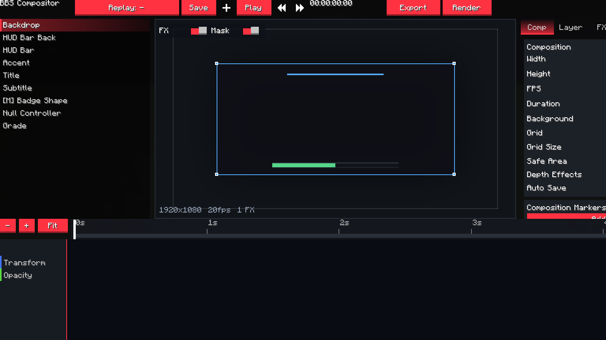
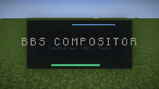
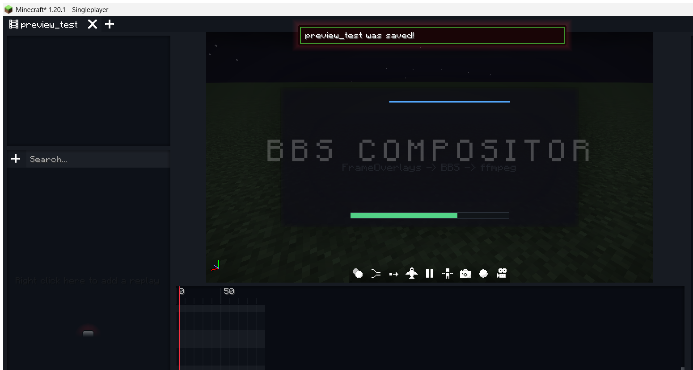

# BBS Compositor (`bbsae`)

**A screen-space compositor for BBS FS films**, built as a Fabric addon for **Minecraft 1.20.1**.

The compositor adds a 2D/2.5D layer on top of BBS's finished 3D frame: text, shapes, images,
solid layers, nulls, adjustment layers, precomps, masks, feathered mattes, effects, layer styles,
parenting, tracked bindings and a native-keyframe timeline. The result is drawn through BBS's
official `RegisterFrameOverlaysEvent`, so it is included in BBS's preview **and in its FFmpeg film
export** without touching the `.dat` film format.

- **Source:** <https://github.com/zhongend/bbsae>
- **Issues:** <https://github.com/zhongend/bbsae/issues>
- **Feature matrix:** [`docs/features.zh.md`](docs/features.zh.md)
- **UI architecture:** [`docs/ui-architecture.zh.md`](docs/ui-architecture.zh.md)
- **Photon research:** [`docs/photon-research.zh.md`](docs/photon-research.zh.md)
- **Developer handoff:** [`docs/HANDOFF.zh.md`](docs/HANDOFF.zh.md)

> This repository does **not** redistribute the BBS FS jar. Download BBS FS 2.7-1.20.1 from its
> official Modrinth page and put `bbs-2.7-1.20.1.jar` in `libs/` before building.

## Download / Install

1. Download the latest `bbsae-0.1.0.jar` from the repository's **Releases** page.
2. Install **Minecraft 1.20.1**, **Fabric Loader 0.16.14+**, **Fabric API 0.92.1+1.20.1** and
   **BBS FS 2.7-1.20.1**.
3. Put `bbsae-0.1.0.jar` and the BBS FS jar into the game's `mods/` folder.
4. Launch the game, open a film in BBS, select a replay, then use
   **Replay properties → Compositor → Open Film Compositor**.

## Status

This is the third vertical slice: the data model, render graph, editor, per-replay project
isolation, timeline scrubbing and render queue are in place. It is not a finished AE clone, and
the feature matrix in [`docs/features.zh.md`](docs/features.zh.md) is deliberately explicit about
what is and is not implemented.

Verified in this iteration:

- `compileJava` and all 16 tests pass;
- the addon loads in a Fabric 1.20.1 + BBS 2.7 development client;
- the compositor preview renders the composition (not a blank frame) after fixing projection,
  model-view and mask-transform state;
- the BBS film recorder produced a real H.264 MP4 (`320x180`, 20 fps, 39 frames) and the exported
  frame contains the compositor layers, proving the frame-overlay path reaches the video file;
- the final jar has Minecraft references remapped to intermediary and keeps BBS class names.

Build artifact: `build/libs/bbsae-0.1.0.jar` (also copied to `bbsae-0.1.0.jar`), SHA-256
`C6499F896395934308B8A487488ABCD19A7FA3540C55063D8EE49839CF409AD4`. The local sandbox could not let
TinyRemapper write a zip directly, so the final jar was assembled from the remapped class tree and
the processed resources; the class entries are intermediary-remapped.

Implemented now:

- film/replay-scoped compositor projects: a film owns its project, every replay owns a separate
  composition inside it; the replay selector switches the edited composition;
- `.bbscomp` projects with multiple compositions, markers, master parameters and output presets;
- layer types: solid/panel/rect, bar, text, image/footage, shape, null, adjustment, precomp;
- in/out, start offset, time scale, freeze, keyframable source-time remap, layer markers, opacity,
  13 blend modes, parenting and track mattes (alpha/luma, normal/inverted);
- BBS-native `KeyframeChannel<Transform>` / `KeyframeChannel<Float>` animation, including effect
  parameters, text metrics, mask points/handles and shape trim/repeater values, edited with BBS's
  own `UIKeyframeEditor` (dope sheet, graph, context menus, interpolation, copy/paste);
- a large, always-visible timeline scrubber with second marks, current timecode and a playhead,
  plus the BBS ruler/CTI and native keyframe dragging underneath it;
- masks with add/subtract/intersect/exclude, feather, opacity, positive/negative expansion,
  inversion, editable points and bezier handles;
- a curated 42-effect catalogue (blur, color, keying, generate, distort, stylize, transitions,
  depth) with real box/radial blur, unsharp sharpen and depth-aware passes;
- layer styles: drop shadow, inner shadow, outer/glow, bevel, color/gradient overlay, satin,
  stroke;
- text with tracking, line height, wrap, per-character range/wiggle animators;
- vector shapes (rect, ellipse, polygon, star, bezier path), boolean operators, trim, repeater,
  roundness, fill/stroke, editable/animatable path points;
- image layers and `%04d` footage sequences with source-time remap and an OS file-picker import
  that copies media into the project's own asset folder;
- tracking bindings to the BBS camera, replay actors and transformed layer anchors, plus depth
  texture capture for depth matte/fog/DOF/displacement;
- animation presets that store/reapply property animation without replacing target content;
- render queue with add/remove/retry/cancel, render settings/output module separation, editable
  output modules, PNG sequence, H.264 review and ProRes 4444 alpha presets;
- auto-save and `.bak` backups;
- a compact BBS-native editor: header/toolbar, **tabbed inspector** (Comp / Layer / FX /
  Mask / Text / Out), **Focus** preview mode, layer stack, composition preview with a selected
  layer box and drag-to-move, timeline header, scrubber, `UIKeyframeEditor`, BBS
  buttons/toggles/trackpads/color pickers, context menus and a replay/film selector;
- preview drag writes the layer position, or inserts a transform keyframe at the playhead when the
  layer already has transform animation;
- the compositor has its own FBO preview again (it is **not** an overlay over BBS's film editor),
  with a preview toolbar for FX/mask preview toggles and a resolution/fps/FX readout;
- BBS timeline empty-state, timeline undo id, Add Transform/Opacity Keyframe context actions, and
  Fit / - / + timeline navigation;
- baked export through BBS's recorder (the **Export** header button opens the film and starts the
  normal BBS recorder), and comp-only export through the render queue.

## Requirements

- Minecraft **1.20.1**
- Fabric Loader 0.16.14
- Fabric API 0.92.1+1.20.1
- BBS FS **2.7-1.20.1**
- Java 17+ to run the game; **Java 21** to run this Gradle build (Loom 1.15)

## Build

1. Put `bbs-2.7-1.20.1.jar` in `libs/` (downloaded from the BBS FS Modrinth page).
2. Set `JAVA_HOME` to a Java 21 JDK.
3. Run:

   ```bat
   gradlew.bat build
   ```

   The addon jar is written to `build/libs/bbsae-0.1.0.jar`; the headless model tests run with
   `gradlew.bat test`.

## Use

1. Put the addon jar and BBS FS in the game's `mods/` folder.
2. Open a film in BBS, select a replay, open its **Replay properties**, and press
   **Open Film Compositor** in the **Compositor** section. This is the intended entry point: the
   panel is bound to that film and replay, and the film gets its composition clip automatically.
3. In the compositor, pick a layer, import an image with **Import Image...**, add text/shapes,
   set stopwatches, and drag the timeline playhead or the large scrubber above the dope sheet.
4. Press **Export** in the compositor header to open the film and start BBS's normal recorder, or
   use **Render** for the compositor's own render queue.
5. The **Replay** button opens a list of the current film's replays and other saved films.
   Every replay has its own composition, and every film has its own project file.

Projects live under:

```
config/bbsae/projects/<film_id>.json
config/bbsae/projects/<film_id>/assets/
config/bbsae/exports/<film_id>/
```

`CompStore.loadFilmProject` creates the project lazily; `ensureReplayComp` creates one composition
per replay. Opening a replay also inserts/updates the `bbsae:composition` clip on the camera
timeline, so a recorded film cannot silently lose its compositor.

## Link to a film

The link is a normal BBS camera clip (`bbsae:composition`), not a sidecar and not a modified film
file. A clip stores project id, comp id, time offset, time scale, fit, opacity and hold. BBS
serializes the clip itself; the project remains a reusable external file.

Baked output needs no special exporter: the overlay runs inside BBS's normal frame. Comp-only
output (alpha, ProRes, PNG) uses the compositor's own render queue, which renders at the
composition's native resolution and hands the PNG sequence to FFmpeg.

## EffectCraft reference

[EffectCraft](https://github.com/storytold/effectcraft) was studied as a design reference. It is a
pure-Rust/egui After Effects reimplementation, so its crates cannot be linked into a Java/Fabric
mod, and copying its UI layer would introduce an FFI/embedding boundary the addon does not need.
What was reused is its **interface and workflow design**: a project/composition/layer hierarchy,
a timeline panel with a left property tree and a right ruler/CTI, current-time display, fit/zoom,
work area, layer switches, effect controls and a render queue. The implementation here stays inside
BBS's native Java UI and film data model.

The other reference addons were studied in [docs/ui-architecture.zh.md](docs/ui-architecture.zh.md):
BBS Refreshed for compact surfaces, BBS POV for sectioned editors/native timeline empty states,
BBSVFX for modular effects, and Wemppy's BBS fork for 1.20.1 API behaviour. An HTML/MCEF embedding
was deliberately rejected: BBS's preview is an OpenGL framebuffer and MCEF would add a native
Chromium runtime, input bridge and alpha-composition layer without preserving BBS's keyframe/undo/
F6-export path. See that document for the full reasoning and a possible isolated MCEF prototype.

[Photon](https://github.com/Low-Drag-MC/Photon) was studied separately for its editor and render
pipeline. It is NeoForge 1.21.1 + LDLib2 and cannot be linked into this Fabric 1.20.1/BBS addon;
the useful conclusions are documented in [docs/photon-research.zh.md](docs/photon-research.zh.md):
dockable hierarchy/scene/timeline workspaces, a real-time scene preview with FX/bloom/mask
toggles, and an isolated editor post-effect stack over a color+depth render target.

Known limits relative to EffectCraft/AE: no 3D cameras/lights inside the composition, no graph
editor for arbitrary expressions, no full 306-effect catalogue, no multi-window docking, and no
per-character text editing on canvas.

## Design notes

- The composition render graph is `layer content FBO -> masks -> track matte -> effects -> styles
  -> blend into accumulation`. Adjustment layers run their effects on the accumulation directly.
- All effect and compositing shaders are runtime GLSL programs (`GlslProgram`), guarded by
  `GlStateGuard` so BBS/Sodium/Iris state is restored.
- Masks and vector shapes are rasterized on the CPU and cached by content hash. This keeps masks
  consistent and supports feathered boolean masks without a stack of stencil passes.
- Depth is copied from the bound world framebuffer at the overlay point. If the copy is refused,
  depth effects degrade to a no-op and log a warning rather than corrupting the frame.
- The editor intentionally does not implement a second window/timeline toolkit. BBS owns the
  buttons, sliders, number fields, track rows, keyframe diamonds, graph editor and context menus.
  Custom drawing is limited to the preview viewport, safe-area/grid overlay, compact timeline
  scrubber and layer thumbnails.
- The compositor FBO is drawn with an identity model-view and its own orthographic projection.
  This matters in the UI: BBS's screen model-view/scissor state must never transform composition
  content into the dashboard's coordinate space. Masks use JOML's column-major translation
  (`m30/m31`); using `m03/m13` silently collapsed every mask to the top-left corner.

## Screenshots

The independent compositor preview, with its own FBO, FX/Mask switches, layer stack, inspector and
native BBS keyframe timeline:



A real exported BBS recording frame (the compositor is included in the video, not only on screen):



The editor was also checked with the BBS film preview showing the composition overlay at a later
time in the demo animation:



## License

MIT.
