# BBS AE (`bbsae`)

<p align="center">
  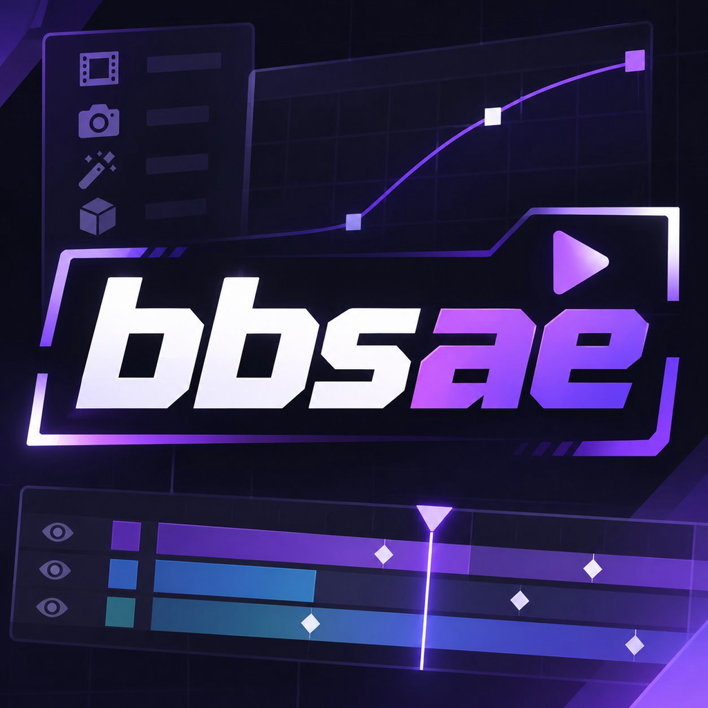
</p>

<p align="center">
<b>作者 / Author：终end</b> · <a href="https://github.com/zhongend">@zhongend</a>
</p>

> **特别感谢赞助者：【星辰久梦君_Star Dm Sov】、血之书、Szv文森特37** — 你们的赞助支持了本插件的开发，感谢你们。完整鸣谢见 [CREDITS.md](CREDITS.md)。

> 交接文档：**[docs/HANDOFF.zh.md](docs/HANDOFF.zh.md)**（当前架构、已实现功能、关键 bug、未完成项、构建 - 重映射流程）。
- **Source:** <https://github.com/zhongend/bbsae>
- **Issues:** <https://github.com/zhongend/bbsae/issues>
- **更新日记 / Changelog:** [`CHANGELOG.md`](CHANGELOG.md)
- **Feature matrix:** [`docs/features.zh.md`](docs/features.zh.md)
- **UI architecture:** [`docs/ui-architecture.zh.md`](docs/ui-architecture.zh.md)
- **Photon research:** [`docs/photon-research.zh.md`](docs/photon-research.zh.md)
- **Developer handoff:** [`docs/HANDOFF.zh.md`](docs/HANDOFF.zh.md)
- **中文图文介绍 / Chinese gallery:** [`docs/GALLERY.zh.md`](docs/GALLERY.zh.md)
- **Round 8 (Alight Motion PIXEL effects):** [`docs/ROUND8-01-AUDIT.zh.md`](docs/ROUND8-01-AUDIT.zh.md),
  [`docs/ROUND8-02-PIXEL.zh.md`](docs/ROUND8-02-PIXEL.zh.md),
  [`docs/ROUND8-03-VERIFY.zh.md`](docs/ROUND8-03-VERIFY.zh.md),
  [`docs/ROUND8-04-PUBLISH.zh.md`](docs/ROUND8-04-PUBLISH.zh.md)
- **Round 9 (export fidelity / duration / icon):** [`docs/ROUND9-EXPORT-SYNC.zh.md`](docs/ROUND9-EXPORT-SYNC.zh.md)
- **Round 10 (drag layer reorder):** [`docs/ROUND10-LAYER-REORDER.zh.md`](docs/ROUND10-LAYER-REORDER.zh.md)
- **Round 11 (asset library fix + blur):** [`docs/ROUND11-ASSET-LIBRARY.zh.md`](docs/ROUND11-ASSET-LIBRARY.zh.md)
- **Round 12 (AE curves / presets / parenting / shape corners, v0.2.0):** [`docs/ROUND12-CURVES-PRESETS-PARENTING.zh.md`](docs/ROUND12-CURVES-PRESETS-PARENTING.zh.md)
- **Round 13 (camera rewrite / 3D parenting / multi-select / performance, v0.3.0):** [`docs/ROUND13-CAMERA-MULTISELECT-PERF.zh.md`](docs/ROUND13-CAMERA-MULTISELECT-PERF.zh.md)
- **Round 14 (UI density / flat buttons / tooltips, v0.4.0):** [`docs/ROUND14-UI-DENSITY-FLAT.zh.md`](docs/ROUND14-UI-DENSITY-FLAT.zh.md)
- **Round 15 (BBS-native preview + world depth / pre-render cache / UI performance, v0.5.0):**
  [`docs/ROUND15-PREVIEW-CACHE-PERF.zh.md`](docs/ROUND15-PREVIEW-CACHE-PERF.zh.md)
- **Round 16 (curve editor redesign — jank analysis, render architecture, AE parity plan):**
  [`docs/ROUND16-CURVE-EDITOR-DESIGN.zh.md`](docs/ROUND16-CURVE-EDITOR-DESIGN.zh.md)
- **Round 17 (curve editor P0+P1 — column-span geometry, blank-page fix, v0.6.0):**
  [`docs/ROUND17-CURVE-PERF.zh.md`](docs/ROUND17-CURVE-PERF.zh.md)
- **Round 18 (visible curves / asset import / video+audio export / single-page library / solid
  stage / camera semantics, v0.7.0):**
  [`docs/ROUND18-CURVE-IMPORT-EXPORT-CAMERA.zh.md`](docs/ROUND18-CURVE-IMPORT-EXPORT-CAMERA.zh.md)
- **Round 19 (AE encoder mode — frame server pipeline for preview and export, v0.8.0):**
  [`docs/ROUND19-AE-ENCODER.zh.md`](docs/ROUND19-AE-ENCODER.zh.md)
- **Round 20 (AE pipeline: disk frame cache, render budget, raw-frame pipe, preview audio,
  proxy resolution, v0.9.0):** [`docs/ROUND20-AE-PIPELINE.zh.md`](docs/ROUND20-AE-PIPELINE.zh.md)
- **Round 21 (timeline zoom, audio and video tracks, narrow-panel fix, v0.10.0):**
  [`docs/ROUND21-TRACKS-AND-AUDIO.zh.md`](docs/ROUND21-TRACKS-AND-AUDIO.zh.md)
- **Round 22 (Blender-style 3D viewport camera — free orbit/pan/zoom, source-texture draft
  rendering, v0.11.0):** [`docs/ROUND22-CAMERA-VIEWPORT.zh.md`](docs/ROUND22-CAMERA-VIEWPORT.zh.md)
- **Round 23 (viewport usability: right-drag orbit, gradients, motion path, plane-depth stacking,
  first-open layout, playback flicker, v0.12.0):**
  [`docs/ROUND23-VIEWPORT-FIXES.zh.md`](docs/ROUND23-VIEWPORT-FIXES.zh.md)
- **Round 24 (viewport input polling, layer-space effects in the export path, mask/exclude,
  effect thumbnails, layer quick panel, v0.13.2):**
  [`docs/ROUND24-VIEWPORT-MASK-QUICKPANEL.zh.md`](docs/ROUND24-VIEWPORT-MASK-QUICKPANEL.zh.md)
- **Round 25 (replay entity layer — depth-keyed matte, native file dialog, v0.14.1):**
  [`docs/ROUND25-ENTITY-KEY-IMPORT.zh.md`](docs/ROUND25-ENTITY-KEY-IMPORT.zh.md)
- **Round 26 (owned Win32 file dialog, sound import, layer library, true 3D camera, v0.15.0):**
  [`docs/ROUND26-IMPORT-LIBRARY-CAMERA.zh.md`](docs/ROUND26-IMPORT-LIBRARY-CAMERA.zh.md)
- **Round 27 (playback clock / BBS-native curve picker / 3D XYZ quick panel, v0.16.0):**
  [`docs/ROUND27-PLAYBACK-CURVES-3D.zh.md`](docs/ROUND27-PLAYBACK-CURVES-3D.zh.md)
- **Round 28 (asset-library scrollbar / professional AE curve editor / plugin icon, v0.17.0):**
  [`docs/ROUND28-ASSETS-CURVES-ICON.zh.md`](docs/ROUND28-ASSETS-CURVES-ICON.zh.md)
- **Round 29 (onboarding / BBS-style settings / non-linear motion / editable keybinds, v0.18.0):**
  [`docs/ROUND29-UI-MOTION-ONBOARDING.zh.md`](docs/ROUND29-UI-MOTION-ONBOARDING.zh.md)
- **Round 30 (sponsor hall / BBS flight camera / 3D effect fix / repeats / adaptive UI, v0.19.0):**
  [`docs/ROUND30-FINAL.zh.md`](docs/ROUND30-FINAL.zh.md)
- **Round 31 (effect-library decluttering / camera hints / settings-only sponsors / premium UI light, v0.19.1):**
  [`docs/ROUND31-UI-POLISH.zh.md`](docs/ROUND31-UI-POLISH.zh.md)
- **Round 32 (Iris final-pass capture / shader-aware replay matte, v0.19.2):**
  [`docs/ROUND32-IRIS-SHADERS.zh.md`](docs/ROUND32-IRIS-SHADERS.zh.md)
- **Round 33 (replay matte persistence / header geometry / collapsible filter, v0.19.3):**
  [`docs/ROUND33-ENTITY-MATTE-UI.zh.md`](docs/ROUND33-ENTITY-MATTE-UI.zh.md)
- **Round 34 (3D matte transparency / 3D effects / effect strength / 3D adjustment layers, v0.20.0):**
  [`docs/ROUND34-3D-MATTE-EFFECTS.zh.md`](docs/ROUND34-3D-MATTE-EFFECTS.zh.md)
- **Round 35 (custom font import / working folder buttons / native dialog fallback, v0.20.1):**
  [`docs/ROUND35-FONT-IMPORT-OS-OPEN.zh.md`](docs/ROUND35-FONT-IMPORT-OS-OPEN.zh.md)
- **Round 36 (single layer/effect application / keyframed strength / precomp pass inheritance, v0.20.3):**
  [`docs/ROUND36-LAYER-EFFECT-APPLICATION.zh.md`](docs/ROUND36-LAYER-EFFECT-APPLICATION.zh.md)
- **Round 37 (3D effect support region / baked styles and masks / 3D effect completeness, v0.20.4):**
  [`docs/ROUND37-3D-EFFECT-SUPPORT.zh.md`](docs/ROUND37-3D-EFFECT-SUPPORT.zh.md)
- **Round 38 (AE effect programme / blur and sharpen family complete, v0.21.0):**
  [`docs/ROUND38-AE-BLUR-FAMILY.zh.md`](docs/ROUND38-AE-BLUR-FAMILY.zh.md)
- **Round 39 (AE effect programme, batch 2: distort family, v0.21.1):**
  [`docs/ROUND39-AE-DISTORT-FAMILY.zh.md`](docs/ROUND39-AE-DISTORT-FAMILY.zh.md)
- **Round 40 (mask exclude semantics / visual mask editing / 3D track mattes, v0.21.2):**
  [`docs/ROUND40-MASK-EXCLUDE.zh.md`](docs/ROUND40-MASK-EXCLUDE.zh.md)
- **Round 41 (projected layer and warp alpha association, v0.21.3):**
  [`docs/ROUND41-PREMULTIPLY.zh.md`](docs/ROUND41-PREMULTIPLY.zh.md)
- **Round 42 (custom font rendering / BBS font folder import flow, v0.21.4):**
  [`docs/ROUND42-FONT-RENDER.zh.md`](docs/ROUND42-FONT-RENDER.zh.md)
- **Round 43 (automatic system font discovery and import, v0.21.5):**
  [`docs/ROUND43-SYSTEM-FONTS.zh.md`](docs/ROUND43-SYSTEM-FONTS.zh.md)
- **Round 44 (effect & layer bug-fix release, v0.22.0):** [`docs/ROUND44-EFFECT-LAYER-FIXES.zh.md`](docs/ROUND44-EFFECT-LAYER-FIXES.zh.md)
- **Photon attribution / 引用声明:** [`PHOTON-NOTICE.md`](PHOTON-NOTICE.md)

<p align="center">
  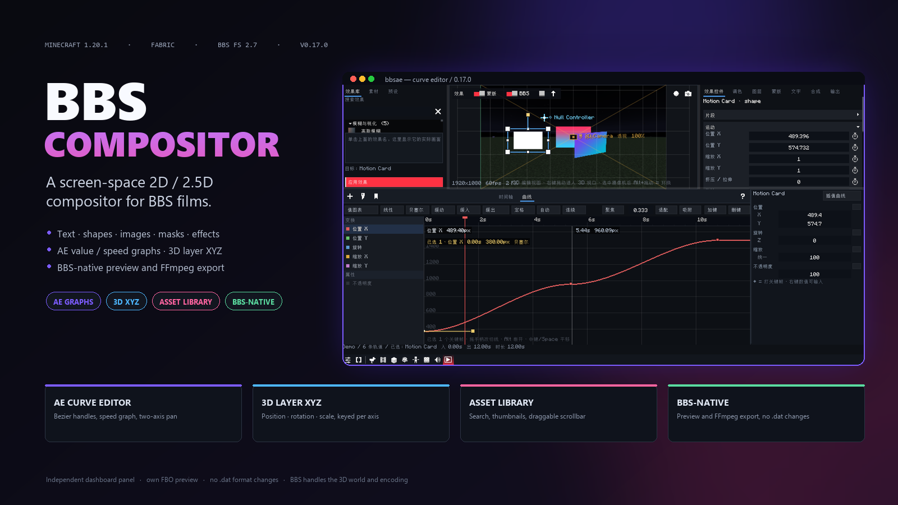
</p>

> This repository does **not** redistribute the BBS FS jar. Download BBS FS 2.7-1.20.1 from its
> official Modrinth page and put `bbs-2.7-1.20.1.jar` in `libs/` before building.

A screen-space compositor for **BBS FS** films, built as a BBS addon for **Minecraft 1.20.1 / Fabric**.

The compositor adds a 2D/2.5D layer on top of BBS's finished 3D frame: text, shapes, images,
solid layers, nulls, adjustment layers, precomps, masks, feathered mattes, effects, layer styles,
parenting, tracked bindings and a native-keyframe timeline. The result is drawn through BBS's
official `RegisterFrameOverlaysEvent`, so it is included in BBS's preview **and in its FFmpeg film
export** without touching the `.dat` film format.

## Download / Install

1. Download [`bbsae-0.34.jar`](https://github.com/zhongend/bbsae/releases/download/v0.34/bbsae-0.34.jar)
   from the **v0.34** release (the asset is updated with each source push).
2. Install **Minecraft 1.20.1**, **Fabric Loader 0.16.14+**, **Fabric API 0.92.1+1.20.1** and
   **BBS FS 2.7-1.20.1**.
3. Put `bbsae-0.34.jar` and the BBS FS jar into the game's `mods/` folder.
4. Launch the game, open a film in BBS, select a replay, then use
   **Replay properties → Compositor → Open Film Compositor**.

`bbsae-0.34.jar` SHA-256: `EAA836A9D072633A38CF1CB023D2E4CBFB3009C80AC963220213C1D8970F1E6C`.

## Gallery

> 中文版图文介绍（含逐张说明）见 **[docs/GALLERY.zh.md](docs/GALLERY.zh.md)**。
### The editor, not an overlay

<p align="center">
  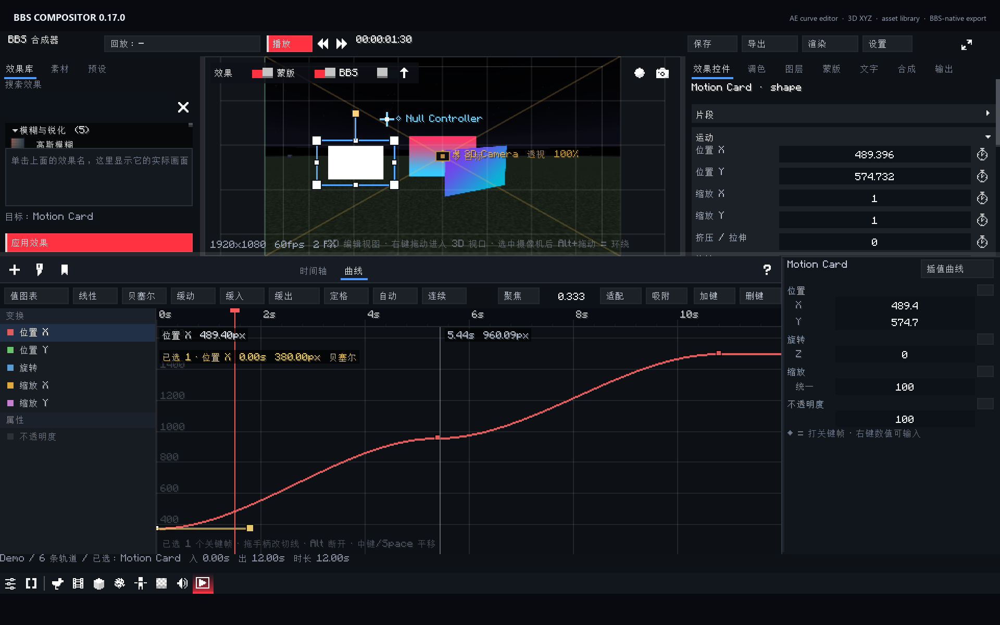
</p>

BBS AE opens as an **independent BBS dashboard panel**, not a transparent overlay on the
film editor. The layout follows a Premiere-style information architecture:

1. **Effects library** — search, categories and a recent list; double-click applies to the selected track.
2. **Live FBO preview** — the compositor renders into its own framebuffer with selection handles,
   safe-area/grid overlays, and **FX / Mask / BBS-world** toggles for A/B comparison.
3. **Effect Controls** — motion, opacity, blend mode, the applied-effect stack, layer styles,
   masks, text, grade, and the context-sensitive Layer/Comp/Output pages.
4. **Track timeline** — one row per layer, movable/trimable clips, frame snapping, work-area
   shading, markers and a BBS-native keyframe drawer. Drag the **left grip** of a track header
   to reorder layers vertically (blue insertion line), without hunting through the context menu.

<p align="center">
  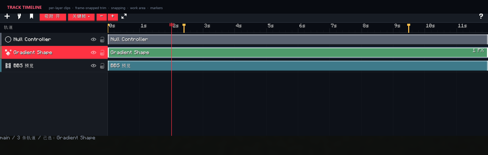
</p>

### 58 effects, including the Alight Motion PIXEL family and repeat tools

The compositor ships a curated catalogue rather than a wall of half-implemented effects. It covers
blur, colour, keying, generate, distort, stylize, transitions and depth. Round 8 added seven
screen/retro effects built on the shared PIXEL shader, and 0.19 adds **Grid Repeat**, **Random
Repeat**, **Turbulent Displace**, **Colorama** and **Light Sweep**:

**Scanlines 路 Glitch 路 VHS 路 Halftone 路 Emboss 路 Mirror 路 Kaleidoscope**

<p align="center">
  <a href="docs/verify/round8-pixel-effects.png">
    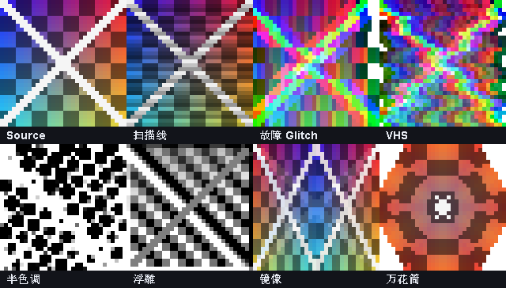
  </a>
</p>

Halftone uses Alight Motion-style properties (dots across the project width, strength, angle, row
phase, ink/paper colours); Mirror overlays a mirrored copy with an opacity control. All seven run in
**layer space**, so the pattern follows the layer when it is moved, scaled or rotated.

### Grading, assets, 3D and export

| 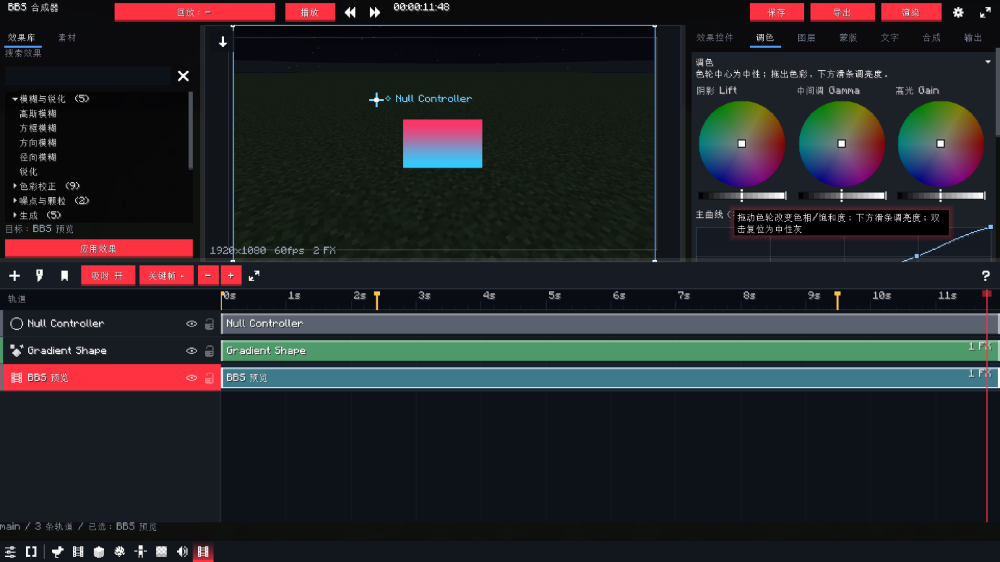 | 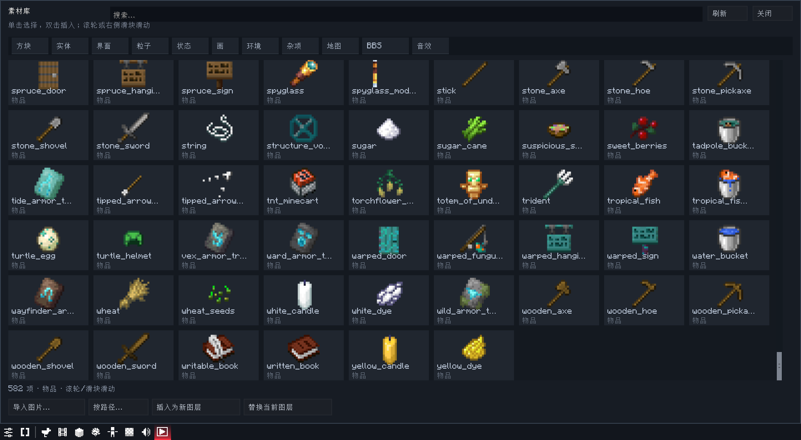 |
| :---: | :---: |
| **AE-style grading** — lift/gamma/gain wheels, five-point master curve, presets and keyframeable exposure/contrast/saturation/vibrance. | **Asset library** — project media plus the client's item/block/entity/gui textures; search, thumbnails and a draggable scrollbar. |

| 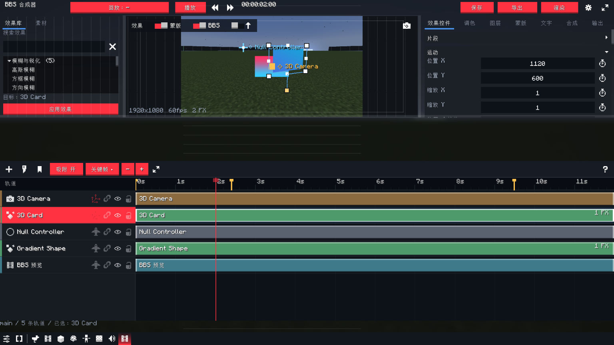 | 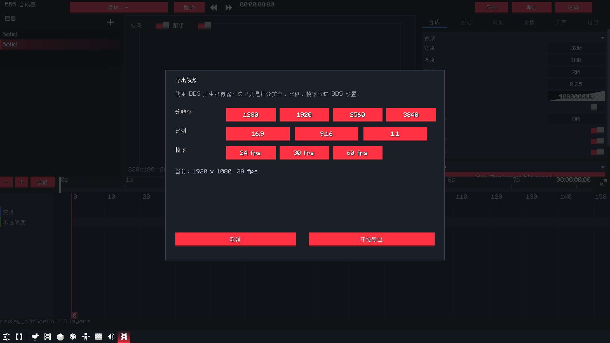 |
| :---: | :---: |
| **3D camera and 2.5D cards** — free camera, depth ordering, adjustment layers and precomps. | **BBS-native export** — resolution/aspect/fps presets write into BBS's recorder, then F6 renders the real film. |

| 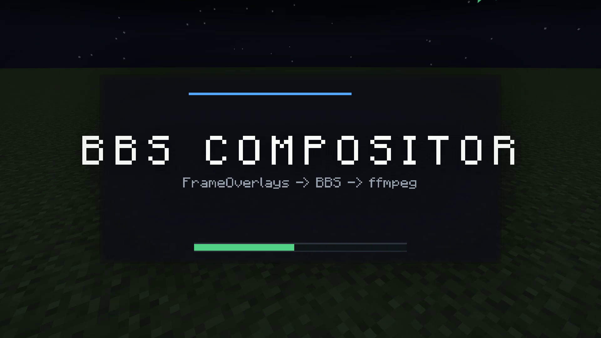 |
| :---: |
| **A real 1920×1080 @ 60 fps export** — 494 frames, 8.23 s, with the compositor layers baked into the MP4. |

### Built on BBS's own frame path

The compositor does not re-encode films or patch `.dat` files. BBS serializes a small
`bbsae:composition` camera clip; `CompRenderer` draws the layer stack at the
`RegisterFrameOverlaysEvent` point. That means the same composition appears in BBS's preview and in
its FFmpeg film export, and BBS keeps ownership of keyframes, undo, project storage and video
encoding.

## What's new in 0.34 — one entry per effect in the library

- The reference batch introduced a second row for effects the classic catalogue already had
  (高斯模糊, 万花筒, 镜像, 网格, 色彩映射, 置换图, 极坐标, 描边, 色相映射): the library showed two
  identical names in two categories. The superseded ids are now hidden from the library (including
  the recent list) while staying registered and renderable, so old projects keep working.
- `EffectLibraryNamingTest` pins the contract: visible names are unique, hidden ids still have a
  renderer, and each hidden id has an AM successor.
- 321 tests green.

## What's new in 0.33 — tile/repeat and paint batch

- **平铺**, **旋转平铺** (`AM · 重复`): tiling with offset/gap/mirror and radial sector repetition.
- **脉动不透明度** (`AM · 透明度`): time-driven alpha pulse.
- **棕褐色**, **色带**, **油画** (`AM · 调色` / `AM · 风格化`): sepia mix, per-channel posterise,
  and a four-quadrant Kuwahara pass for brush-like smoothing (radius 0 returns the input).
- 47 reference-compatible effects total; 319 tests green.

## What's new in 0.32 — colour grading and light batch

- **Six new effects**: 分离色调、双色调、色彩映射（8-stop palette）、色相偏移 in `AM · 调色`;
  漏光（time-driven band）and 光包裹（backdrop spill around edges）in `AM · 风格化`.
- Palette map indexes an eight-colour LUT by luminance; split tone and duotone keep the original
  alpha and expose balance/amount sliders.
- Neutral declarations (`amount`/`alpha`/`strength`) for all six; shader link + neutrality tests
  cover them. 319 tests green.

## What's new in 0.31 — backdrop-reading effects (displacement map, gradient displace, glass)

- The effect pipeline now hands each layer the **composition below it**: `CompRenderContext.backdrop`
  is set around the layer effect loop and the adjustment pass, and `AmEffectDef.comp()` marks
  effects that sample it through `Comp`.
- **置换图** (RG/GB/luminance channels, amount in layer pixels), **渐变置换** (composition gradient),
  **玻璃** (refraction + tint + highlight) added under `AM · 变形` / `AM · 风格化`.
- Backdrop effects are excluded from the layer-local 3D bake and run once after projection, so a 3D
  plane cannot apply them twice; without a backdrop (isolated preview) they fall back to their own
  input instead of failing.
- 319 tests green.

## What's new in 0.30 — zero value is proven pixel by pixel

- **Pixel-level zero test.** `EffectPipelineTest.zeroValuesRestoreTheInputPixelForPixel` runs
  thirteen representative effects (block shatter, wave, blur, turbulent displace, bend, gaussian
  blur, pinch/bulge, ripple, swirl, mirror, stretch, slice glitch, chromatic aberration) through the
  real GL pipeline at their identity value and requires the output to equal the input **exactly**.
- **Block shatter near-zero fix.** The shard border used to be applied regardless of the cell's
  progress: at progress 0.005 (no shard had started moving) the layer was covered by a dark grid,
  which is what "pulling it to zero does not restore the layer" looked like. The border now fades
  in with the cell's own progress; a regression test allows resampling noise but not edge darkening.
- 319 tests green.

## What's new in 0.29 — generative and distortion batch

- **Eight more effects**: 彩色像差、移轴模糊、轴向拉伸、切片故障 (distortion/style) and
  四色渐变、条纹、网格、星空 (generative). Each has its reference parameter set and a zero-value
  declaration where one exists.
- The generative group now includes gradient/stripe/grid/star overlays with colour pickers and
  alpha, all keyframeable through the existing scalar channels.
- 317 tests green; contact sheet shows the new row rendering.

## What's new in 0.28 — blur batch with a two-pass path

- **Five blur effects**: 高斯模糊、方框模糊、动感模糊、径向模糊、镜头模糊 (`AM · 模糊`).
- Pure blurs no longer go through a fragment body: `AmEffectDef.blur(...)` routes them to the
  existing separable blur (premultiply → horizontal → vertical → unpremultiply), with an optional
  iteration count for the box kernel. A zero radius skips the pass entirely.
- Directional (motion), radial (zoom) and lens blurs are single-pass sample loops with their own
  length/angle/centre/radius parameters.
- 317 tests green; the contact sheet shows all five rendering.

## What's new in 0.27 — third effect batch (polar, fractal warp, colour tools)

- **Six more reference-compatible effects**: 极坐标、分形扭曲、色彩化、替换颜色、渐变映射、径向阴影.
- Shared shader helpers grew the noise/fbm/rotation set, so noise-driven effects are plain
  definitions from now on.
- All new effects carry their zero-value declaration (strength/amount/size) and are covered by
  the shader link test and the neutrality test.
- 317 tests green; effect contact sheet (`docs/verify/effect-pipeline.png`) now renders every
  batch through the real composition pipeline.

## What's new in 0.26 — distort batch, zero-value audit, library icons

- **Six more reference-compatible effects**: 收缩与膨胀、圆形波纹、万花筒、镜像、旋转扭曲、像素化
  (`AM · 变形`), all data-driven and covered by the headless shader link test.
- **Zero means the original layer.** Seventeen existing effects had no neutral branch, so a value
  of 0 still ran their shader; brightness/contrast, hue/saturation, exposure, tint, levels, curves,
  invert, vignette, noise, grain, shake, matte choker, colorama, color grade and the new effects now
  short-circuit at their identity value. `EffectNeutralTest` pins the contract and lists the
  effects that legitimately have no zero state.
- **Effect library icons**: every effect row now carries a 16 px category icon from the BBS icon
  atlas (colour wheel, morph, blur sphere, checkerboard, key, exchange, cylinder, font…), with a
  reserved gutter so names stay aligned; category headers keep their tree arrow.
- 317 tests green.

## What's new in 0.25 — the full blend set and clearer inspector groups

- **Blend modes 13 → 30.** The layer blending list now also has 蒙版 / 排除（蒙版） as alpha
  operations (the backdrop keeps its colour, only coverage changes), plus 线性加深、线性减淡、
  线性光、亮光、点光、柔光叠加、减去、划分、较暗颜色、较亮颜色、色相、饱和度、颜色、明度、
  颜色相乘. Existing project files keep their numeric mode ids.
- **Every blend formula is pinned by a pixel test.** `BlendModesTest` composites 1×1 pixels through
  the real GLSL and compares them with the documented formula, including the two mask modes.
- **Inspector dividers.** Each collapsible section is preceded by a two-pixel hairline groove, so
  the right-hand panel reads as groups instead of one long run of headers.
- **Data-driven effect runtime + first reference batch.** Effects are now definitions (parameter
  schema + one fragment body) compiled lazily: 色彩平衡、色温、高光与阴影、卡通、长阴影、弯曲、
  描边 ship in the new `AM · 调色` / `AM · 风格化` / `AM · 变形` groups. The library, sliders,
  colour pickers and keyframe channels are generated from the definition, and the zero-value
  contract skips the pass so those effects return the original layer at 0.
- Research and roadmap for the effect-library parity work: [`docs/EFFECT-LIBRARY-PLAN.zh.md`](docs/EFFECT-LIBRARY-PLAN.zh.md).

## What's new in 0.24 — wave/chroma/itrp/蒙版 fix round + 点跟踪器

- **波浪变形 / 置换图 / 湍流置换现在真的会动**。DISTORT 着色器的位移量被错误地除了两次图层
  尺寸，一个 48 px 的位移只移动 ~0.1 px——这三个效果此前一直"未生效"。着色器改为直接把图层
  像素位移交给 layer→comp 基；3D 烘焙的双重缩放一并修掉。
- **绿幕抠像重做**：色度模式改为色相差 + 饱和度门控（亮度无关），打光的绿幕与偏黄绿都能抠净；
  新增 蒙版黑场/白场 清理滑杆；溢色抑制只在屏幕色影响区压绿，主体绿色不受影响，叠加在抠像
  上的效果不再混入残留绿边。
- **分形杂色按 AE 语义重做**：归入「噪点与颗粒」，噪声域改图层像素空间（缩放 = 特征尺寸），
  演化逐八度旋转噪声域——打关键帧后云雾变形而非平移。
- **itrp / iterationRP 黑屏修复**：itrp 的 final pass 输出 alpha=0，捕获的世界帧按纹理 alpha
  混合时整帧不可见——捕获后新增 OPAQUE pass 把 alpha 归一为 1；Iris 最终帧钩子绑不上时自动
  回退 colortex0 捕获，预览读出显示捕获状态。
- **蒙版**：2D/调整层/轨道遮罩的蒙版统一按渲染分辨率栅格化（与 3D 烘焙一致），动画蒙版编辑
  不再每帧栅格化整幅合成，预览卡顿消除。
- **点跟踪器**：检查器可新建跟踪器（锚点/模板/搜索/置信度/范围），每显示帧协作式分析一帧；
  结果可一键烘焙到所选图层的位置关键帧，或通过 `tracker.<id>.x / .y` 表达式驱动参数。

## What's new in 0.23 — this is now BBS AE

**BBS Compositor is now BBS AE.** The mod id stays `bbsae`, so existing projects keep working.
This release collects the fixes since 0.22.1:

- **Faster preview** — frame-cache writes moved to a background writer with atomic files; cache keys now include the project and entity/replay parameters, and the timeline stops copying its layer list every frame.
- **Precise curve editing** — only real Bezier handles are drawn, the nearest handle wins, and handle drags use a press snapshot so they no longer jump or drop the last mouse sample.
- **Readable layer library** — cards size themselves from the available width and wrap Chinese descriptions with real font metrics.
- **Better transform handles** — edges scale one axis, corners stay proportional (Shift frees them), and 3D layers use a ray/plane hit test so the handle tracks the pointer in perspective.
- The first sponsor is now **【星辰久梦君_Star Dm Sov】**, in gold.

The full list is in [`CHANGELOG.md`](CHANGELOG.md).

## What's new in 0.22.1 — imported fonts actually display

The font path is fixed from first principles: a font file is a **partial map** from code points to
glyphs, so "the imported font does not show" turned out to be three separate facts stacked on top
of each other.

- **Per-character fallback.** Minecraft answers a code point the font has no glyph for with a
  missing glyph that has *no renderer and a 1 px advance*; a Latin font with Chinese text therefore
  rendered **nothing at all**. The compositor now asks the font file itself
  (`stbtt_FindGlyphIndex`, cached per file) and draws each character with the chosen font where it
  has the glyph, and with BBS' default font where it does not — measured and drawn with the same
  choice, and the fallback glyph is scaled to the custom font's size so mixed text lines up.
- **`.ttc` collections are supported.** 微软雅黑/宋体/黑体 ship as TrueType collections, and BBS'
  stb loader only reads a single font at offset 0 — "imported but BBS cannot parse". The importer
  now extracts face 0 into a standalone sfnt (`msyh-face0.ttf`), which every loader understands.
  The system-font picker lists `.ttc` files and names them from their first face.
- **Layout size vs glyph atlas size.** A 200 px text layer used to be a 96 px atlas blown up 2×;
  the importer now passes the oversampling factor so the atlas matches the drawn size.
- **The UI explains the rest.** The text inspector reports when the font file is missing and how
  many characters of the current text the font cannot draw (with a sample), instead of silently
  falling back. Importing reports the same.
- Verification harness: `-Dbbsae.debugFonts=true` logs font resolution and per-glyph advances;
  `runClientView -PbbsaeFontShot=fontsheet [-PbbsaeFontImportSrc=<font>]` renders a real
  composition sheet with a custom font, a system `.ttc`, and the default font. Screenshots:
  [`round45-font-timesbd-fallback.png`](docs/verify/round45-font-timesbd-fallback.png),
  [`round45-font-msyh-ttc.png`](docs/verify/round45-font-msyh-ttc.png).
- New tests: `FontCoverageTest`, `FontImportTtcTest` (real `msyh.ttc` extraction + stb coverage).

## What's new in 0.22.0 — effect & layer bug-fix release

This release is a deep, first-principles pass over the two subsystems that produced the most
complaints: **effects (效果)** and **layers (图层)**. Every fix below has a regression test or a
pixel-level harness behind it; the suite is now 265 tests and includes a real-GL
`EffectPipelineTest` that drives every catalogue entry through `EffectRenderer` and writes a
contact sheet.

**Effects**

- **Blur kernels were 8x too wide.** The 17-tap kernel multiplied the radius by the *tap index*
  instead of the normalised `i / 8`, so a 12 px blur sampled up to 96 px. Every blur, glow, drop
  shadow and stroke was far too strong, and the halo was clipped by a padding that only reserved
  `radius`. Fixed in the shader; `blurRadiusIsInPixelsNotTapCounts` pins it.
- **Preview and export now use the same pixel units.** Shaders were fed the framebuffer size
  while `EffectSpace` works in composition pixels, so at any proxy scale (<1) every pixel-valued
  parameter (radius, offset, mosaic size, halftone dots) grew by `1/scale`, and local resampling
  drifted by the same factor. Effects visibly jumped while dragging a curve and never matched the
  1:1 export. Every family now binds the composition size.
- **AE-style centre parameters are layer-local.** 球面化 / 光学补偿 / CC 镜头 / CC 倾斜 / 放大 /
  CC 波纹脉冲 / 变换 / CC 径向快速模糊 compared a 0..1 layer coordinate against composition UV, so
  the effect was dead unless the layer filled the comp, and 中心 Y was mirrored. Centres now go
  through `EffectSpace.localToCompUv`, like 径向模糊 already did.
- **蒙版收缩 no longer erases the layer.** `choke` (px) was compared against a 0..1 alpha, so the
  default `smoothstep(2, 4, a)` was zero everywhere. It is a real alpha erode/dilate now, with
  softness in pixels.
- **Wipes/dissolve had an inverted identity.** Progress 0 is fully hidden in the shader, so the
  neutral value is 1; the old rule made the first keyframe pop the layer on for one frame.
- **Keyed soft edges lost alpha twice** (`c.a * alpha` where alpha already contained `c.a`).
- **暗角 did nothing at its defaults.** The in-layer distance is at most 0.707, but the default
  radius was 0.75; the distance is now normalised by the corner distance.
- **置换图's 噪波缩放 slider was dead** (the shader hardcoded 80 cycles), and **方向模糊** never set
  the shared blur kernel's `Mode`, so a box blur elsewhere in the comp changed its kernel.
- **抖动/震屏 now respects 效果强度** (0 = no shake) instead of ignoring the slider.
- **Warp effects round-trip through premultiplied alpha**, removing dark halos around text and
  semi-transparent edges.
- **外发光 is drawn under the layer** (it used to be identical to 辉光 and wash colour into the
  layer), and 着色's default strength is 0.5 so adding it no longer flattens the layer to one colour.

**Layers**

- **Delete / Ctrl+D act on the whole selection.** With several tracks highlighted, Delete removed
  only the primary layer and Ctrl+D copied only it.
- **Duplicating a selection remaps parent and track-matte references** to the *new* ids, so a
  duplicated null still drives its duplicated children; duplicated animated layers are also offset
  visibly (the +24 px used to be ignored once a layer had transform keys).
- **预合成 keeps the group's z position.** The insertion index was computed before the layers were
  removed, so the precomp landed one slot too high.
- **预合成 no longer paints an opaque black rectangle.** Nested comps now render with a transparent
  stage, and a 3D precomp with any effect/style/mask no longer exports the "预合成（草稿）"
  placeholder text.
- **Track mattes are applied after effects/styles on 2D and 3D alike**, and the matte layer's own
  masks are honoured. Cameras/nulls/adjustment layers are rejected as mattes instead of silently
  multiplying the target by zero.
- **独显 (solo) is honoured by the 3D workspace, by both hit tests, and by adjustment layers**, not
  just by the composition graph.
- **Animated masks and 文本框宽度 now invalidate the 3D raster** (a keyed mask used to freeze at its
  first frame, in the export too).
- **Mirroring works**: a negative scale is preserved instead of being clamped to `+0.0001`.
- **`startTime` is applied after the speed change** (`(t - in) * timeScale + startTime`); trimming
  and splitting compensate consistently.
- **VRAM leaks fixed**: the live-world preview leaked one composition-sized FBO per display frame
  (BBS preview / entity / depth comps), the 3D source cache leaked its staging buffer when a
  style/mask replaced it, and error paths leaked the accumulation target.
- **Guide (参考层) layers no longer reach the recorded film or the green pre-render frames**, and the
  效果/蒙版 A/B toggles now work on green frames and on baked 3D layers.
- **Texture state can no longer go stale** after the FBO pool deletes a texture: binds are forced
  raw and the pixel-store mode is restored by `GlStateGuard`.

**Editor**

- **Inspector toggles are undoable and saved** (可见/锁定/独显/参考层, 时间重映射, 遮罩, 蒙版, 标记,
  绑定, 文字, 换行), so Ctrl+Z now reverts the checkbox you just clicked. **重置变换** clears all
  nine transform channels, including the 3D ones.
- **A second 调色 effect can no longer reuse an effect id** (parameter edits used to land on the old
  effect), effect apply is gated to a single unlocked layer, effect fold state is per layer, and
  right-clicking inside a multi-selection keeps it so the batch menu is reachable.
- A reorder no-op no longer wipes the redo stack; a reorder keeps `selectedIds` and `selectedLayer`
  in sync; marker ids are unique; deleting a layer clears bindings that pointed at it.
- The 图层库 modal now blocks clicks and scrolling behind it, and its grid no longer sticks to the
  mouse when the release happens outside the dialog.
- The README's Chinese text was mojibake from an old encoding round-trip; it is repaired.

## What's new in 0.21.5

- **System fonts are available in the text inspector.** A searchable "System fonts…" list scans
  `Windows\Fonts` (and the macOS/Linux font folders), reads each font's OpenType name table for a
  real display name, and imports the chosen file into BBS' fonts folder through the normal link
  loader. Fonts are copied only when selected.
- **Name-table parsing bug fixed.** The parser read `count` from the name table's `format` field,
  so every font looked like it had zero records and the list fell back to filenames; `count` is at
  offset 2. `SystemFontsTest` pins the real Arial name.
- TTC collections are not listed: BBS' stb loader cannot address an individual face in a
  collection. TTF/OTF are listed; protected folders and malformed files are skipped safely.
- 254/254 tests pass.

## What's new in 0.21.4

- **Imported fonts actually render.** The text layer measured with the custom FontRenderer but
  drew glyphs through `Batcher2D.text`, which always uses the default font; metrics changed while
  the letters did not. Glyph drawing now sets the batcher font to the layer's font (and restores
  it afterwards), so measurement and rendering agree.
- **Import flow mirrors original BBS.** The text section now has "Open BBS fonts folder" and
  "Refresh font list" buttons next to import; fonts copied to `config/bbs/assets/fonts` are listed
  immediately, the same folder/link contract BBS uses.
- Import still verifies the copy through BBS' own stb loader and explains TTC/WOFF/unsupported
  OTF/CFF instead of silently selecting a font that falls back.
- 250/250 tests pass.

## What's new in 0.21.3

- **Projected 2D layers no longer darken.** `projectPlane` returns a premultiplied framebuffer
  after drawing straight-alpha content into a transparent target; it is now un-premultiplied
  exactly once. This fixes dark fringes on flat layers under a tilted camera and dark luma
  track mattes projected onto a 3D target.
- **Geometric warps no longer bleed black at alpha edges.** `AE_DISTORT` now round-trips through
  premultiplied alpha like the blur family.
- 250/250 tests pass.

## What's new in 0.21.2

- **The first Subtract / Exclude mask now cuts from the full layer.** The first mask used to be
  treated as an empty canvas, so a single Subtract/Exclude showed the mask instead of the outside.
  The stack now matches AE/Alight Motion: Add/Intersect define the area, Subtract/Exclude cut out
  of the layer.
- **Masks are editable on the canvas.** The 2D/camera preview projects each mask with the same
  `CompScene.project` path as the selection box, draws points and bezier handles, and lets you drag
  points/handles. 3D layers use a mouse-ray/plane intersection, so the point follows the cursor on
  the plane. Drags write keyframes at the playhead when a mask channel already exists.
- **3D track mattes work.** The "用作蒙版 / 用作排除" buttons used to be ignored on 3D targets; the
  matte is now applied after projection, and a 2D matte over a 3D target is projected first.
- 250/250 tests pass, including `MaskCombineTest` for the first-mask and combined modes.

## What's new in 0.21.1

- **AE effect programme, batch 2: 12 new distort effects** — offset, polar coordinates,
  spherize, optics compensation, CC lens, CC slant, magnify, CC ripple pulse, CC bend, CC split,
  rolling-shutter repair and a 2D transform. They join displacement, bulge, pinch, twist, wave,
  turbulent displace and mirror.
- One `AE_DISTORT` shader family supplies the modes. Each is a single-input resample, so it is
  baked into the layer raster before projection and follows the 3D plane; `EffectPadding` and the
  proxy-radius conversion are wired in, and the composition does not apply them twice.
- Neutral values and `global_strength` are covered: zero amount/offset/identity transform returns
  the original layer.
- 248/248 tests pass, including the headless GLSL compile test for `AE_DISTORT`.

## What's new in 0.21.0

- **AE effect programme, batch 1: Blur & Sharpen is complete (17/17).** Nine new effects —
  bilateral, smart, CC cross, CC radial fast, lens/bokeh, channel, compound, unsharp mask and
  camera-shake deblur — join the existing Gaussian/box/directional/radial blurs, sharpen and
  linear wipe. One `AE_BLUR` shader family supplies the modes; the pass works in premultiplied
  alpha so falloffs do not darken.
- The new effects participate in the existing strength, neutral-value, 3D padding and
  proxy-radius systems, so they behave like every other effect in 2D and 3D.
- This is a staged programme, not a claim to all 200+ AE effects: audio, particles, tracking,
  Cryptomatte/EXtractoR and temporal effects need engines this compositor does not have yet.
  The roadmap is in the round document.
- 246/246 tests pass; the new shader is covered by the headless GLSL compile test.

## What's new in 0.20.4

- **3D layers reserve room for their effects.** A blur, glow, drop shadow or stroke used to be
  clipped at the layer rectangle because the 3D raster was exactly the layer box. The raster is now
  padded by the effect kernel's radius (`EffectPadding`), so the falloff is complete in the viewport,
  the camera view and the export.
- **Layer styles are baked with the layer.** Drop shadow, outer glow, stroke and gradient overlay
  were applied after projection (or not at all in the 3D workspace). They now run in layer space
  after the effects, are skipped by the composition pass, and follow the plane.
- **Masks work on 3D layers.** The mask is rasterized in layer space, multiplied in before the
  effects, and the layer is now projected through the baked path even when the mask is its only
  pixel operation.
- 246/246 tests pass.

## What's new in 0.20.3

- **3D-layer effects are applied exactly once.** The layer-space raster already bakes the
  non-depth stack; 0.20.0 then ran the same effects again after projection, doubling every blur,
  brightness and generator and replacing a layer-anchored gradient with a composition-space one.
- **Keyframed effect strength now animates.** `global_strength` is part of every new effect's
  parameter map, and `resolveEffect` also resolves `fx/<id>/...` channels that have no stored
  base value, so a strength keyframe on an older effect is no longer ignored.
- **Precomps inherit the parent pass.** A depth/guide pass with effects disabled no longer brings
  the precomp's effects back through a hardcoded `true`.
- 238/238 tests pass.

## What's new in 0.20.2

- **Fonts in subfolders resolve correctly.** The picker used to strip a font link down to its
  basename, so `fonts/sub/Name.ttf` was looked up as `fonts/Name.ttf` (often missing, or a
  different root font). The path under `fonts/` is now preserved; existing root-font projects are
  unchanged.

## What's new in 0.20.1

- **Custom fonts import for real.** The importer keeps the font's actual (including Chinese) name,
  never overwrites a different font with the same name, rejects TTC/WOFF with a clear message, and
  verifies the copy through BBS' own stb loader before claiming success. The font picker also scans
  the fonts folder directly, so the new font appears immediately.
- **Folder buttons work without AWT.** "Open folder" used `Desktop` and swallowed every exception;
  on a headless JRE or a launcher with a restricted desktop it did nothing. It now uses Minecraft's
  own OS integration, then AWT, then a direct `explorer`/`open`/`xdg-open` launch, and reports the
  path when all three fail.
- **Native file dialogs no longer fail silently.** On Windows, a dialog that returns "cancel" in a
  few milliseconds (stale HWND, remote session) is treated as a backend failure and falls back to
  AWT; an unowned Win32 dialog is skipped in favour of AWT's always-on-top owner.
- **Font browser starts in the system font folder.** Importing a font from the in-game browser opens
  `Windows\Fonts` first, and remembers a previously browsed font folder.

## What's new in 0.20.0

- **3D entity layers are transparent again.** A 3D replay-entity layer used to fall back to the
  un-keyed world plate, so its background was the whole frame. The screen-space matte now runs for
  2D and 3D entity layers alike; the 3D transform no longer re-projects the key away from the actor.
- **The matte no longer lags the preview.** The matte used Minecraft's tick delta while the world
  actor used the film runner's own fractional cursor. Both passes now use the actor pass's exact
  sub-tick, so the matte and the plate overlap frame for frame.
- **3D layer effects actually run.** `renderBaked3D` only projected the source raster, but the
  effect loop skipped every non-depth effect believing it had been baked. Effects now run once,
  after the projection (depth effects still run last).
- **3D layers keep their edges.** Flat layers are projected as a 16x16 cell grid instead of one
  giant quad, so a corner behind the camera no longer clips the whole layer.
- **Adjustment layers work in the 3D workspace.** A visible adjustment layer is applied as a
  full-screen post-process over the finished viewport image, so it grades the whole camera view.
- **Every effect has a keyframeable strength.** `global_strength` 0 is exactly the original layer,
  1 is the raw effect; generative effects (gradient, checkerboard, kaleidoscope) finally cross-fade.
  A neutral table also makes zero blur/glow/distortion/stroke/wipe values true no-ops.

## What's new in 0.19.3

- **Replay entity matte, fixed for real.** The depth-only target is replaced by a transparent
  actor-only **RGBA coverage** pass. The world depth is blitted into the same target first, so
  hardware `LEQUAL` still occludes actors behind blocks; the layer shader then samples an ordinary
  colour texture. No `DEPTH_COMPONENT24` sampling, no fragile sampler state.
- **The matte now persists.** It is generated once per world frame at `AFTER_ENTITIES`; the frame
  overlay no longer clears and re-renders it when a visibility toggle changes the request. Hiding
  and showing the layer no longer produces the "flashes once, then disappears" behaviour.
- **Editor onion skins no longer poison the matte.** The editor controller leaves the shared entity
  posed at an onion-skin tick; before the coverage pass the replay is re-applied at the current
  tick. Playback was already correct, which is why opening the project from film playback worked.
- **Header geometry.** The settings button no longer overlaps the focus button; the right cluster
  is computed from each control's own width and low-priority actions hide before they collide.
- **Collapsible texture filter.** The linear/auto/nearest chip expands to three explicit choices,
  remembers the open state, and survives narrow previews.

## What's new in 0.19.2

- The compositor preview now samples Iris' **final pass** instead of the pre-composite G-buffer,
  so BSL/Complementary-style exposure, bloom, tonemap and colour grading match the live game.
- Replay entity mattes read Iris' **own depth attachment** and match the live film id, fixing
  "mask shows 0 entities" under a shader pack.
- Fixed the 2D preview hint overprinting the resolution/shader readout.

## What's new in 0.19.0 / 0.19.1

**The thank-you release: a sponsor hall, BBS-style flight cameras, a faster AE curve, adaptive
layout, texture-filter intelligence, and a real fix for effects on 3D layers.**

*Sponsor credits.* **星辰久梦君**, **血之书** and **Szv文森特37** now live in a dedicated
**Settings → 赞助者** category, not on the editing page: a compact gold-lit board, three cards,
and one plain thank-you per person. No per-person motivational copy. The same names are in
`CREDITS.md`.

*BBS flight camera.* Camera settings now switch between **AE 摄像机** (position + target) and
**BBS 原版摄像机** (free yaw/pitch). A BBS camera shows a flight icon; press **F** to fly with
WASD, Space/Shift and the mouse, scroll to change speed, and press **F** again to leave a
position/rotation/FOV keyframe at the playhead. Both camera styles are ordinary layers and can
coexist in one composition; the active camera decides the shot.

*3D effects actually work.* The source-raster fingerprint omitted effect type, order, enabled
state and resolved parameters. Every 3D layer effect appeared dead until unrelated content
changed. The fingerprint now includes the whole resolved effect stack, depth effects are applied
after the 3D projection instead of being skipped, and a missing depth buffer is a true no-op
rather than erasing the layer.

*New effects.* **缃戞牸閲嶅 / 闅忔満閲嶅** (Alight Motion-style grid and seeded random repetition),
**湍流置换** (EffectCraft-inspired fractal displacement), **色彩映射** (three-stop Colorama),
and **扇厜** (animated light sweep). The effect catalogue is now **58** entries; all new shaders
have real GL pixel tests, and the repeat shader has identity/repetition/gap/seed tests.

*AE curve performance.* BBS's batcher emits one draw call per solid box. The value graph was
issuing thousands of boxes per frame (halo + core, per row, per column). The graph now opens one
batch scope, samples each curve once and paints both strokes from the same column array. The
vertex/draw-call count no longer scales with curve slope.

*Effect library decluttered.* The 56 px effect preview and the 16 px per-row thumbnails are gone;
the list gains their space and uses 17 px rows. A 16 px thumbnail could not communicate a blur or
a displacement, while it made the 190 px sidebar read as a dense grid.

*Interface light.* The onboarding backdrop now uses a warm/cool aurora, slow light shafts, an
orbital structure line and dust behind the card. The editor shell gets a quiet blue-black
gradient, two low-alpha pools and four stage corner brackets; none of it covers controls or the
program picture.

*Adaptive UI.* Header actions disappear before they collide, side columns shrink around a
preview floor, the timeline never steals the body on short windows, the settings card fits small
panels, and the preview controls fold themselves away on narrow previews.

*Texture filtering.* A new project setting **线性过滤** and per-image override choose automatic,
linear or nearest. Automatic detects high-resolution sources (large/downscaled) and keeps
pixel-art nearest; the settings page shows the live high-res/pixel/pending counts. The preview
bar has a one-click `线性 / 自动 / 最近邻` chip.

*Keyframe drawer and shader compatibility.* Switching to the curve page and back no longer leaves
the keyframe drawer blank. Preview status now reports Iris/shader-pass state, shadow-pass copies
are skipped, and a missing depth attachment is visible in the preview readout instead of silently
turning depth effects into a black frame.

<p align="center">
  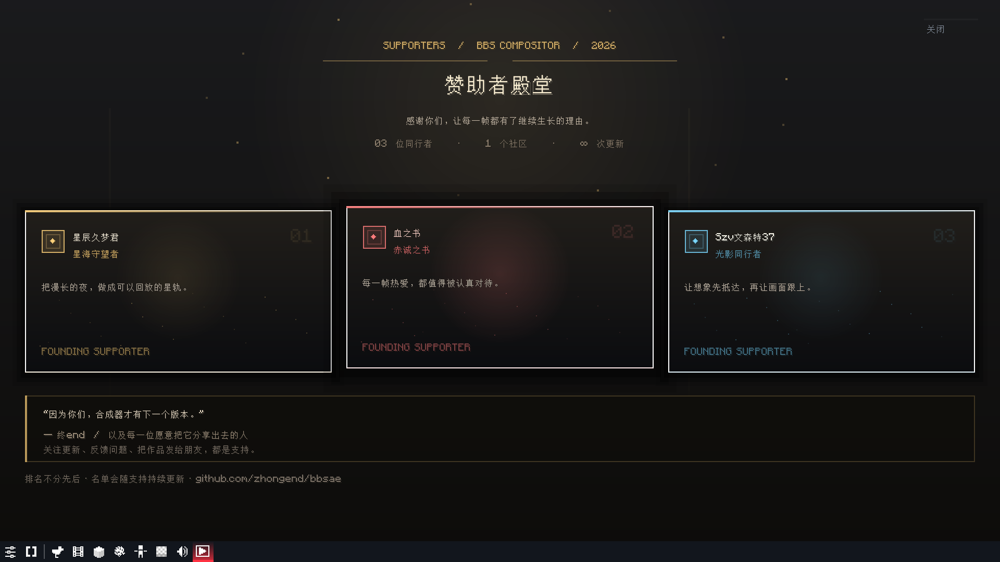
</p>

<p align="center">
  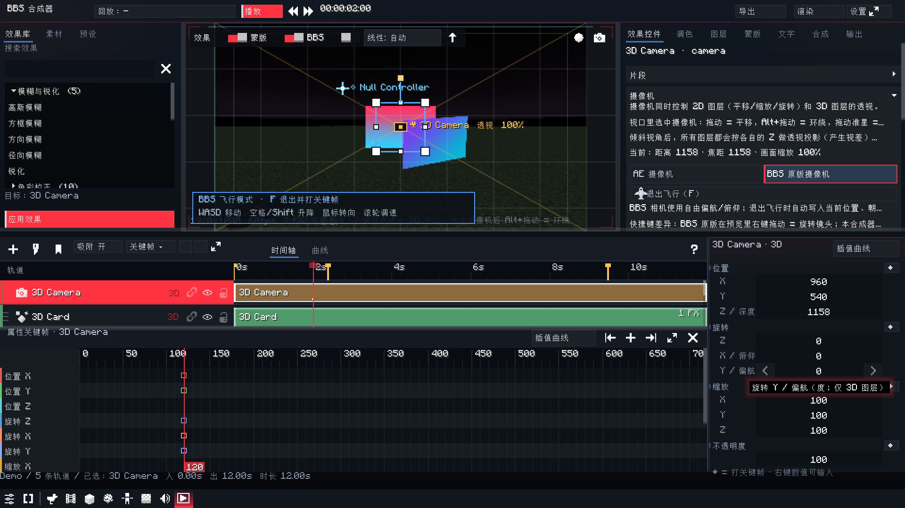
</p>

<p align="center">
  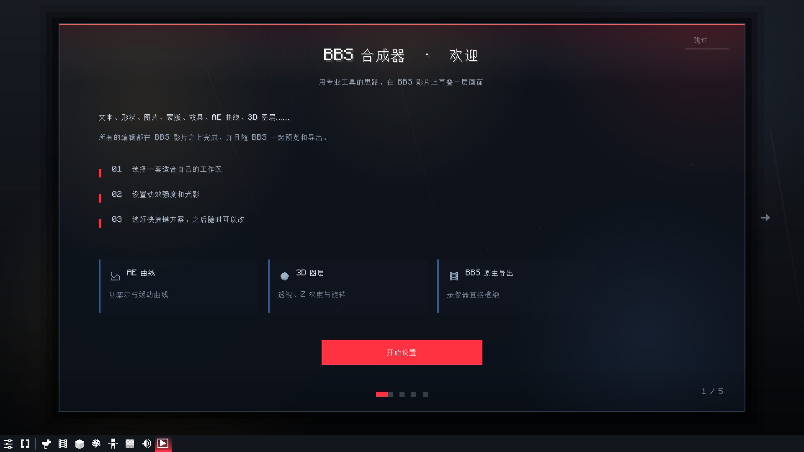
</p>

<p align="center">
  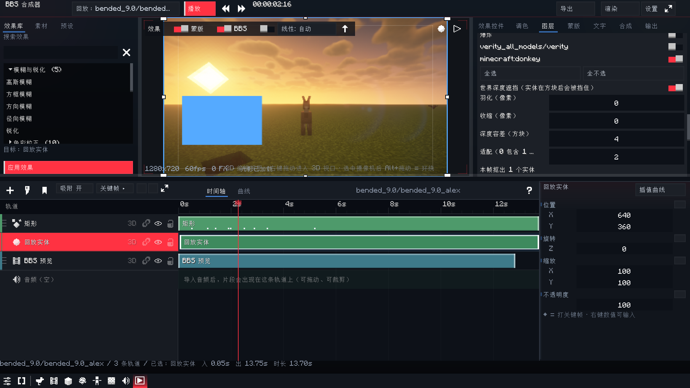
</p>

<p align="center">
  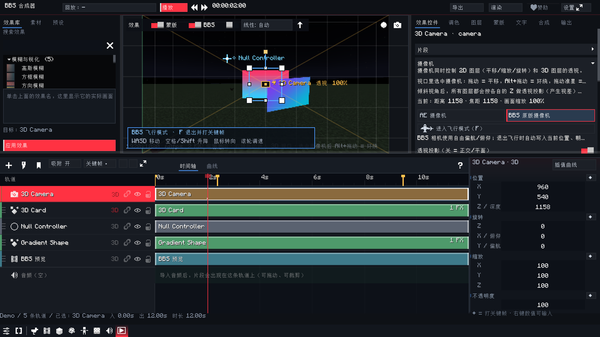
</p>

## What's new in 0.18.0

**A first-run onboarding, a BBS-style settings surface and editable shortcuts — and every custom
widget now moves with a non-linear curve instead of snapping.**

*Onboarding.* The compositor opens on a BBS-style welcome card: layout presets (标准 / 专注 / 紧凑 /
宽屏), a motion preset (平衡 / 电影感 / 极简), a shortcut scheme, and a short finish page. The
background is the same visual language as BBS's own landing screen — a deep surface, drifting
lights and a pointer-following glow — and the choice is persisted, so it only appears once. It can
be replayed from Settings → 新手引导.

*Settings.* The old fixed 520×520 modal is replaced by a left category rail + right scrollable list
in the style of BBS 2.7's settings: search, section headers, toggles, sliders and segmented choices.
Motion intensity/speed, glow, shadows, backdrop brightness, layout density, project defaults,
encoder/proxy and the shortcut editor all live here. The overlay enters with a short overshoot,
rows light up under the pointer and category switches sweep an accent line.

*Shortcuts.* Every compositor command is now an action in one table with a default for the
Premiere and BBS schemes. Click a keycap, press the new combination, and it is saved globally;
Backspace clears a binding, Esc cancels, and conflicting actions are reported in the status bar.
`Ctrl+,` opens Settings and `Ctrl+/` jumps straight to the editor.

*Motion.* A shared `UiMotion` layer drives button hover, tab underlines, tile/card entrance,
asset-library scroll smoothing, track selection, panel entrance and the new overlays. Settings can
turn it off or reduce intensity/speed; all motion is paint-time only, never in the frame/export
path. The `UiMotion` easings and the shortcut table are covered by unit tests.

<p align="center">
  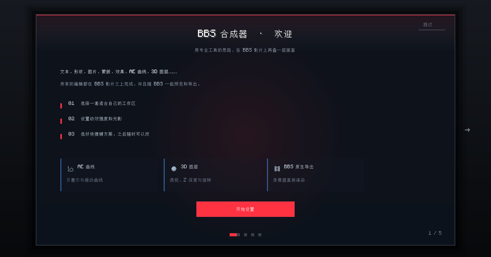
</p>

<p align="center">
  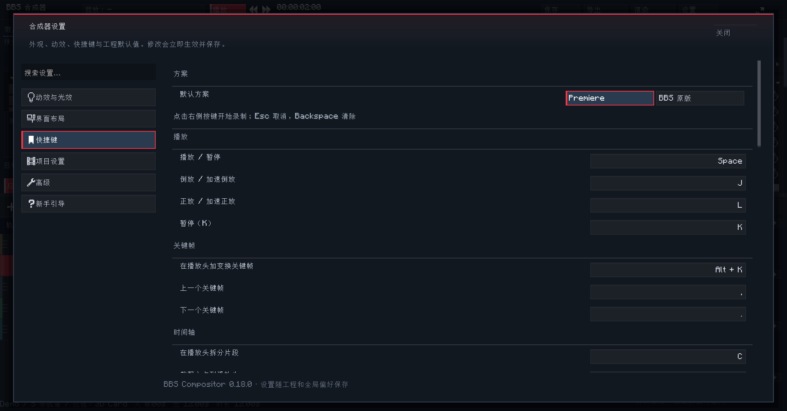
</p>

## What's new in 0.17.0

**The asset scrollbar drags, Bezier handles drag from where they are, and the project icon is finally
the plugin's icon.**

*Asset library scrollbar.* The 3 px line was painted, never hit-tested. It is now a real 8 px thumb:
drag it, click the track to jump, release anywhere (the physical button is polled so it cannot stick),
hover highlights, and the grid reserves room so the thumb never covers a tile. The hint says
—滚轮或右侧滑块滑动—

*The curve editor was editing the wrong property.* All five transform curves share one BBS
`Transform` keyframe. The editor stored `IdentityHashMap<Keyframe, channel>` ownership, so the last
adapter (Scale Y) overwrote Position X: dragging a position key changed Scale Y, and the
Bezier/Ease presets filtered the selection to nothing. Ownership now comes from the **active
channel** for transform keys; scalar channels keep their one-to-one map.

*Bezier handles no longer collapse on mouse-down.* The drag handler treated the pointer delta as the
handle's absolute offset, so the first 1 px collapsed `rx` to 0.25 and `ry` to 0. It now snapshots
`rx/ry/lx/ly` at press and adds the delta, clamps influence to the adjacent segment, mirrors by
default, breaks with Alt, and reports influence/speed. Default 卤5-frame handles are expanded to
33.3 % influence when Bezier is chosen; value fitting includes the handles so they cannot be clipped.

*Professional graph ergonomics.* Middle/Space drag pans **both** axes; right-clicking a key exposes the
interpolation menu (linear / bezier / ease / ease-in / ease-out / hold / auto / continuous / delete);
arrow keys nudge 1 frame / 1 pixel (Shift = 10×); the graph shows a selected-key card (channel, time,
value, interpolation) next to the playhead readout.

*The plugin icon.* `fabric.mod.json` had no `icon`, so Mod Menu showed a placeholder. The repository's
32×32 compositor icon (by 超级大布叮) is now packaged as a 128×128 padded, rounded
`assets/bbsae/icon.png` and registered in the metadata; the BBS 16×16 tab/clip icon stays the
original. `IconResourceTest` checks both.

<p align="center">
  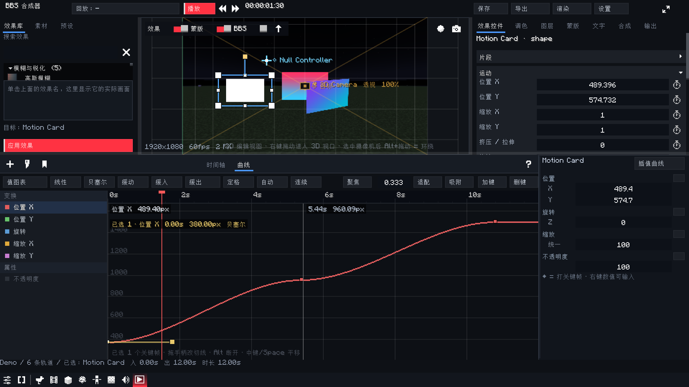
</p>

## What's new in 0.16.0

**The preview runs at the film's speed, the clip picker speaks Chinese, and 3D layers get
their XYZ back.**

*The clock was a unit error.* `startRenderFrame(tickDelta)` added `tickDelta / 20` once per
rendered frame, but BBS passes Minecraft's **fraction of the current client tick** there, not the
elapsed time since the previous frame. Summing the sawtooth happened to give 1× at 60 fps, ran
**3.6× too fast at 144 fps** and 0.5× at 30 fps. Playback now advances by wall-clock seconds with
a 0.5 s stall clamp, reset on resume/seek, so one second of composition is one second of film.
`CompTimeTest` reproduces the old refresh-rate dependence and checks the new clock at
30/60/90/144/240 fps.

*The clip picker no longer shows a translation key.* BBS labels a clip type through
`UIKeys.C_CLIP` (`bbs.ui.camera.clips.<link>`). A missing entry falls back to the key itself, so
the add-clip menu showed `bbs.ui.camera.clips.bbsae:composition`. The addon now registers that
key — and the legacy `composition` spelling — through `RegisterL10nEvent`, with a post-ready
fallback, and new clips are titled `合成器` from the start.

*The 3D layer quick panel is 3D.* The right-hand quick panel switches from five 2D rows to ten
3D rows: position X/Y/Z, rotation X/Y/Z and scale X/Y/Z, each group with its own ◆ key button.
Z depth, pitch, yaw and Z scale write the layer's scalar channels, the same channels the 3D scene
graph reads.

*BBS's own curve picker is one click away.* A **插值曲线** button in the keyframe drawer header
and in the quick panel opens BBS's `UIInterpolationContextMenu`: the graph preview, the full
icon grid (linear/hold/bezier/auto/ease/bounce/elastic/—, the four bezier arguments and
copy/paste. It applies to every selected keyframe, or selects the key at the playhead first.

*First-key buttons work.* The inspector's ◆ was disabled until a scalar channel already existed,
and `addScalarKey` read fields `CompLayer.scalar()` did not know (`z`, `rotationX/Y`, `scaleZ`,
`squash`, camera distance/target/FOV), inserting 0. Every scalar field is now readable, the
current displayed value is passed explicitly, and the key action starts its undo checkpoint
before writing.

<p align="center">
  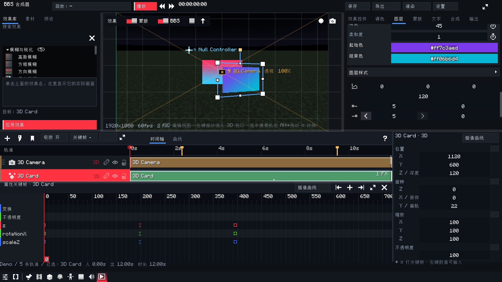
</p>

## What's new in 0.10.0

**The timeline zooms, and audio/video finally have tracks.**

*Zoom was a unit error.* BBS's `Scale.zoom(delta, min, max)` **adds** to a value measured in pixels
per second; the editor passed 卤1, so every key press and wheel notch changed the scale by 1.7 % — a
dead control. A step is now 1.35× (`zoomTarget`), applied through the same additive API and anchored
at the cursor, with `Alt + =/-` for track height. Two tests drive BBS's real `Scale` to prove that one
step is exactly 1.35× and that in/out steps cancel.

*Audio is a track now.* The timeline's rows were exactly `doc.layers`; audio clips lived only in the
inspector. There is now a virtual audio row (`rowCount()` = layers + 1) with the same time axis, row
height and scroll: green bars, click to select, drag to move, 8-px edges to trim (the source offset
follows a trim-in), `Delete` removes the selected clip — and the bar length is the length stored at
import (`probeDuration`), so what you see is what the mixer plays.

*Video is a track now.* `footage` layers already consume `frame_%04d.png`, but nothing produced those
frames. `CompVideoImport` converts a video with FFmpeg on a worker thread — at the composition's frame
rate and raster, letterboxed, 60 s cap — then creates a footage layer on the client thread. The
compositor can then ask for frame 91 in any order, which is the whole point of the frame pipeline.

*Two UI bugs.* A side-by-side layout at ~360 logical pixels squeezed the preview to a negative width
(so it silently stopped drawing); both columns now shrink proportionally with a 160 px preview floor.
And the effect/mask/world-backdrop toggles are hidden in AE mode, where they cannot change the frame.

## What's new in 0.9.0

**The AE pipeline got the four things it was missing.**

*Disk frames.* The frame server now has an L2 on disk keyed by the **content fingerprint**
(`cache/frames/<project>/<comp>/<signature>_<frame>_<w>x<h>.rgba`). Because the file name *is* the
document state, an entry can never be stale: different content means a different file. Raw pixels
(no PNG round-trip — 1080p ImageIO is slower than re-rendering a simple comp), written only for
frames that took ≤ 45 ms, 512 MB budget with oldest-first eviction.

*A render budget instead of one frame per tick.* GL lives on the render thread — a background render
thread would need a shared context and would fight Minecraft's state. So the "farm" spends 22 ms of
each 50 ms tick producing frames (up to 6), which removes the hard 20 fps ceiling: a 12-second
60 fps composition used to take 36 s to write even at 3 ms a frame. And full-size video now streams
**raw RGBA frames into FFmpeg's stdin** instead of writing a PNG per frame, which was the real
bottleneck. Resized presets, PNG sequences and "keep frames" keep the file path (and its resampler).

*Preview audio.* The composition's mix is rendered on a worker thread and played through BBS's own
OpenAL (`SoundBuffer`/`SoundPlayer`), so there is no second audio backend. The playhead is
authoritative: `sync(time)` corrects drift over 250 ms and handles loops, and one
`syncPreviewAudio()` derives everything from `(playing, AE, has audio, toggle)` — so any code that
pauses playback also stops the sound.

*Proxy resolution, explicit.* `encoderProxy` 1/1, 3/4, 1/2, 1/4 in Settings; the badge reads
`AE 编码器 · 代理 1/2`. The frame cache keys on the factor, and export is always 1/1 — a silent
proxy is how "the preview looks soft but the export is sharp" becomes a bug report.

## What's new in 0.8.0

**A second render pipeline, and it is the one an editor needs.** Until now the composition was an
overlay: the game produced the frame, at window resolution, at display-refresh timing, and BBS's
recorder wrote it. That is correct for a film overlay and wrong for an editor, where "frame 90"
must mean the same picture in the viewer and in the file. **AE 编码器模式** (Settings →渲染 / 编码
管线) switches the frame source to the compositor:

- `CompRenderer.renderFrame(project, doc, frame, alpha)` is now the **only** way a frame leaves the
  compositor: time comes from the frame index (`frame / fps`), the raster is the composition's own
  resolution, editor chrome is suppressed, guide layers are excluded.
- `CompFrameServer` caches those frames, keyed by the document fingerprint — editing anything makes
  the old frames unreachable, so there is no invalidation to forget. 192 MB LRU (~23 frames of
  1080p).
- The preview asks the server for the playhead's frame; the render queue asks it for every frame of
  the range. Same function, same pixels. This is the producer/consumer "pull" model MLT uses and
  the `RenderManager` + `FrameHashCache` design Olive uses.
- **AE 导出** (the header button changes label) queues the composition at its own resolution and
  frame rate instead of going through BBS's recorder.

It is a different pipeline, so it is labelled like one: a one-time **risk dialog** (six concrete
consequences, not a disclaimer), a red **AE 编码器 / 帧 N / total** badge on the preview, and a red
hint in Settings. The honest limitations: the 3D world can only enter through the `BBS 棰勮` layer,
and offline exports see its **last** captured frame; depth effects lose their depth; the BBS
recorder keeps rendering in BBS mode, so the two paths never mix.

## What's new in 0.7.0

**The curve is a curve again.** The editor opened on a fixed **-100— 00** value axis and a view
length of `frames / 24` seconds, so a position channel (values in the hundreds) and a 12-second
60 fps composition were both framed wrong: every sampled Y landed outside the graph rectangle, the
clip removed the line, and only the keyframe glyphs survived. The graph now frames its own data
(value axis from the active channel's keys, time axis from the composition duration), pins
out-of-range values to the edge like AE, and refills its per-column spans every frame — the
incremental span cache whose invalidation could not be proven is gone (0.2 ms/frame against a
screenshot that showed neighbouring columns jumping between unrelated values).

**Importing a file works inside the game.** `UIFileDialogs.pickFile()` is a native tinyfd window: on
a fullscreen game it can open behind the window or never call back at all, which is why the import
button looked dead. Images, fonts and audio now go through an in-game browser
(`UIImportBrowser`) with drives, folders, an extension filter and a typed path; the freshly
imported file is selected in the asset library immediately.

**Video and audio export.** The composition has a real audio track (in-point, offset, gain, fades,
loop, mute). `CompAudioMixer` renders it to 48 kHz stereo with a pure function, and that same mix
feeds the MP4's AAC track, the standalone WAV module and the PNG sequence folder. Video export pads
audio before `-shortest` so the last frame is never dropped; a range export now plays the *right*
part of a clip (`seek = exportStart - clipStart`, previously every range export started the music
from 0). The render queue's output module is a chooser with real names and a video/audio icon
instead of a text field for internal preset ids.

**The asset library is one sliding page.** The old modal pinned everything to a 620×400 rectangle;
below that the action row was off-screen ("the button does nothing"). Categories slide
horizontally, the thumbnail grid scrolls vertically, and the footer switches between short and long
labels by width. The render queue's field row no longer uses `UIElement.row()`, which ignores child
widths and was squeezing a 110-px label column into a quarter-width box.

**The stage is solid.** A transparent composition over the live game world read as "the panel is
broken". The stage colour is opaque by default, the world backdrop is an explicit toggle, and
`CompRenderer.stageColor()` is the single place that decides (backdrop preview → transparent,
alpha export → transparent, everything else → the document colour). Existing projects migrate once.

**Camera semantics.** A camera is a view, not content: hiding its row or trimming it no longer
switches the composition back to 1:1. The gizmo, its hit test and its drag all read the animated
transform (`cameraEye`), and `layerAt()` reuses `handleAt()` instead of maintaining a second copy of
the geometry — clicking the camera body now works wherever it is drawn.

## What's new in 0.6.0

**The curve editor stopped drawing a line per pixel.** `line()` walked every pixel of a segment
and emitted a quad per step, so a steep curve cost thousands of quads per frame and got slower the
further you dragged a handle. Curves are now rasterised into a **per-column span cache**
(`CurveSpans`): one rectangle per screen column, merged into runs when the span is identical.
Vertex count is bounded by the width of the graph instead of by the data, and an unchanged curve
costs zero evaluations.

**Editing only recomputes what changed.** A handle drag rebuilds the 20— 0 columns of the affected
segment instead of resampling the whole graph; the five transform axes share one key list, so they
invalidate together (a shared epoch) while scalar channels keep their own revision counter.

**Release no longer jumps.** A drag used to rebuild the entire inspector and every keyframe sheet
on mouse-up — 3— 0 ms landing exactly on the frame you let go. A drag now only re-runs the
inspector's value bindings; only adding/removing keys rebuilds widgets.

**Preview follows the curve.** Dragging used to leave the pre-render cache answering with the last
green frame (a regression from 0.5.0: `markDirty()` only ran on save). A drag now invalidates the
cache every frame, drops the preview to 0.7× resolution while the mouse is down, and — when the
playhead sits outside the edited segment — reuses the frame it already has instead of re-rendering
the whole graph.

**The blank curve page is fixed.** The strip was laid out only when the tab was clicked, so a
dashboard page switch (or entering a precomp, or the render view) could leave the curve editor
visible with a zero-height rectangle — and a negative clip silently erases everything. The strip is
now reconciled every frame from `(page, visibility, area)`, the graph area is clamped to at least
1×1, and a strip too short to host a graph falls back to the timeline with a message. Switching to
the curve page also grows the strip to 55% of the panel once.

**Smaller fixes.** Modifiers in the curve area go through GLFW instead of `Screen.hasAltDown()`
(Alt-broken handles were intermittent); the active channel survives an inspector edit (it used to
jump back to "位置 X" because the check compared object identity); `keyAt`/marquee iterate the raw
key list instead of allocating a `Key` per keyframe per frame; grid labels and the value readout
are cached per view/frame instead of `String.format`-ed every display frame.

Value-axis zoom stays on **Ctrl+wheel** (as requested), not AE's Alt+wheel.

Tests: **119/119**.

## What's new in 0.5.0

**The preview is BBS's preview now.** The compositor used to paint the film frame only if a
toggle callback happened to request it, cropped it to fill the composition rectangle, and had no
depth at all — a `depth_*` effect silently did nothing while previewing. Three changes:

1. The world frame and its **depth buffer** are copied together at the end of the world render
   (`SceneDepth.captureFrom`), so colour and depth always come from the same frame, and depth
   effects see the film's real geometry.
2. The capture request is re-derived from the document every frame instead of only from a toggle,
   so a project saved with the world backdrop — or a one-click 3D workspace — actually gets it.
3. The world frame is drawn **contained** (letterboxed), exactly like BBS's own preview, instead
   of cover-cropped into the composition rectangle.

**Pre-render cache with a green bar.** Press **预渲染** in the timeline toolbar and the ruler
fills with a green strip. Green frames are served from a disk+VRAM cache
(`config/bbsae/cache/—, raw RGBA + deflate, 1280×720 cap) instead of being re-rendered, so a
composition with a dozen effects plays back smoothly. The pass is cooperative — two frames per
display frame, 18 ms budget — and any edit invalidates the green immediately.

**The editor stopped writing the project to disk on every mouse event.** `save()` used to
serialize the whole project (megabytes of JSON) and rewrite the file for every slider tick, wheel
notch and drag delta; it is now a dirty flag with a debounced write. That single change removes
most of the "the UI is extremely laggy" symptom.

**Preview renders at display resolution.** A 1920×1080 composition shown in a 700 px panel used to
render 2.07 M pixels to display 0.28 M. The render targets now follow the viewport
(`CompRenderContext.scale`), which is a 7× reduction in per-pass cost with no coordinate changes.

**Camera.** Wheel now dollies *towards* the composition (it used to zoom out), Alt+wheel narrows
the field of view, Alt is read from GLFW instead of `Screen.hasAltDown()`, and the inspector is no
longer rebuilt on every wheel notch.

**Alt+wheel resizes the tracks.** It was bound to horizontal timeline zoom; row height was hidden
behind Alt+Shift. Now Alt+wheel is track height (18— 2 px), Ctrl+wheel zooms time.

**Curve editor.** The value axis is fitted to the **active channel** instead of every visible
channel — position (0— 080) and opacity (0—) on one axis turned the graph into a flat line at the
bottom. Only the active channel's curves, keys and handles are drawn and hit-tested by default
(`聚焦` overlays the rest), and the cursor shows a crosshair with a live time/value readout.

See [`docs/ROUND15-PREVIEW-CACHE-PERF.zh.md`](docs/ROUND15-PREVIEW-CACHE-PERF.zh.md).

## What's new in 0.4.0

**UI density: small / medium / large, auto-following BBS.** Everything — row height, control height,
label column, icon size, panel widths — now derives from one density number (`CompUi`). "Auto" reads
BBS's applied GUI scale: 1— → large, 3 → medium, 4+ → small. That inversion is deliberate: a scale
of 4 leaves a 480×270 logical canvas, so tall rows simply do not fit, while scale 1 has room to
breathe. Switch it in Settings →鐣岄潰瀵嗗害; it is saved per project.

**Flat buttons instead of accent blocks.** BBS's `UIButton` fills itself with the theme's primary
colour; forty of those in an inspector is a wall of saturated blocks. `UICompButton` keeps all of
BBS's click/hover/tooltip behaviour and changes only the skin: raised-surface fill, hairline border,
left-aligned label, accent reserved for the single primary action of a surface (play, enter
compositor, apply effect). One-symbol actions became icon buttons.

**Every button explains itself on hover.** `CompUi.describe` is a vocabulary of 70+ Chinese
descriptions covering the panel's buttons; `UICompButton` sets the tooltip automatically from its
label, and unknown labels still get a sentence. A test fails if a known label loses its description.

See [`docs/ROUND14-UI-DENSITY-FLAT.zh.md`](docs/ROUND14-UI-DENSITY-FLAT.zh.md).

## What's new in 0.3.0

**One camera, finally.** The compositor used to have two unrelated camera paths (a 2D pan/zoom built
from `scale.x`, and a 3D perspective camera gated behind a `camera3D` toggle), plus a Y-flip hack in
the 3D matrix. They disagreed about zoom and framing, and the 3D projection called JOML's affine
`transformPosition` instead of `transformProject` — so 3D layers landed at coordinates like
`-230646px`. Everything now derives from one pose: one space (comp pixels, Y down, Z toward the
viewer), one `CompCamera`, one `CompScene`. The 2D view is literally the 3D camera sampled at z = 0,
which is why switching a layer to 3D no longer changes its size or position (pinned by a test to
0.1px). Drag the camera body to pan, the crosshair to aim, the wheel to dolly, Alt+wheel for FOV.

**3D parenting.** With one scene graph, 3D parenting is the same change of basis as 2D — plus a
Rz路Rx路Ry decomposition so z / tilt / scaleZ survive. Whole-matrix equality is asserted in tests.

**Multi-select and pre-compose.** Ctrl/Shift selection in the track timeline, Ctrl-click in the
preview, drag the whole selection, and a batch panel: combine into a pre-render (time rebased,
parent/matte relations retargeted), group under a null, align, distribute, show/hide/lock,
duplicate, delete.

**Performance.** The editor re-rendered the entire graph every display frame even while parked.
A content fingerprint now caches the composed frame (and quantises time to the composition frame
rate); the 1-second full-project JSON snapshot only runs when the document is dirty and is capped at
32MB; depth/world captures are on demand; the per-frame `glGetError`/`glCheckFramebufferStatus`
syncs are gone; the FBO pool no longer destroys and recreates 8MB textures mid-frame.

See [`docs/ROUND13-CAMERA-MULTISELECT-PERF.zh.md`](docs/ROUND13-CAMERA-MULTISELECT-PERF.zh.md).

## What's new in 0.2.0

**AE curve editor.** The bottom strip now has a `时间轴 / 曲线` switch. The curve view is a real
After Effects graph editor: value graph and speed graph, per-keyframe bezier handles with
mirrored/Alt-broken tangents, marquee selection, drag-to-retime with frame snapping, double-click
to add a key, AE keyframe glyphs (square = linear, circle = bezier, diamond = hold), eight easing
presets (linear / bezier / easy ease / ease in / ease out / hold / auto / continuous) with an
influence field, and a channel list that shows every animated property — position/rotation/scale as separate curves, opacity, effect parameters, mask points, shape corners.

Why it needed engine work: BBS evaluates a `Transform` channel with one interpolation for the whole
vector and ignores `lx/ly/rx/ry`, so handles could never bend position/scale/rotation.
`CompCurves` now evaluates each component with the same `BezierUtils` math BBS uses for float
channels — the curve the editor draws is exactly the curve that renders.

**Layer presets.** A third left-column tab: save the selected layer as an animation / effect-stack /
style / shape / whole-layer preset, apply it to any other layer, or use the ten built-in looks.
Effect and shape ids are remapped on apply (including their animated channel paths), and animation
payloads are re-timed to the target layer's in point.

**Parenting no longer teleports.** Binding used to write `parentId` and let the parent matrix
multiply the child, so a child at (900, 500) bound to a parent at (200, 100) jumped by (200, 100)
times the parent's rotation and scale. `CompParenting` now does a change of basis
(`local' = parentWorld⁻¹ · childWorld`), shifts every transform key by the same delta, and converts
preview drags into parent space so the layer stays under the cursor.

**Shape corners and colours.** Per-corner radii for rectangles (4) and triangles/polygons/stars
(one per vertex), round or bevel joins, animatable per corner; and shapes now paint their own fill
and stroke instead of the whole layer taking the last shape's colour.

See [`docs/ROUND12-CURVES-PRESETS-PARENTING.zh.md`](docs/ROUND12-CURVES-PRESETS-PARENTING.zh.md)
for the derivations, the file map and the verification list.

## Status

This is the third vertical slice: the data model, render graph, editor, per-replay project
isolation, timeline scrubbing and render queue are in place. It is not a finished AE clone, and
the feature matrix in [`docs/features.zh.md`](docs/features.zh.md) is deliberately explicit about
what is and is not implemented.

Verified in this iteration:

- `compileJava` and all **119** tests pass (headless model + real hidden-window OpenGL 3.2 pixel
  tests + export-duration/icon checks + the new curve/parenting/preset/shape assertions);
- the addon loads in a Fabric 1.20.1 + BBS 2.7 development client;
- the compositor preview renders the composition (not a blank frame) after fixing projection,
  model-view and mask-transform state;
- the BBS film recorder produced a real H.264 MP4 (`320x180`, 20 fps, 39 frames) and the exported
  frame contains the compositor layers, proving the frame-overlay path reaches the video file;
- the final jar has Minecraft references remapped to intermediary and keeps BBS class names.

Build artifact: `build/libs/bbsae-0.6.0.jar` (also copied to `bbsae-0.6.0.jar`), **548025** bytes,
SHA-256 `b4ab3d93cf64e8eaa154542b1a42a3da2e1df22e224196f04009de44185aef92` (check the file if it is
repacked). The jar is produced by `gradlew build`; `remapJar` writes it directly and the class
entries are intermediary-remapped.

2026-10-24 interaction-logic pass (see `docs/INTERACTION-AUDIT.zh.md`):

- precompose now rebases the inner layer to 0 (in/out, keys, markers), keeps the source's stack
  index and transfers parent/matte relations; the previous code could make a layer starting at 5s
  disappear and jump the result to the top;
- selecting a keyframe now moves the playhead, so the Effect Controls edit the selected key
  instead of writing a second key at the old playhead;
- the Layer page's in/out fields use the same `trimInTo/trimOutTo` semantics as the timeline;
- errors use `notifyError` instead of assignments to `status.label` (render overwrote them every
  frame); the export dialog has one Start button and accepts 0 as "composition duration";
- material replacement has an explicit replace mode; precomp placeholders are preview-only;
- discrete commands create action-level undo checkpoints, and style reorder/3D exit/comp rename/
  precomp breadcrumb/work-area handles/keyframe-tick hit testing are in place. 66/66 tests pass.

2026-10-18 asset-library hotfix:

- the asset browser's `mc:` marker was passed to `Identifier` as a namespace (`mc`), but vanilla
  resources live in `minecraft`; every item/block/entity thumbnail failed to load and inserted
  layers had no texture. `mc:` is now mapped to `minecraft`;
- added `InterfaceBlur.applyUnder()` plus a dark scrim behind the library;
- the panel is now 620×400 (5×3 thumbnails, 6 category columns) so the action buttons fit a
  1536×864 / GUI-scale-2 logical screen;
- evidence: [`docs/verify/round11-asset-library.png`](docs/verify/round11-asset-library.png),
  details: [`docs/ROUND11-ASSET-LIBRARY.zh.md`](docs/ROUND11-ASSET-LIBRARY.zh.md).

2026-10-18 ninth pass (export fidelity, 12 s duration, compositor icon):

- the export length now uses `max(film, composition)` instead of BBS's 12-second camera default;
  the composition clip is normalized (`tick=0`, full duration, opacity 1) and the film is saved
  before recording, so the recorder cannot stop early or miss trimmed clips;
- the **BBS preview layer** no longer disappears in the film-editor/F6 export path: the clean
  world frame is captured at `AFTER_TRANSLUCENT` into `SceneColor`, and a `bbs` layer can sample
  it outside the compositor panel too. The 2D overlay also disables depth writes and restores the
  UI scissor, so the export cannot inherit a stale composition/frame state;
- `workAreaOut` follows the composition duration (including migration of the old 12-second
  default), so preview playback no longer loops at 12 s;
- added the user-provided compositor icon as `assets/bbsae/assets/textures/gui/compositor_icon.png`
  (16×16), used by the dashboard tab and the `bbsae:composition` clip;
- the export dialog has an explicit **Export duration (seconds)** field (persisted as
  `CompSettings.exportDuration`, 0 = composition duration) and a **Sync to BBS timeline** button.
  The same field is available in the **compositor settings** after entering a project, with an
  **Apply export duration to composition + BBS timeline** button, so the length can be changed
  before opening the export dialog;
  the value is passed to BBS's native recorder directly as `round(seconds * 20) + 1` ticks, and
  `editorLoop` is disabled for the export. A 40-second setting produced **2402 frames /
  40.033 s** (`docs/verify/round9-export-40s-35s.png`, `round9-export-40s-ffprobe.txt`), a
  25-second composition produced 1502 frames / 25.033 s, and a 20-second run is kept at
  `docs/verify/round9-export-20s-15s.png`;
- **fixed the actual 20-second drag wall:** the field used to update only `exportDuration`, while
  the timeline clamps drags to `doc.duration`; the callback now calls
  `adoptCompositionDuration(seconds)`, extending `doc.duration`, work area, composition clip and
  BBS loop first. A layer can now be dragged from 20 s to 40 s (`layerCanMovePastTwentySeconds...`);
- a BBS-preview-layer-only export at `docs/verify/round9-bbs-preview-layer.png` proves the
  `bbs` layer now samples the clean world frame in the export path;
- tests now **65 / 65** (added `compositionExportDurationExtendsPastTheTwelveSecondFilmDefault`
  and `IconResourceTest`). Details: [`docs/ROUND9-EXPORT-SYNC.zh.md`](docs/ROUND9-EXPORT-SYNC.zh.md).

2026-10-18 eighth pass (Alight Motion PIXEL effects, first-principles bug audit):

- added seven PIXEL-family effects: **Scanlines, Glitch, VHS, Halftone, Emboss, Mirror,
  Kaleidoscope**; the catalogue grew to 53 then **58** in 0.19 (repeats, turbulence, colour mapping,
  light sweep);
- every one operates in **layer space** through `EffectSpace` / `sampleLocal`, so the pattern
  follows the layer instead of staying glued to the composition;
- Halftone follows Alight Motion's properties (dots across the project width, strength, angle,
  row phase, ink/paper colours); Mirror now overlays a mirrored copy with an opacity control
  instead of discarding half the layer;
- fixed four dead parameters (`glitch.speed`, `vhs.speed`, `vhs.noise`, `depth_dof.focus`);
- fixed `EffectSpace.identity()` inverting the V axis (adjustment/3D-layer effects sampled the
  vertically flipped row) and `CompShaders.delete()` leaving a dangling `rgbSplit` program;
- new `PixelPlan` separates parameter resolution from GL so a headless test can prove every
  registry parameter reaches the shader; new GL pixel tests cover identity, layer space, colour
  and symmetry. Evidence: `docs/verify/round8-pixel-effects.png`.
- details: [`docs/ROUND8-01-AUDIT.zh.md`](docs/ROUND8-01-AUDIT.zh.md),
  [`docs/ROUND8-02-PIXEL.zh.md`](docs/ROUND8-02-PIXEL.zh.md),
  [`docs/ROUND8-03-VERIFY.zh.md`](docs/ROUND8-03-VERIFY.zh.md),
  [`docs/ROUND8-04-PUBLISH.zh.md`](docs/ROUND8-04-PUBLISH.zh.md).

2026-10-18 sixth pass (distortion, grading, landing screen, media/sound, export):

- distortion effects now measure strength in **pixels** and radius against the layer's half
  diagonal (`2蟺/wavelength` for waves); `pinch` gained its missing radius parameter. A real GL
  pixel test asserts that a bulge pulls transparent pixels into a square;
- the inspector has a real **grading page**: three AE-style colour wheels (lift/gamma/gain),
  a five-point master tone curve drawn with the same formula as the shader, presets and
  keyframeable exposure/contrast/saturation/vibrance/temperature/tint;
- the **landing screen** lists `.bbscomp` projects, creates new ones (name, canvas, fps,
  duration) and forbids editing until a project is chosen; shortcut scheme (Premiere / BBS) is
  selected there and persisted per project;
- all four panel areas are **draggable** (left, right, timeline, keyframe drawer) and the
  keyframe drawer height is saved; the old `row()` tab overflow is gone;
- the media library indexes 10 texture roots plus BBS textures, searches across every category,
  and has a sound library that auditions vanilla/BBS sound events, copies their ids and opens
  BBS's own sound overlay;
- layer duration has direct in/out/duration fields and 1s/2s/5s/fill buttons; settings add a
  default layer duration;
- 10 motion templates, a reworked block-shatter shader and a richer composition-clip inspector
  (project picker, fit choice, clip info, fixed 合成器 title);
- external replay playback can be configured to hide the compositor
  (`showDuringExternalPlayback`), detected with `BBSRendering.isCustomSize()` so F6 recording is
  never mistaken for external playback;
- export accepts custom width/height and a numeric aspect ratio; a real **1920x1080 @ 60 fps**
  export was produced (494 frames, 8.23 s) and a frame is at
  `docs/verify/round6-export-1080p60.png`.

2026-10-18 track-editor / Effect Controls pass (the Premiere-style correction):

- the bottom of the workspace is now a **real track editor**, not a small strip above a property
  sheet: one row per layer, a track header with visibility/lock, a movable/trimable clip bar,
  frame-snapped dragging, edge handles, snapping to the playhead/markers/other clips, zoom/pan,
  work-area shading and a proper seconds ruler;
- the layer stack is no longer a second list in the left column. Track headers are the single
  selection surface; clicking a bar selects its layer and feeds the right-hand panel. This removes
  the old duplicate "which list owns selection?" state;
- the right column is now **Effect Controls** by default: Motion (position/scale/rotation/anchor),
  Opacity + blend mode, the applied-effect stack and layer styles for the selected track. With no
  track selected it shows an explicit empty state instead of editing the last layer;
- the left column is a Premiere-style **Effects library** with search, categories, recent effects
  and a native `UIList` tree. Double-click or "Apply" adds the effect to the selected track; an
  effect can be enabled, reordered or removed in Effect Controls;
- the BBS keyframe editor moved into an optional drawer under the track timeline. Adding a keyframe
  opens it automatically; it fits the composition duration instead of the keyframes' bounding box;
- shortcuts were rebuilt around `KeyAction.PRESSED`: the old code also ran on key release, which
  made Space/S and other toggles fire twice and look broken. The new set adds J/K/L shuttle,
  frame/5-frame stepping, Home/End, edit-point and marker navigation, track selection/stacking,
  `[`/`]` trim to playhead, I/O work area, Alt+arrow nudging, C/Ctrl+K split, S snapping,
  `=`/`-`/`\` zoom/fit, F focus, Ctrl+S save, Ctrl+M export and Ctrl+/ shortcut help;
- split-at-playhead keeps footage continuous (`startTime` advances with the split), trim-in keeps
  the source frame under the cursor instead of slipping the clip, and moving a bar carries its
  keyframes and layer markers with it. These rules live in `CompLayer` and are covered by tests.

2026-10-18 UI pass (Chinese build):

- the whole compositor UI is Chinese: header, inspector tabs, every inspector field, effect names,
  effect parameter names and render-queue states;
- the inspector tab bar was replaced with a deterministic clickable bar (BBS's `UITabStrip` is a
  scroll view and swallowed presses inside the dashboard panel, so no tab could be switched);
- the timeline is primed on the first laid-out frame: sheets no longer stay blank until the user
  clicks something;
- Space toggles playback;
- opening the compositor now starts with a replay picker: a replay must be chosen before editing;
- export opens a small preset dialog (1280/1920/2560/3840, 16:9 / 9:16 / 1:1, 24/30/60 fps) that
  writes the values into BBS's own video settings and then runs BBS's native recorder, so export is
  no longer stuck at the old 320x180 preview size;
- toolbar regrouped: transport in the centre, save/export/render/focus anchored to the right, the
  add-layer button moved into the layer panel header.

2026-10-18 asset-library pass:

- **asset library** (materials button in the layer panel): a photo-library style browser with
  categories, thumbnails, search and paging. It indexes the project's own `assets` folder **and the
  client's resource packs** (`mc:textures/item|block|entity|gui`), so Minecraft item/block icons can
  be dropped straight into a HUD composition; double-click inserts, or replace the selected layer;
- layer stack is now drawn top-most first (AE convention), new layers appear on top;
- global undo/redo via 1-second project snapshots (Ctrl+Z / Ctrl+Y), plus Ctrl+D duplicate,
  Delete, Escape closes modals;
- Chinese default layer names, Chinese layer badges, label rows in the inspector use explicit
  two-column layout.

Implemented now:

- film/replay-scoped compositor projects: a film owns its project, every replay owns a separate
  composition inside it; the replay selector switches the edited composition;
- `.bbscomp` projects with multiple compositions, markers, master parameters and output presets;
- layer types: solid/panel/rect, bar, text, image/footage, shape, null, adjustment, precomp;
- in/out, start offset, time scale, freeze, keyframable source-time remap, layer markers, opacity,
  13 blend modes, parenting and track mattes (alpha/luma, normal/inverted);
- BBS-native `KeyframeChannel<Transform>` / `KeyframeChannel<Float>` animation, including effect
  parameters, text metrics, mask points/handles and shape trim/repeater values, edited with BBS's
  own `UIKeyframeEditor` (dope sheet, graph, context menus, interpolation, copy/paste);
- a real track timeline with a seconds ruler, playhead, work-area shading, track headers and
  movable/trimable layer bars; the BBS keyframe editor (dope sheet/graph/native keyframe dragging)
  opens in a drawer under the tracks when needed;
- masks with add/subtract/intersect/exclude, feather, opacity, positive/negative expansion,
  inversion, editable points and bezier handles;
- a curated **58-effect** catalogue (blur, color, keying, generate, distort, stylize, screen/retro,
  transitions, depth, grid/random repeat) with real box/radial blur, unsharp sharpen, depth-aware
  passes and the Alight Motion-style Scanlines / Glitch / VHS / Halftone / Emboss / Mirror /
  Kaleidoscope / Grid Repeat / Random Repeat family;
- layer styles: drop shadow, inner shadow, outer/glow, bevel, color/gradient overlay, satin,
  stroke;
- text with tracking, line height, wrap, per-character range/wiggle animators;
- vector shapes (rect, ellipse, polygon, star, bezier path), boolean operators, trim, repeater,
  roundness, fill/stroke, editable/animatable path points;
- image layers and `%04d` footage sequences with source-time remap and an OS file-picker import
  that copies media into the project's own asset folder;
- tracking bindings to the BBS camera, replay actors and transformed layer anchors, plus depth
  texture capture for depth matte/fog/DOF/displacement;
- animation presets that store/reapply property animation without replacing target content;
- render queue with add/remove/retry/cancel, render settings/output module separation, editable
  output modules, PNG sequence, H.264 review and ProRes 4444 alpha presets;
- auto-save and `.bak` backups;
- a compact BBS-native editor with a Premiere-style information architecture:
  **Effects library | composition preview | Effect Controls**, and a **track timeline** at the
  bottom. The timeline has a seconds ruler, track headers (name, type icon, visibility, lock),
  movable/trimable bars with keyframe ticks and FX badges, snapping, zoom/pan and work-area shading;
  the BBS keyframe editor sits in an optional drawer under the tracks;
- the inspector is contextual: **Effect Controls** (Motion/Opacity/effect stack/styles), **Layer**
  (timing, switches, parenting, matte, expressions, type-specific fields), **Mask**, **Text**,
  **Comp** and **Output**. Nothing edits a hidden "last selected layer";
- the left **Effects library** has search, categories, recent effects and double-click apply; the
  effect stack in Effect Controls supports enable/disable, reorder and remove;
- preview drag writes the layer position, or inserts a transform keyframe at the playhead when the
  layer already has transform animation;
- the compositor has its own FBO preview again (it is **not** an overlay over BBS's film editor),
  with a preview toolbar for FX/mask preview toggles and a resolution/fps/FX readout;
- BBS timeline empty-state, timeline undo id, Add Transform/Opacity Keyframe context actions, and
  Fit / - / + / wheel-zoom track-timeline navigation;
- baked export through BBS's recorder (the **Export** header button opens the film and starts the
  normal BBS recorder), and comp-only export through the render queue.

## Requirements

- Minecraft **1.20.1**
- Fabric Loader 0.16.14
- Fabric API 0.92.1+1.20.1
- BBS FS **2.7-1.20.1**
- Java 17+ to run the game; **Java 21** to run this Gradle build (Loom 1.15)

## Build

1. Put `bbs-2.7-1.20.1.jar` in `libs/` (downloaded from the BBS FS Modrinth page).
2. Set `JAVA_HOME` to a Java 21 JDK.
3. Run:

   ```bat
   gradlew.bat build
   ```

   The addon jar is written to `build/libs/bbsae-0.6.0.jar`; the headless model tests run with
   `gradlew.bat test`.

## Use

1. Put the addon jar and BBS FS in the game's `mods/` folder.
2. Open a film in BBS, select a replay, open its **Replay properties**, and press
   **Open Film Compositor** in the **Compositor** section. This is the intended entry point: the
   panel is bound to that film and replay, and the film gets its composition clip automatically.
3. In the compositor, pick a layer, import an image with **Import Image...**, add text/shapes,
   set stopwatches, and drag clips/edges in the track timeline or scrub its ruler.
4. Press **Export** in the compositor header to open the film and start BBS's normal recorder, or
   use **Render** for the compositor's own render queue.
5. The **Replay** button cycles replays; right-click it to pick a replay or another saved film.
   Every replay has its own composition, and every film has its own project file.

Projects live under:

```
config/bbsae/projects/<film_id>.json
config/bbsae/projects/<film_id>/assets/
config/bbsae/exports/<film_id>/
```

`CompStore.loadFilmProject` creates the project lazily; `ensureReplayComp` creates one composition
per replay. Opening a replay also inserts/updates the `bbsae:composition` clip on the camera
timeline, so a recorded film cannot silently lose its compositor.

## Link to a film

The link is a normal BBS camera clip (`bbsae:composition`), not a sidecar and not a modified film
file. A clip stores project id, comp id, time offset, time scale, fit, opacity and hold. BBS
serializes the clip itself; the project remains a reusable external file.

Baked output needs no special exporter: the overlay runs inside BBS's normal frame. Comp-only
output (alpha, ProRes, PNG) uses the compositor's own render queue, which renders at the
composition's native resolution and hands the PNG sequence to FFmpeg.

## EffectCraft reference

[EffectCraft](https://github.com/storytold/effectcraft) was studied as a design reference. It is a
pure-Rust/egui After Effects reimplementation, so its crates cannot be linked into a Java/Fabric
mod, and copying its UI layer would introduce an FFI/embedding boundary the addon does not need.
What was reused is its **interface and workflow design**: a project/composition/layer hierarchy,
a timeline panel with a left property tree and a right ruler/CTI, current-time display, fit/zoom,
work area, layer switches, effect controls and a render queue. The implementation here stays inside
BBS's native Java UI and film data model.

The other reference addons were studied in [docs/ui-architecture.zh.md](docs/ui-architecture.zh.md):
BBS Refreshed for compact surfaces, BBS POV for sectioned editors/native timeline empty states,
BBSVFX for modular effects, and Wemppy's BBS fork for 1.20.1 API behaviour. An HTML/MCEF embedding
was deliberately rejected: BBS's preview is an OpenGL framebuffer and MCEF would add a native
Chromium runtime, input bridge and alpha-composition layer without preserving BBS's keyframe/undo/
F6-export path. See that document for the full reasoning and a possible isolated MCEF prototype.

[Photon](https://github.com/Low-Drag-MC/Photon) was studied separately for its editor and render
pipeline. It is NeoForge 1.21.1 + LDLib2 and cannot be linked into this Fabric 1.20.1/BBS addon;
the useful conclusions are documented in [docs/photon-research.zh.md](docs/photon-research.zh.md):
dockable hierarchy/scene/timeline workspaces, a real-time scene preview with FX/bloom/mask
toggles, and an isolated editor post-effect stack over a color+depth render target.

Known limits relative to EffectCraft/AE: no imported 3D models inside the composition (3D
layers are camera-projected planes over the live BBS world), no lights, no graph editor for
arbitrary expressions, no full 306-effect catalogue, no multi-window docking, and no
per-character text editing on canvas.

## Design notes

- The composition render graph is `layer content FBO -> masks -> track matte -> effects -> styles
  -> blend into accumulation`. Adjustment layers run their effects on the accumulation directly.
- All effect and compositing shaders are runtime GLSL programs (`GlslProgram`), guarded by
  `GlStateGuard` so BBS/Sodium/Iris state is restored.
- Masks and vector shapes are rasterized on the CPU and cached by content hash. This keeps masks
  consistent and supports feathered boolean masks without a stack of stencil passes.
- Depth is copied from the bound world framebuffer at the overlay point. If the copy is refused,
  depth effects degrade to a no-op and log a warning rather than corrupting the frame.
- The editor intentionally does not implement a second window/timeline toolkit. BBS owns the
  buttons, sliders, number fields, track rows, keyframe diamonds, graph editor and context menus.
  Custom drawing is limited to the preview viewport, safe-area/grid overlay, the track timeline
  (bars, ruler, snapping guide) and track-header controls; keyframe diamonds remain BBS's.
- The compositor FBO is drawn with an identity model-view and its own orthographic projection.
  This matters in the UI: BBS's screen model-view/scissor state must never transform composition
  content into the dashboard's coordinate space. Masks use JOML's column-major translation
  (`m30/m31`); using `m03/m13` silently collapsed every mask to the top-left corner.

## Screenshots and verification

The screenshots above were captured from the Fabric 1.20.1 + BBS 2.7 development client. The
editing workflow was verified with real mouse/keyboard injection: applying an effect, trimming a
track, splitting at the playhead, opening the export dialog, switching to the grade page and
playing back. The full evidence set lives in [`docs/verify/`](docs/verify/), including the real
`1920x1080@60fps` export frame `docs/verify/round6-export-1080p60.png` and the PIXEL contact
sheet. An older exported MP4 frame is still available at
[`docs/export-frame3.png`](docs/export-frame3.png).

## 鸣谢 / Acknowledgements

这个插件能一直向前走，离不开下面这三位赞助者。他们的赞助支持了本插件的开发：付费的开发时间、渲染与导出环节的真机验证，以及每一轮修复后的回归测试。**特别感谢你们对 BBS 合成器开发的赞助支持。**

| 赞助者 / Sponsor | 感谢 / Thanks |
| --- | --- |
| **星辰久梦君** | 感谢你赞助并一直关注这个项目。 |
| **血之书** | 感谢你的赞助，让效果栈和图层功能能持续扩展。 |
| **Szv文森特37** | 感谢你的赞助与反馈，帮助合成器一路修到今天。 |

名字会一直留在这里（游戏内「设置 → 关于 / 赞助者」同样展示）。如果你也想支持这个插件，可以在 GitHub 上打开 issue、提 PR，或通过项目页的赞助方式联系作者。

### 其他感谢 / Other credits

- **项目与维护 / Project & maintainer:** 终end ([@zhongend](https://github.com/zhongend))
- **合成器图标 / Compositor icon:** 超级大布叮 — original 32×32 at
  [`docs/gallery/compositor-icon.png`](docs/gallery/compositor-icon.png); BBS UI copy at 16×16;
  the 128×128 Mod Menu icon ([`src/main/resources/assets/bbsae/icon.png`](src/main/resources/assets/bbsae/icon.png))
  is the same mark on a padded, rounded dark tile.
- **运行环境 / Runtime:** Minecraft 1.20.1 + Fabric + BBS FS 2.7-1.20.1
- **Photon (仅研究 / research only):** [Photon](https://github.com/Low-Drag-MC/Photon) by **KilaBash**,
  licensed **CC BY-NC-SA 4.0**. Only editor/rendering ideas were studied; no Photon source,
  shaders or assets are included. See [PHOTON-NOTICE.md](PHOTON-NOTICE.md).

完整名单见 [CREDITS.md](CREDITS.md)。

## License

MIT.
- **Round 45 (imported fonts display, .ttc extraction, v0.22.1):** [`docs/ROUND45-FONT-DISPLAY.zh.md`](docs/ROUND45-FONT-DISPLAY.zh.md)
