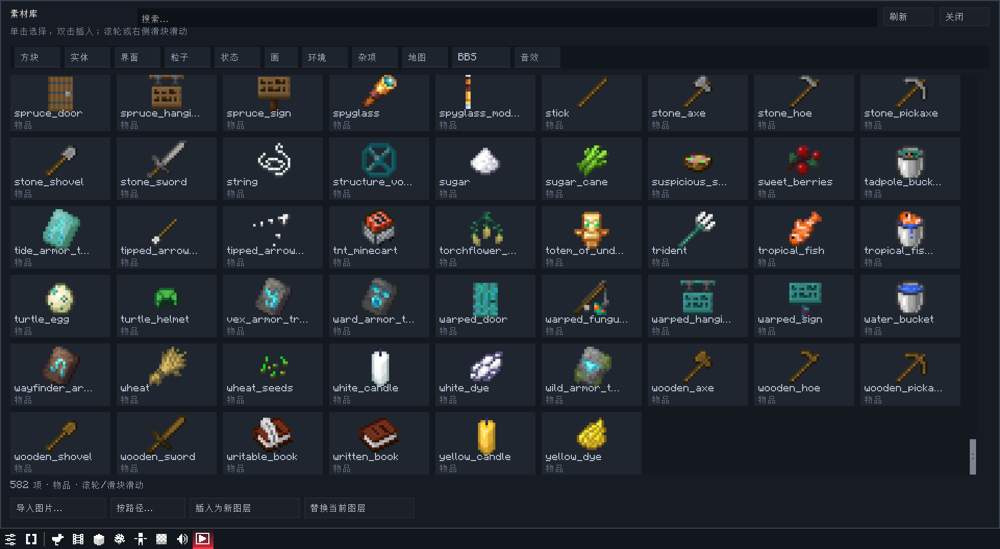
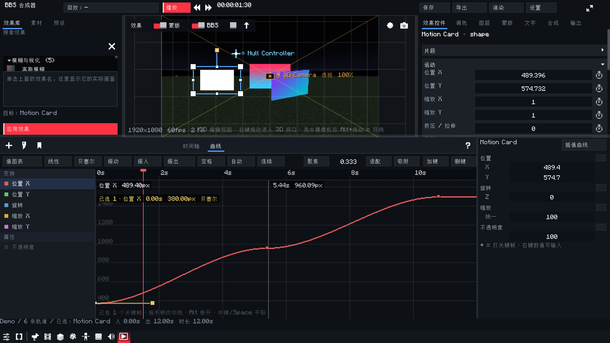
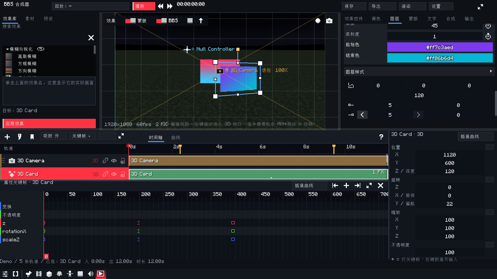

# BBS Compositor (`bbsae`)

<p align="center">
  
</p>

<p align="center">
  <b>作者 / Author：终end</b> · <a href="https://github.com/zhongend">@zhongend</a>
</p>

> 交接文档：**[docs/HANDOFF.zh.md](docs/HANDOFF.zh.md)**（当前架构、已实现功能、关键 bug、未完成项、构建/重映射流程）。

- **Source:** <https://github.com/zhongend/bbsae>
- **Issues:** <https://github.com/zhongend/bbsae/issues>
- **Feature matrix:** [`docs/features.zh.md`](docs/features.zh.md)
- **UI architecture:** [`docs/ui-architecture.zh.md`](docs/ui-architecture.zh.md)
- **Photon research:** [`docs/photon-research.zh.md`](docs/photon-research.zh.md)
- **Developer handoff:** [`docs/HANDOFF.zh.md`](docs/HANDOFF.zh.md)
- **中文图文介绍 / Chinese gallery:** [`docs/GALLERY.zh.md`](docs/GALLERY.zh.md)
- **Round 8 (Alight Motion PIXEL effects):** [`docs/ROUND8-01-AUDIT.zh.md`](docs/ROUND8-01-AUDIT.zh.md),
  [`docs/ROUND8-02-PIXEL.zh.md`](docs/ROUND8-02-PIXEL.zh.md),
  [`docs/ROUND8-03-VERIFY.zh.md`](docs/ROUND8-03-VERIFY.zh.md),
  [`docs/ROUND8-04-PUBLISH.zh.md`](docs/ROUND8-04-PUBLISH.zh.md)
- **Round 9 (export fidelity / duration / icon):** [`docs/ROUND9-EXPORT-SYNC.zh.md`](docs/ROUND9-EXPORT-SYNC.zh.md)
- **Round 10 (drag layer reorder):** [`docs/ROUND10-LAYER-REORDER.zh.md`](docs/ROUND10-LAYER-REORDER.zh.md)
- **Round 11 (asset library fix + blur):** [`docs/ROUND11-ASSET-LIBRARY.zh.md`](docs/ROUND11-ASSET-LIBRARY.zh.md)
- **Round 12 (AE curves / presets / parenting / shape corners, v0.2.0):** [`docs/ROUND12-CURVES-PRESETS-PARENTING.zh.md`](docs/ROUND12-CURVES-PRESETS-PARENTING.zh.md)
- **Round 13 (camera rewrite / 3D parenting / multi-select / performance, v0.3.0):** [`docs/ROUND13-CAMERA-MULTISELECT-PERF.zh.md`](docs/ROUND13-CAMERA-MULTISELECT-PERF.zh.md)
- **Round 14 (UI density / flat buttons / tooltips, v0.4.0):** [`docs/ROUND14-UI-DENSITY-FLAT.zh.md`](docs/ROUND14-UI-DENSITY-FLAT.zh.md)
- **Round 15 (BBS-native preview + world depth / pre-render cache / UI performance, v0.5.0):**
  [`docs/ROUND15-PREVIEW-CACHE-PERF.zh.md`](docs/ROUND15-PREVIEW-CACHE-PERF.zh.md)
- **Round 16 (curve editor redesign — jank analysis, render architecture, AE parity plan):**
  [`docs/ROUND16-CURVE-EDITOR-DESIGN.zh.md`](docs/ROUND16-CURVE-EDITOR-DESIGN.zh.md)
- **Round 17 (curve editor P0+P1 — column-span geometry, blank-page fix, v0.6.0):**
  [`docs/ROUND17-CURVE-PERF.zh.md`](docs/ROUND17-CURVE-PERF.zh.md)
- **Round 18 (visible curves / asset import / video+audio export / single-page library / solid
  stage / camera semantics, v0.7.0):**
  [`docs/ROUND18-CURVE-IMPORT-EXPORT-CAMERA.zh.md`](docs/ROUND18-CURVE-IMPORT-EXPORT-CAMERA.zh.md)
- **Round 19 (AE encoder mode — frame server pipeline for preview and export, v0.8.0):**
  [`docs/ROUND19-AE-ENCODER.zh.md`](docs/ROUND19-AE-ENCODER.zh.md)
- **Round 20 (AE pipeline: disk frame cache, render budget, raw-frame pipe, preview audio,
  proxy resolution, v0.9.0):** [`docs/ROUND20-AE-PIPELINE.zh.md`](docs/ROUND20-AE-PIPELINE.zh.md)
- **Round 21 (timeline zoom, audio and video tracks, narrow-panel fix, v0.10.0):**
  [`docs/ROUND21-TRACKS-AND-AUDIO.zh.md`](docs/ROUND21-TRACKS-AND-AUDIO.zh.md)
- **Round 22 (Blender-style 3D viewport camera — free orbit/pan/zoom, source-texture draft
  rendering, v0.11.0):** [`docs/ROUND22-CAMERA-VIEWPORT.zh.md`](docs/ROUND22-CAMERA-VIEWPORT.zh.md)
- **Round 23 (viewport usability: right-drag orbit, gradients, motion path, plane-depth stacking,
  first-open layout, playback flicker, v0.12.0):**
  [`docs/ROUND23-VIEWPORT-FIXES.zh.md`](docs/ROUND23-VIEWPORT-FIXES.zh.md)
- **Round 24 (viewport input polling, layer-space effects in the export path, mask/exclude,
  effect thumbnails, layer quick panel, v0.13.2):**
  [`docs/ROUND24-VIEWPORT-MASK-QUICKPANEL.zh.md`](docs/ROUND24-VIEWPORT-MASK-QUICKPANEL.zh.md)
- **Round 25 (replay entity layer — depth-keyed matte, native file dialog, v0.14.1):**
  [`docs/ROUND25-ENTITY-KEY-IMPORT.zh.md`](docs/ROUND25-ENTITY-KEY-IMPORT.zh.md)
- **Round 26 (owned Win32 file dialog, sound import, layer library, true 3D camera, v0.15.0):**
  [`docs/ROUND26-IMPORT-LIBRARY-CAMERA.zh.md`](docs/ROUND26-IMPORT-LIBRARY-CAMERA.zh.md)
- **Round 27 (playback clock / BBS-native curve picker / 3D XYZ quick panel, v0.16.0):**
  [`docs/ROUND27-PLAYBACK-CURVES-3D.zh.md`](docs/ROUND27-PLAYBACK-CURVES-3D.zh.md)
- **Round 28 (asset-library scrollbar / professional AE curve editor / plugin icon, v0.17.0):**
  [`docs/ROUND28-ASSETS-CURVES-ICON.zh.md`](docs/ROUND28-ASSETS-CURVES-ICON.zh.md)
- **Round 29 (onboarding / BBS-style settings / non-linear motion / editable keybinds, v0.18.0):**
  [`docs/ROUND29-UI-MOTION-ONBOARDING.zh.md`](docs/ROUND29-UI-MOTION-ONBOARDING.zh.md)
- **Photon attribution / 引用声明:** [`PHOTON-NOTICE.md`](PHOTON-NOTICE.md)

<p align="center">
  
</p>

> This repository does **not** redistribute the BBS FS jar. Download BBS FS 2.7-1.20.1 from its
> official Modrinth page and put `bbs-2.7-1.20.1.jar` in `libs/` before building.

A screen-space compositor for **BBS FS** films, built as a BBS addon for **Minecraft 1.20.1 / Fabric**.

The compositor adds a 2D/2.5D layer on top of BBS's finished 3D frame: text, shapes, images,
solid layers, nulls, adjustment layers, precomps, masks, feathered mattes, effects, layer styles,
parenting, tracked bindings and a native-keyframe timeline. The result is drawn through BBS's
official `RegisterFrameOverlaysEvent`, so it is included in BBS's preview **and in its FFmpeg film
export** without touching the `.dat` film format.

## Download / Install

1. Download [`bbsae-0.18.0.jar`](https://github.com/zhongend/bbsae/releases/download/v0.18.0/bbsae-0.18.0.jar)
   from the **v0.18.0** release (the asset is updated with each source push).
2. Install **Minecraft 1.20.1**, **Fabric Loader 0.16.14+**, **Fabric API 0.92.1+1.20.1** and
   **BBS FS 2.7-1.20.1**.
3. Put `bbsae-0.18.0.jar` and the BBS FS jar into the game's `mods/` folder.
4. Launch the game, open a film in BBS, select a replay, then use
   **Replay properties → Compositor → Open Film Compositor**.

## Gallery

> 中文版图文介绍（含逐张说明）见 **[docs/GALLERY.zh.md](docs/GALLERY.zh.md)**。

### The editor, not an overlay

<p align="center">
  
</p>

BBS Compositor opens as an **independent BBS dashboard panel**, not a transparent overlay on the
film editor. The layout follows a Premiere-style information architecture:

1. **Effects library** — search, categories and a recent list; double-click applies to the selected track.
2. **Live FBO preview** — the compositor renders into its own framebuffer with selection handles,
   safe-area/grid overlays, and **FX / Mask / BBS-world** toggles for A/B comparison.
3. **Effect Controls** — motion, opacity, blend mode, the applied-effect stack, layer styles,
   masks, text, grade, and the context-sensitive Layer/Comp/Output pages.
4. **Track timeline** — one row per layer, movable/trimable clips, frame snapping, work-area
   shading, markers and a BBS-native keyframe drawer. Drag the **left grip** of a track header
   to reorder layers vertically (blue insertion line), without hunting through the context menu.

<p align="center">
  
</p>

### 53 effects, including the Alight Motion PIXEL family

The compositor ships a curated catalogue rather than a wall of half-implemented effects. It covers
blur, colour, keying, generate, distort, stylize, transitions and depth. Round 8 added seven
screen/retro effects built on the shared PIXEL shader:

**Scanlines · Glitch · VHS · Halftone · Emboss · Mirror · Kaleidoscope**

<p align="center">
  <a href="docs/verify/round8-pixel-effects.png">
    
  </a>
</p>

Halftone uses Alight Motion-style properties (dots across the project width, strength, angle, row
phase, ink/paper colours); Mirror overlays a mirrored copy with an opacity control. All seven run in
**layer space**, so the pattern follows the layer when it is moved, scaled or rotated.

### Grading, assets, 3D and export

|  |  |
| :---: | :---: |
| **AE-style grading** — lift/gamma/gain wheels, five-point master curve, presets and keyframeable exposure/contrast/saturation/vibrance. | **Asset library** — project media plus the client's item/block/entity/gui textures; search, thumbnails and a draggable scrollbar. |

|  |  |
| :---: | :---: |
| **3D camera and 2.5D cards** — free camera, depth ordering, adjustment layers and precomps. | **BBS-native export** — resolution/aspect/fps presets write into BBS's recorder, then F6 renders the real film. |

|  |
| :---: |
| **A real 1920×1080 @ 60 fps export** — 494 frames, 8.23 s, with the compositor layers baked into the MP4. |

### Built on BBS's own frame path

The compositor does not re-encode films or patch `.dat` files. BBS serializes a small
`bbsae:composition` camera clip; `CompRenderer` draws the layer stack at the
`RegisterFrameOverlaysEvent` point. That means the same composition appears in BBS's preview and in
its FFmpeg film export, and BBS keeps ownership of keyframes, undo, project storage and video
encoding.

## What's new in 0.18.0

**A first-run onboarding, a BBS-style settings surface and editable shortcuts — and every custom
widget now moves with a non-linear curve instead of snapping.**

*Onboarding.* The compositor opens on a BBS-style welcome card: layout presets (标准 / 专注 / 紧凑 /
宽屏), a motion preset (平衡 / 电影感 / 极简), a shortcut scheme, and a short finish page. The
background is the same visual language as BBS's own landing screen — a deep surface, drifting
lights and a pointer-following glow — and the choice is persisted, so it only appears once. It can
be replayed from Settings → 新手引导.

*Settings.* The old fixed 520×520 modal is replaced by a left category rail + right scrollable list
in the style of BBS 2.7's settings: search, section headers, toggles, sliders and segmented choices.
Motion intensity/speed, glow, shadows, backdrop brightness, layout density, project defaults,
encoder/proxy and the shortcut editor all live here. The overlay enters with a short overshoot,
rows light up under the pointer and category switches sweep an accent line.

*Shortcuts.* Every compositor command is now an action in one table with a default for the
Premiere and BBS schemes. Click a keycap, press the new combination, and it is saved globally;
Backspace clears a binding, Esc cancels, and conflicting actions are reported in the status bar.
`Ctrl+,` opens Settings and `Ctrl+/` jumps straight to the editor.

*Motion.* A shared `UiMotion` layer drives button hover, tab underlines, tile/card entrance,
asset-library scroll smoothing, track selection, panel entrance and the new overlays. Settings can
turn it off or reduce intensity/speed; all motion is paint-time only, never in the frame/export
path. The `UiMotion` easings and the shortcut table are covered by unit tests.

<p align="center">
  
</p>

<p align="center">
  
</p>

## What's new in 0.17.0

**The asset scrollbar drags, Bezier handles drag from where they are, and the project icon is finally
the plugin's icon.**

*Asset library scrollbar.* The 3 px line was painted, never hit-tested. It is now a real 8 px thumb:
drag it, click the track to jump, release anywhere (the physical button is polled so it cannot stick),
hover highlights, and the grid reserves room so the thumb never covers a tile. The hint says
“滚轮或右侧滑块滑动”.

*The curve editor was editing the wrong property.* All five transform curves share one BBS
`Transform` keyframe. The editor stored `IdentityHashMap<Keyframe, channel>` ownership, so the last
adapter (Scale Y) overwrote Position X: dragging a position key changed Scale Y, and the
Bezier/Ease presets filtered the selection to nothing. Ownership now comes from the **active
channel** for transform keys; scalar channels keep their one-to-one map.

*Bezier handles no longer collapse on mouse-down.* The drag handler treated the pointer delta as the
handle's absolute offset, so the first 1 px collapsed `rx` to 0.25 and `ry` to 0. It now snapshots
`rx/ry/lx/ly` at press and adds the delta, clamps influence to the adjacent segment, mirrors by
default, breaks with Alt, and reports influence/speed. Default ±5-frame handles are expanded to
33.3 % influence when Bezier is chosen; value fitting includes the handles so they cannot be clipped.

*Professional graph ergonomics.* Middle/Space drag pans **both** axes; right-clicking a key exposes the
interpolation menu (linear / bezier / ease / ease-in / ease-out / hold / auto / continuous / delete);
arrow keys nudge 1 frame / 1 pixel (Shift = 10×); the graph shows a selected-key card (channel, time,
value, interpolation) next to the playhead readout.

*The plugin icon.* `fabric.mod.json` had no `icon`, so Mod Menu showed a placeholder. The repository's
32×32 compositor icon (by 超级大布叮) is now packaged as a 128×128 padded, rounded
`assets/bbsae/icon.png` and registered in the metadata; the BBS 16×16 tab/clip icon stays the
original. `IconResourceTest` checks both.

<p align="center">
  
</p>

## What's new in 0.16.0

**The preview runs at the film's speed, the clip picker speaks Chinese, and 3D layers get
their XYZ back.**

*The clock was a unit error.* `startRenderFrame(tickDelta)` added `tickDelta / 20` once per
rendered frame, but BBS passes Minecraft's **fraction of the current client tick** there, not the
elapsed time since the previous frame. Summing the sawtooth happened to give 1× at 60 fps, ran
**3.6× too fast at 144 fps** and 0.5× at 30 fps. Playback now advances by wall-clock seconds with
a 0.5 s stall clamp, reset on resume/seek, so one second of composition is one second of film.
`CompTimeTest` reproduces the old refresh-rate dependence and checks the new clock at
30/60/90/144/240 fps.

*The clip picker no longer shows a translation key.* BBS labels a clip type through
`UIKeys.C_CLIP` (`bbs.ui.camera.clips.<link>`). A missing entry falls back to the key itself, so
the add-clip menu showed `bbs.ui.camera.clips.bbsae:composition`. The addon now registers that
key — and the legacy `composition` spelling — through `RegisterL10nEvent`, with a post-ready
fallback, and new clips are titled `合成器` from the start.

*The 3D layer quick panel is 3D.* The right-hand quick panel switches from five 2D rows to ten
3D rows: position X/Y/Z, rotation X/Y/Z and scale X/Y/Z, each group with its own ◆ key button.
Z depth, pitch, yaw and Z scale write the layer's scalar channels, the same channels the 3D scene
graph reads.

*BBS's own curve picker is one click away.* A **插值曲线** button in the keyframe drawer header
and in the quick panel opens BBS's `UIInterpolationContextMenu`: the graph preview, the full
icon grid (linear/hold/bezier/auto/ease/bounce/elastic/…), the four bezier arguments and
copy/paste. It applies to every selected keyframe, or selects the key at the playhead first.

*First-key buttons work.* The inspector's ◆ was disabled until a scalar channel already existed,
and `addScalarKey` read fields `CompLayer.scalar()` did not know (`z`, `rotationX/Y`, `scaleZ`,
`squash`, camera distance/target/FOV), inserting 0. Every scalar field is now readable, the
current displayed value is passed explicitly, and the key action starts its undo checkpoint
before writing.

<p align="center">
  
</p>

## What's new in 0.10.0

**The timeline zooms, and audio/video finally have tracks.**

*Zoom was a unit error.* BBS's `Scale.zoom(delta, min, max)` **adds** to a value measured in pixels
per second; the editor passed ±1, so every key press and wheel notch changed the scale by 1.7 % — a
dead control. A step is now 1.35× (`zoomTarget`), applied through the same additive API and anchored
at the cursor, with `Alt + =/-` for track height. Two tests drive BBS's real `Scale` to prove that one
step is exactly 1.35× and that in/out steps cancel.

*Audio is a track now.* The timeline's rows were exactly `doc.layers`; audio clips lived only in the
inspector. There is now a virtual audio row (`rowCount()` = layers + 1) with the same time axis, row
height and scroll: green bars, click to select, drag to move, 8-px edges to trim (the source offset
follows a trim-in), `Delete` removes the selected clip — and the bar length is the length stored at
import (`probeDuration`), so what you see is what the mixer plays.

*Video is a track now.* `footage` layers already consume `frame_%04d.png`, but nothing produced those
frames. `CompVideoImport` converts a video with FFmpeg on a worker thread — at the composition's frame
rate and raster, letterboxed, 60 s cap — then creates a footage layer on the client thread. The
compositor can then ask for frame 91 in any order, which is the whole point of the frame pipeline.

*Two UI bugs.* A side-by-side layout at ~360 logical pixels squeezed the preview to a negative width
(so it silently stopped drawing); both columns now shrink proportionally with a 160 px preview floor.
And the effect/mask/world-backdrop toggles are hidden in AE mode, where they cannot change the frame.

## What's new in 0.9.0

**The AE pipeline got the four things it was missing.**

*Disk frames.* The frame server now has an L2 on disk keyed by the **content fingerprint**
(`cache/frames/<project>/<comp>/<signature>_<frame>_<w>x<h>.rgba`). Because the file name *is* the
document state, an entry can never be stale: different content means a different file. Raw pixels
(no PNG round-trip — 1080p ImageIO is slower than re-rendering a simple comp), written only for
frames that took ≥ 45 ms, 512 MB budget with oldest-first eviction.

*A render budget instead of one frame per tick.* GL lives on the render thread — a background render
thread would need a shared context and would fight Minecraft's state. So the "farm" spends 22 ms of
each 50 ms tick producing frames (up to 6), which removes the hard 20 fps ceiling: a 12-second
60 fps composition used to take 36 s to write even at 3 ms a frame. And full-size video now streams
**raw RGBA frames into FFmpeg's stdin** instead of writing a PNG per frame, which was the real
bottleneck. Resized presets, PNG sequences and "keep frames" keep the file path (and its resampler).

*Preview audio.* The composition's mix is rendered on a worker thread and played through BBS's own
OpenAL (`SoundBuffer`/`SoundPlayer`), so there is no second audio backend. The playhead is
authoritative: `sync(time)` corrects drift over 250 ms and handles loops, and one
`syncPreviewAudio()` derives everything from `(playing, AE, has audio, toggle)` — so any code that
pauses playback also stops the sound.

*Proxy resolution, explicit.* `encoderProxy` 1/1, 3/4, 1/2, 1/4 in Settings; the badge reads
`AE 编码器 · 代理 1/2`. The frame cache keys on the factor, and export is always 1/1 — a silent
proxy is how "the preview looks soft but the export is sharp" becomes a bug report.

## What's new in 0.8.0

**A second render pipeline, and it is the one an editor needs.** Until now the composition was an
overlay: the game produced the frame, at window resolution, at display-refresh timing, and BBS's
recorder wrote it. That is correct for a film overlay and wrong for an editor, where "frame 90"
must mean the same picture in the viewer and in the file. **AE 编码器模式** (Settings → 渲染 / 编码
管线) switches the frame source to the compositor:

- `CompRenderer.renderFrame(project, doc, frame, alpha)` is now the **only** way a frame leaves the
  compositor: time comes from the frame index (`frame / fps`), the raster is the composition's own
  resolution, editor chrome is suppressed, guide layers are excluded.
- `CompFrameServer` caches those frames, keyed by the document fingerprint — editing anything makes
  the old frames unreachable, so there is no invalidation to forget. 192 MB LRU (~23 frames of
  1080p).
- The preview asks the server for the playhead's frame; the render queue asks it for every frame of
  the range. Same function, same pixels. This is the producer/consumer "pull" model MLT uses and
  the `RenderManager` + `FrameHashCache` design Olive uses.
- **AE 导出** (the header button changes label) queues the composition at its own resolution and
  frame rate instead of going through BBS's recorder.

It is a different pipeline, so it is labelled like one: a one-time **risk dialog** (six concrete
consequences, not a disclaimer), a red **AE 编码器 / 帧 N / total** badge on the preview, and a red
hint in Settings. The honest limitations: the 3D world can only enter through the `BBS 预览` layer,
and offline exports see its **last** captured frame; depth effects lose their depth; the BBS
recorder keeps rendering in BBS mode, so the two paths never mix.

## What's new in 0.7.0

**The curve is a curve again.** The editor opened on a fixed **-100…100** value axis and a view
length of `frames / 24` seconds, so a position channel (values in the hundreds) and a 12-second
60 fps composition were both framed wrong: every sampled Y landed outside the graph rectangle, the
clip removed the line, and only the keyframe glyphs survived. The graph now frames its own data
(value axis from the active channel's keys, time axis from the composition duration), pins
out-of-range values to the edge like AE, and refills its per-column spans every frame — the
incremental span cache whose invalidation could not be proven is gone (0.2 ms/frame against a
screenshot that showed neighbouring columns jumping between unrelated values).

**Importing a file works inside the game.** `UIFileDialogs.pickFile()` is a native tinyfd window: on
a fullscreen game it can open behind the window or never call back at all, which is why the import
button looked dead. Images, fonts and audio now go through an in-game browser
(`UIImportBrowser`) with drives, folders, an extension filter and a typed path; the freshly
imported file is selected in the asset library immediately.

**Video and audio export.** The composition has a real audio track (in-point, offset, gain, fades,
loop, mute). `CompAudioMixer` renders it to 48 kHz stereo with a pure function, and that same mix
feeds the MP4's AAC track, the standalone WAV module and the PNG sequence folder. Video export pads
audio before `-shortest` so the last frame is never dropped; a range export now plays the *right*
part of a clip (`seek = exportStart - clipStart`, previously every range export started the music
from 0). The render queue's output module is a chooser with real names and a video/audio icon
instead of a text field for internal preset ids.

**The asset library is one sliding page.** The old modal pinned everything to a 620×400 rectangle;
below that the action row was off-screen ("the button does nothing"). Categories slide
horizontally, the thumbnail grid scrolls vertically, and the footer switches between short and long
labels by width. The render queue's field row no longer uses `UIElement.row()`, which ignores child
widths and was squeezing a 110-px label column into a quarter-width box.

**The stage is solid.** A transparent composition over the live game world read as "the panel is
broken". The stage colour is opaque by default, the world backdrop is an explicit toggle, and
`CompRenderer.stageColor()` is the single place that decides (backdrop preview → transparent,
alpha export → transparent, everything else → the document colour). Existing projects migrate once.

**Camera semantics.** A camera is a view, not content: hiding its row or trimming it no longer
switches the composition back to 1:1. The gizmo, its hit test and its drag all read the animated
transform (`cameraEye`), and `layerAt()` reuses `handleAt()` instead of maintaining a second copy of
the geometry — clicking the camera body now works wherever it is drawn.

## What's new in 0.6.0

**The curve editor stopped drawing a line per pixel.** `line()` walked every pixel of a segment
and emitted a quad per step, so a steep curve cost thousands of quads per frame and got slower the
further you dragged a handle. Curves are now rasterised into a **per-column span cache**
(`CurveSpans`): one rectangle per screen column, merged into runs when the span is identical.
Vertex count is bounded by the width of the graph instead of by the data, and an unchanged curve
costs zero evaluations.

**Editing only recomputes what changed.** A handle drag rebuilds the 20–80 columns of the affected
segment instead of resampling the whole graph; the five transform axes share one key list, so they
invalidate together (a shared epoch) while scalar channels keep their own revision counter.

**Release no longer jumps.** A drag used to rebuild the entire inspector and every keyframe sheet
on mouse-up — 3–10 ms landing exactly on the frame you let go. A drag now only re-runs the
inspector's value bindings; only adding/removing keys rebuilds widgets.

**Preview follows the curve.** Dragging used to leave the pre-render cache answering with the last
green frame (a regression from 0.5.0: `markDirty()` only ran on save). A drag now invalidates the
cache every frame, drops the preview to 0.7× resolution while the mouse is down, and — when the
playhead sits outside the edited segment — reuses the frame it already has instead of re-rendering
the whole graph.

**The blank curve page is fixed.** The strip was laid out only when the tab was clicked, so a
dashboard page switch (or entering a precomp, or the render view) could leave the curve editor
visible with a zero-height rectangle — and a negative clip silently erases everything. The strip is
now reconciled every frame from `(page, visibility, area)`, the graph area is clamped to at least
1×1, and a strip too short to host a graph falls back to the timeline with a message. Switching to
the curve page also grows the strip to 55% of the panel once.

**Smaller fixes.** Modifiers in the curve area go through GLFW instead of `Screen.hasAltDown()`
(Alt-broken handles were intermittent); the active channel survives an inspector edit (it used to
jump back to "位置 X" because the check compared object identity); `keyAt`/marquee iterate the raw
key list instead of allocating a `Key` per keyframe per frame; grid labels and the value readout
are cached per view/frame instead of `String.format`-ed every display frame.

Value-axis zoom stays on **Ctrl+wheel** (as requested), not AE's Alt+wheel.

Tests: **119/119**.

## What's new in 0.5.0

**The preview is BBS's preview now.** The compositor used to paint the film frame only if a
toggle callback happened to request it, cropped it to fill the composition rectangle, and had no
depth at all — a `depth_*` effect silently did nothing while previewing. Three changes:

1. The world frame and its **depth buffer** are copied together at the end of the world render
   (`SceneDepth.captureFrom`), so colour and depth always come from the same frame, and depth
   effects see the film's real geometry.
2. The capture request is re-derived from the document every frame instead of only from a toggle,
   so a project saved with the world backdrop — or a one-click 3D workspace — actually gets it.
3. The world frame is drawn **contained** (letterboxed), exactly like BBS's own preview, instead
   of cover-cropped into the composition rectangle.

**Pre-render cache with a green bar.** Press **预渲染** in the timeline toolbar and the ruler
fills with a green strip. Green frames are served from a disk+VRAM cache
(`config/bbsae/cache/…`, raw RGBA + deflate, 1280×720 cap) instead of being re-rendered, so a
composition with a dozen effects plays back smoothly. The pass is cooperative — two frames per
display frame, 18 ms budget — and any edit invalidates the green immediately.

**The editor stopped writing the project to disk on every mouse event.** `save()` used to
serialize the whole project (megabytes of JSON) and rewrite the file for every slider tick, wheel
notch and drag delta; it is now a dirty flag with a debounced write. That single change removes
most of the "the UI is extremely laggy" symptom.

**Preview renders at display resolution.** A 1920×1080 composition shown in a 700 px panel used to
render 2.07 M pixels to display 0.28 M. The render targets now follow the viewport
(`CompRenderContext.scale`), which is a 7× reduction in per-pass cost with no coordinate changes.

**Camera.** Wheel now dollies *towards* the composition (it used to zoom out), Alt+wheel narrows
the field of view, Alt is read from GLFW instead of `Screen.hasAltDown()`, and the inspector is no
longer rebuilt on every wheel notch.

**Alt+wheel resizes the tracks.** It was bound to horizontal timeline zoom; row height was hidden
behind Alt+Shift. Now Alt+wheel is track height (18–62 px), Ctrl+wheel zooms time.

**Curve editor.** The value axis is fitted to the **active channel** instead of every visible
channel — position (0–1080) and opacity (0–1) on one axis turned the graph into a flat line at the
bottom. Only the active channel's curves, keys and handles are drawn and hit-tested by default
(`聚焦` overlays the rest), and the cursor shows a crosshair with a live time/value readout.

See [`docs/ROUND15-PREVIEW-CACHE-PERF.zh.md`](docs/ROUND15-PREVIEW-CACHE-PERF.zh.md).

## What's new in 0.4.0

**UI density: small / medium / large, auto-following BBS.** Everything — row height, control height,
label column, icon size, panel widths — now derives from one density number (`CompUi`). "Auto" reads
BBS's applied GUI scale: 1–2 → large, 3 → medium, 4+ → small. That inversion is deliberate: a scale
of 4 leaves a 480×270 logical canvas, so tall rows simply do not fit, while scale 1 has room to
breathe. Switch it in Settings → 界面密度; it is saved per project.

**Flat buttons instead of accent blocks.** BBS's `UIButton` fills itself with the theme's primary
colour; forty of those in an inspector is a wall of saturated blocks. `UICompButton` keeps all of
BBS's click/hover/tooltip behaviour and changes only the skin: raised-surface fill, hairline border,
left-aligned label, accent reserved for the single primary action of a surface (play, enter
compositor, apply effect). One-symbol actions became icon buttons.

**Every button explains itself on hover.** `CompUi.describe` is a vocabulary of 70+ Chinese
descriptions covering the panel's buttons; `UICompButton` sets the tooltip automatically from its
label, and unknown labels still get a sentence. A test fails if a known label loses its description.

See [`docs/ROUND14-UI-DENSITY-FLAT.zh.md`](docs/ROUND14-UI-DENSITY-FLAT.zh.md).

## What's new in 0.3.0

**One camera, finally.** The compositor used to have two unrelated camera paths (a 2D pan/zoom built
from `scale.x`, and a 3D perspective camera gated behind a `camera3D` toggle), plus a Y-flip hack in
the 3D matrix. They disagreed about zoom and framing, and the 3D projection called JOML's affine
`transformPosition` instead of `transformProject` — so 3D layers landed at coordinates like
`-230646px`. Everything now derives from one pose: one space (comp pixels, Y down, Z toward the
viewer), one `CompCamera`, one `CompScene`. The 2D view is literally the 3D camera sampled at z = 0,
which is why switching a layer to 3D no longer changes its size or position (pinned by a test to
0.1px). Drag the camera body to pan, the crosshair to aim, the wheel to dolly, Alt+wheel for FOV.

**3D parenting.** With one scene graph, 3D parenting is the same change of basis as 2D — plus a
Rz·Rx·Ry decomposition so z / tilt / scaleZ survive. Whole-matrix equality is asserted in tests.

**Multi-select and pre-compose.** Ctrl/Shift selection in the track timeline, Ctrl-click in the
preview, drag the whole selection, and a batch panel: combine into a pre-render (time rebased,
parent/matte relations retargeted), group under a null, align, distribute, show/hide/lock,
duplicate, delete.

**Performance.** The editor re-rendered the entire graph every display frame even while parked.
A content fingerprint now caches the composed frame (and quantises time to the composition frame
rate); the 1-second full-project JSON snapshot only runs when the document is dirty and is capped at
32MB; depth/world captures are on demand; the per-frame `glGetError`/`glCheckFramebufferStatus`
syncs are gone; the FBO pool no longer destroys and recreates 8MB textures mid-frame.

See [`docs/ROUND13-CAMERA-MULTISELECT-PERF.zh.md`](docs/ROUND13-CAMERA-MULTISELECT-PERF.zh.md).

## What's new in 0.2.0

**AE curve editor.** The bottom strip now has a `时间轴 / 曲线` switch. The curve view is a real
After Effects graph editor: value graph and speed graph, per-keyframe bezier handles with
mirrored/Alt-broken tangents, marquee selection, drag-to-retime with frame snapping, double-click
to add a key, AE keyframe glyphs (square = linear, circle = bezier, diamond = hold), eight easing
presets (linear / bezier / easy ease / ease in / ease out / hold / auto / continuous) with an
influence field, and a channel list that shows every animated property —
position/rotation/scale as separate curves, opacity, effect parameters, mask points, shape corners.

Why it needed engine work: BBS evaluates a `Transform` channel with one interpolation for the whole
vector and ignores `lx/ly/rx/ry`, so handles could never bend position/scale/rotation.
`CompCurves` now evaluates each component with the same `BezierUtils` math BBS uses for float
channels — the curve the editor draws is exactly the curve that renders.

**Layer presets.** A third left-column tab: save the selected layer as an animation / effect-stack /
style / shape / whole-layer preset, apply it to any other layer, or use the ten built-in looks.
Effect and shape ids are remapped on apply (including their animated channel paths), and animation
payloads are re-timed to the target layer's in point.

**Parenting no longer teleports.** Binding used to write `parentId` and let the parent matrix
multiply the child, so a child at (900, 500) bound to a parent at (200, 100) jumped by (200, 100)
times the parent's rotation and scale. `CompParenting` now does a change of basis
(`local' = parentWorld⁻¹ · childWorld`), shifts every transform key by the same delta, and converts
preview drags into parent space so the layer stays under the cursor.

**Shape corners and colours.** Per-corner radii for rectangles (4) and triangles/polygons/stars
(one per vertex), round or bevel joins, animatable per corner; and shapes now paint their own fill
and stroke instead of the whole layer taking the last shape's colour.

See [`docs/ROUND12-CURVES-PRESETS-PARENTING.zh.md`](docs/ROUND12-CURVES-PRESETS-PARENTING.zh.md)
for the derivations, the file map and the verification list.

## Status

This is the third vertical slice: the data model, render graph, editor, per-replay project
isolation, timeline scrubbing and render queue are in place. It is not a finished AE clone, and
the feature matrix in [`docs/features.zh.md`](docs/features.zh.md) is deliberately explicit about
what is and is not implemented.

Verified in this iteration:

- `compileJava` and all **119** tests pass (headless model + real hidden-window OpenGL 3.2 pixel
  tests + export-duration/icon checks + the new curve/parenting/preset/shape assertions);
- the addon loads in a Fabric 1.20.1 + BBS 2.7 development client;
- the compositor preview renders the composition (not a blank frame) after fixing projection,
  model-view and mask-transform state;
- the BBS film recorder produced a real H.264 MP4 (`320x180`, 20 fps, 39 frames) and the exported
  frame contains the compositor layers, proving the frame-overlay path reaches the video file;
- the final jar has Minecraft references remapped to intermediary and keeps BBS class names.

Build artifact: `build/libs/bbsae-0.6.0.jar` (also copied to `bbsae-0.6.0.jar`), **548025** bytes,
SHA-256 `b4ab3d93cf64e8eaa154542b1a42a3da2e1df22e224196f04009de44185aef92` (check the file if it is
repacked). The jar is produced by `gradlew build`; `remapJar` writes it directly and the class
entries are intermediary-remapped.

2026-10-24 interaction-logic pass (see `docs/INTERACTION-AUDIT.zh.md`):

- precompose now rebases the inner layer to 0 (in/out, keys, markers), keeps the source's stack
  index and transfers parent/matte relations; the previous code could make a layer starting at 5s
  disappear and jump the result to the top;
- selecting a keyframe now moves the playhead, so the Effect Controls edit the selected key
  instead of writing a second key at the old playhead;
- the Layer page's in/out fields use the same `trimInTo/trimOutTo` semantics as the timeline;
- errors use `notifyError` instead of assignments to `status.label` (render overwrote them every
  frame); the export dialog has one Start button and accepts 0 as "composition duration";
- material replacement has an explicit replace mode; precomp placeholders are preview-only;
- discrete commands create action-level undo checkpoints, and style reorder/3D exit/comp rename/
  precomp breadcrumb/work-area handles/keyframe-tick hit testing are in place. 66/66 tests pass.

2026-10-18 asset-library hotfix:

- the asset browser's `mc:` marker was passed to `Identifier` as a namespace (`mc`), but vanilla
  resources live in `minecraft`; every item/block/entity thumbnail failed to load and inserted
  layers had no texture. `mc:` is now mapped to `minecraft`;
- added `InterfaceBlur.applyUnder()` plus a dark scrim behind the library;
- the panel is now 620×400 (5×3 thumbnails, 6 category columns) so the action buttons fit a
  1536×864 / GUI-scale-2 logical screen;
- evidence: [`docs/verify/round11-asset-library.png`](docs/verify/round11-asset-library.png),
  details: [`docs/ROUND11-ASSET-LIBRARY.zh.md`](docs/ROUND11-ASSET-LIBRARY.zh.md).

2026-10-18 ninth pass (export fidelity, 12 s duration, compositor icon):

- the export length now uses `max(film, composition)` instead of BBS's 12-second camera default;
  the composition clip is normalized (`tick=0`, full duration, opacity 1) and the film is saved
  before recording, so the recorder cannot stop early or miss trimmed clips;
- the **BBS preview layer** no longer disappears in the film-editor/F6 export path: the clean
  world frame is captured at `AFTER_TRANSLUCENT` into `SceneColor`, and a `bbs` layer can sample
  it outside the compositor panel too. The 2D overlay also disables depth writes and restores the
  UI scissor, so the export cannot inherit a stale composition/frame state;
- `workAreaOut` follows the composition duration (including migration of the old 12-second
  default), so preview playback no longer loops at 12 s;
- added the user-provided compositor icon as `assets/bbsae/assets/textures/gui/compositor_icon.png`
  (16×16), used by the dashboard tab and the `bbsae:composition` clip;
- the export dialog has an explicit **Export duration (seconds)** field (persisted as
  `CompSettings.exportDuration`, 0 = composition duration) and a **Sync to BBS timeline** button.
  The same field is available in the **compositor settings** after entering a project, with an
  **Apply export duration to composition + BBS timeline** button, so the length can be changed
  before opening the export dialog;
  the value is passed to BBS's native recorder directly as `round(seconds * 20) + 1` ticks, and
  `editorLoop` is disabled for the export. A 40-second setting produced **2402 frames /
  40.033 s** (`docs/verify/round9-export-40s-35s.png`, `round9-export-40s-ffprobe.txt`), a
  25-second composition produced 1502 frames / 25.033 s, and a 20-second run is kept at
  `docs/verify/round9-export-20s-15s.png`;
- **fixed the actual 20-second drag wall:** the field used to update only `exportDuration`, while
  the timeline clamps drags to `doc.duration`; the callback now calls
  `adoptCompositionDuration(seconds)`, extending `doc.duration`, work area, composition clip and
  BBS loop first. A layer can now be dragged from 20 s to 40 s (`layerCanMovePastTwentySeconds...`);
- a BBS-preview-layer-only export at `docs/verify/round9-bbs-preview-layer.png` proves the
  `bbs` layer now samples the clean world frame in the export path;
- tests now **65 / 65** (added `compositionExportDurationExtendsPastTheTwelveSecondFilmDefault`
  and `IconResourceTest`). Details: [`docs/ROUND9-EXPORT-SYNC.zh.md`](docs/ROUND9-EXPORT-SYNC.zh.md).

2026-10-18 eighth pass (Alight Motion PIXEL effects, first-principles bug audit):

- added seven PIXEL-family effects: **Scanlines, Glitch, VHS, Halftone, Emboss, Mirror,
  Kaleidoscope**; the catalogue now has **53** effects;
- every one operates in **layer space** through `EffectSpace` / `sampleLocal`, so the pattern
  follows the layer instead of staying glued to the composition;
- Halftone follows Alight Motion's properties (dots across the project width, strength, angle,
  row phase, ink/paper colours); Mirror now overlays a mirrored copy with an opacity control
  instead of discarding half the layer;
- fixed four dead parameters (`glitch.speed`, `vhs.speed`, `vhs.noise`, `depth_dof.focus`);
- fixed `EffectSpace.identity()` inverting the V axis (adjustment/3D-layer effects sampled the
  vertically flipped row) and `CompShaders.delete()` leaving a dangling `rgbSplit` program;
- new `PixelPlan` separates parameter resolution from GL so a headless test can prove every
  registry parameter reaches the shader; new GL pixel tests cover identity, layer space, colour
  and symmetry. Evidence: `docs/verify/round8-pixel-effects.png`.
- details: [`docs/ROUND8-01-AUDIT.zh.md`](docs/ROUND8-01-AUDIT.zh.md),
  [`docs/ROUND8-02-PIXEL.zh.md`](docs/ROUND8-02-PIXEL.zh.md),
  [`docs/ROUND8-03-VERIFY.zh.md`](docs/ROUND8-03-VERIFY.zh.md),
  [`docs/ROUND8-04-PUBLISH.zh.md`](docs/ROUND8-04-PUBLISH.zh.md).

2026-10-18 sixth pass (distortion, grading, landing screen, media/sound, export):

- distortion effects now measure strength in **pixels** and radius against the layer's half
  diagonal (`2π/wavelength` for waves); `pinch` gained its missing radius parameter. A real GL
  pixel test asserts that a bulge pulls transparent pixels into a square;
- the inspector has a real **grading page**: three AE-style colour wheels (lift/gamma/gain),
  a five-point master tone curve drawn with the same formula as the shader, presets and
  keyframeable exposure/contrast/saturation/vibrance/temperature/tint;
- the **landing screen** lists `.bbscomp` projects, creates new ones (name, canvas, fps,
  duration) and forbids editing until a project is chosen; shortcut scheme (Premiere / BBS) is
  selected there and persisted per project;
- all four panel areas are **draggable** (left, right, timeline, keyframe drawer) and the
  keyframe drawer height is saved; the old `row()` tab overflow is gone;
- the media library indexes 10 texture roots plus BBS textures, searches across every category,
  and has a sound library that auditions vanilla/BBS sound events, copies their ids and opens
  BBS's own sound overlay;
- layer duration has direct in/out/duration fields and 1s/2s/5s/fill buttons; settings add a
  default layer duration;
- 10 motion templates, a reworked block-shatter shader and a richer composition-clip inspector
  (project picker, fit choice, clip info, fixed “合成器” title);
- external replay playback can be configured to hide the compositor
  (`showDuringExternalPlayback`), detected with `BBSRendering.isCustomSize()` so F6 recording is
  never mistaken for external playback;
- export accepts custom width/height and a numeric aspect ratio; a real **1920x1080 @ 60 fps**
  export was produced (494 frames, 8.23 s) and a frame is at
  `docs/verify/round6-export-1080p60.png`.

2026-10-18 track-editor / Effect Controls pass (the Premiere-style correction):

- the bottom of the workspace is now a **real track editor**, not a small strip above a property
  sheet: one row per layer, a track header with visibility/lock, a movable/trimable clip bar,
  frame-snapped dragging, edge handles, snapping to the playhead/markers/other clips, zoom/pan,
  work-area shading and a proper seconds ruler;
- the layer stack is no longer a second list in the left column. Track headers are the single
  selection surface; clicking a bar selects its layer and feeds the right-hand panel. This removes
  the old duplicate "which list owns selection?" state;
- the right column is now **Effect Controls** by default: Motion (position/scale/rotation/anchor),
  Opacity + blend mode, the applied-effect stack and layer styles for the selected track. With no
  track selected it shows an explicit empty state instead of editing the last layer;
- the left column is a Premiere-style **Effects library** with search, categories, recent effects
  and a native `UIList` tree. Double-click or "Apply" adds the effect to the selected track; an
  effect can be enabled, reordered or removed in Effect Controls;
- the BBS keyframe editor moved into an optional drawer under the track timeline. Adding a keyframe
  opens it automatically; it fits the composition duration instead of the keyframes' bounding box;
- shortcuts were rebuilt around `KeyAction.PRESSED`: the old code also ran on key release, which
  made Space/S and other toggles fire twice and look broken. The new set adds J/K/L shuttle,
  frame/5-frame stepping, Home/End, edit-point and marker navigation, track selection/stacking,
  `[`/`]` trim to playhead, I/O work area, Alt+arrow nudging, C/Ctrl+K split, S snapping,
  `=`/`-`/`\` zoom/fit, F focus, Ctrl+S save, Ctrl+M export and Ctrl+/ shortcut help;
- split-at-playhead keeps footage continuous (`startTime` advances with the split), trim-in keeps
  the source frame under the cursor instead of slipping the clip, and moving a bar carries its
  keyframes and layer markers with it. These rules live in `CompLayer` and are covered by tests.

2026-10-18 UI pass (Chinese build):

- the whole compositor UI is Chinese: header, inspector tabs, every inspector field, effect names,
  effect parameter names and render-queue states;
- the inspector tab bar was replaced with a deterministic clickable bar (BBS's `UITabStrip` is a
  scroll view and swallowed presses inside the dashboard panel, so no tab could be switched);
- the timeline is primed on the first laid-out frame: sheets no longer stay blank until the user
  clicks something;
- Space toggles playback;
- opening the compositor now starts with a replay picker: a replay must be chosen before editing;
- export opens a small preset dialog (1280/1920/2560/3840, 16:9 / 9:16 / 1:1, 24/30/60 fps) that
  writes the values into BBS's own video settings and then runs BBS's native recorder, so export is
  no longer stuck at the old 320x180 preview size;
- toolbar regrouped: transport in the centre, save/export/render/focus anchored to the right, the
  add-layer button moved into the layer panel header.

2026-10-18 asset-library pass:

- **asset library** (materials button in the layer panel): a photo-library style browser with
  categories, thumbnails, search and paging. It indexes the project's own `assets` folder **and the
  client's resource packs** (`mc:textures/item|block|entity|gui`), so Minecraft item/block icons can
  be dropped straight into a HUD composition; double-click inserts, or replace the selected layer;
- layer stack is now drawn top-most first (AE convention), new layers appear on top;
- global undo/redo via 1-second project snapshots (Ctrl+Z / Ctrl+Y), plus Ctrl+D duplicate,
  Delete, Escape closes modals;
- Chinese default layer names, Chinese layer badges, label rows in the inspector use explicit
  two-column layout.

Implemented now:

- film/replay-scoped compositor projects: a film owns its project, every replay owns a separate
  composition inside it; the replay selector switches the edited composition;
- `.bbscomp` projects with multiple compositions, markers, master parameters and output presets;
- layer types: solid/panel/rect, bar, text, image/footage, shape, null, adjustment, precomp;
- in/out, start offset, time scale, freeze, keyframable source-time remap, layer markers, opacity,
  13 blend modes, parenting and track mattes (alpha/luma, normal/inverted);
- BBS-native `KeyframeChannel<Transform>` / `KeyframeChannel<Float>` animation, including effect
  parameters, text metrics, mask points/handles and shape trim/repeater values, edited with BBS's
  own `UIKeyframeEditor` (dope sheet, graph, context menus, interpolation, copy/paste);
- a real track timeline with a seconds ruler, playhead, work-area shading, track headers and
  movable/trimable layer bars; the BBS keyframe editor (dope sheet/graph/native keyframe dragging)
  opens in a drawer under the tracks when needed;
- masks with add/subtract/intersect/exclude, feather, opacity, positive/negative expansion,
  inversion, editable points and bezier handles;
- a curated **53-effect** catalogue (blur, color, keying, generate, distort, stylize, screen/retro,
  transitions, depth) with real box/radial blur, unsharp sharpen, depth-aware passes and the
  Alight Motion-style Scanlines / Glitch / VHS / Halftone / Emboss / Mirror / Kaleidoscope family;
- layer styles: drop shadow, inner shadow, outer/glow, bevel, color/gradient overlay, satin,
  stroke;
- text with tracking, line height, wrap, per-character range/wiggle animators;
- vector shapes (rect, ellipse, polygon, star, bezier path), boolean operators, trim, repeater,
  roundness, fill/stroke, editable/animatable path points;
- image layers and `%04d` footage sequences with source-time remap and an OS file-picker import
  that copies media into the project's own asset folder;
- tracking bindings to the BBS camera, replay actors and transformed layer anchors, plus depth
  texture capture for depth matte/fog/DOF/displacement;
- animation presets that store/reapply property animation without replacing target content;
- render queue with add/remove/retry/cancel, render settings/output module separation, editable
  output modules, PNG sequence, H.264 review and ProRes 4444 alpha presets;
- auto-save and `.bak` backups;
- a compact BBS-native editor with a Premiere-style information architecture:
  **Effects library | composition preview | Effect Controls**, and a **track timeline** at the
  bottom. The timeline has a seconds ruler, track headers (name, type icon, visibility, lock),
  movable/trimable bars with keyframe ticks and FX badges, snapping, zoom/pan and work-area shading;
  the BBS keyframe editor sits in an optional drawer under the tracks;
- the inspector is contextual: **Effect Controls** (Motion/Opacity/effect stack/styles), **Layer**
  (timing, switches, parenting, matte, expressions, type-specific fields), **Mask**, **Text**,
  **Comp** and **Output**. Nothing edits a hidden "last selected layer";
- the left **Effects library** has search, categories, recent effects and double-click apply; the
  effect stack in Effect Controls supports enable/disable, reorder and remove;
- preview drag writes the layer position, or inserts a transform keyframe at the playhead when the
  layer already has transform animation;
- the compositor has its own FBO preview again (it is **not** an overlay over BBS's film editor),
  with a preview toolbar for FX/mask preview toggles and a resolution/fps/FX readout;
- BBS timeline empty-state, timeline undo id, Add Transform/Opacity Keyframe context actions, and
  Fit / - / + / wheel-zoom track-timeline navigation;
- baked export through BBS's recorder (the **Export** header button opens the film and starts the
  normal BBS recorder), and comp-only export through the render queue.

## Requirements

- Minecraft **1.20.1**
- Fabric Loader 0.16.14
- Fabric API 0.92.1+1.20.1
- BBS FS **2.7-1.20.1**
- Java 17+ to run the game; **Java 21** to run this Gradle build (Loom 1.15)

## Build

1. Put `bbs-2.7-1.20.1.jar` in `libs/` (downloaded from the BBS FS Modrinth page).
2. Set `JAVA_HOME` to a Java 21 JDK.
3. Run:

   ```bat
   gradlew.bat build
   ```

   The addon jar is written to `build/libs/bbsae-0.6.0.jar`; the headless model tests run with
   `gradlew.bat test`.

## Use

1. Put the addon jar and BBS FS in the game's `mods/` folder.
2. Open a film in BBS, select a replay, open its **Replay properties**, and press
   **Open Film Compositor** in the **Compositor** section. This is the intended entry point: the
   panel is bound to that film and replay, and the film gets its composition clip automatically.
3. In the compositor, pick a layer, import an image with **Import Image...**, add text/shapes,
   set stopwatches, and drag clips/edges in the track timeline or scrub its ruler.
4. Press **Export** in the compositor header to open the film and start BBS's normal recorder, or
   use **Render** for the compositor's own render queue.
5. The **Replay** button cycles replays; right-click it to pick a replay or another saved film.
   Every replay has its own composition, and every film has its own project file.

Projects live under:

```
config/bbsae/projects/<film_id>.json
config/bbsae/projects/<film_id>/assets/
config/bbsae/exports/<film_id>/
```

`CompStore.loadFilmProject` creates the project lazily; `ensureReplayComp` creates one composition
per replay. Opening a replay also inserts/updates the `bbsae:composition` clip on the camera
timeline, so a recorded film cannot silently lose its compositor.

## Link to a film

The link is a normal BBS camera clip (`bbsae:composition`), not a sidecar and not a modified film
file. A clip stores project id, comp id, time offset, time scale, fit, opacity and hold. BBS
serializes the clip itself; the project remains a reusable external file.

Baked output needs no special exporter: the overlay runs inside BBS's normal frame. Comp-only
output (alpha, ProRes, PNG) uses the compositor's own render queue, which renders at the
composition's native resolution and hands the PNG sequence to FFmpeg.

## EffectCraft reference

[EffectCraft](https://github.com/storytold/effectcraft) was studied as a design reference. It is a
pure-Rust/egui After Effects reimplementation, so its crates cannot be linked into a Java/Fabric
mod, and copying its UI layer would introduce an FFI/embedding boundary the addon does not need.
What was reused is its **interface and workflow design**: a project/composition/layer hierarchy,
a timeline panel with a left property tree and a right ruler/CTI, current-time display, fit/zoom,
work area, layer switches, effect controls and a render queue. The implementation here stays inside
BBS's native Java UI and film data model.

The other reference addons were studied in [docs/ui-architecture.zh.md](docs/ui-architecture.zh.md):
BBS Refreshed for compact surfaces, BBS POV for sectioned editors/native timeline empty states,
BBSVFX for modular effects, and Wemppy's BBS fork for 1.20.1 API behaviour. An HTML/MCEF embedding
was deliberately rejected: BBS's preview is an OpenGL framebuffer and MCEF would add a native
Chromium runtime, input bridge and alpha-composition layer without preserving BBS's keyframe/undo/
F6-export path. See that document for the full reasoning and a possible isolated MCEF prototype.

[Photon](https://github.com/Low-Drag-MC/Photon) was studied separately for its editor and render
pipeline. It is NeoForge 1.21.1 + LDLib2 and cannot be linked into this Fabric 1.20.1/BBS addon;
the useful conclusions are documented in [docs/photon-research.zh.md](docs/photon-research.zh.md):
dockable hierarchy/scene/timeline workspaces, a real-time scene preview with FX/bloom/mask
toggles, and an isolated editor post-effect stack over a color+depth render target.

Known limits relative to EffectCraft/AE: no imported 3D models inside the composition (3D
layers are camera-projected planes over the live BBS world), no lights, no graph editor for
arbitrary expressions, no full 306-effect catalogue, no multi-window docking, and no
per-character text editing on canvas.

## Design notes

- The composition render graph is `layer content FBO -> masks -> track matte -> effects -> styles
  -> blend into accumulation`. Adjustment layers run their effects on the accumulation directly.
- All effect and compositing shaders are runtime GLSL programs (`GlslProgram`), guarded by
  `GlStateGuard` so BBS/Sodium/Iris state is restored.
- Masks and vector shapes are rasterized on the CPU and cached by content hash. This keeps masks
  consistent and supports feathered boolean masks without a stack of stencil passes.
- Depth is copied from the bound world framebuffer at the overlay point. If the copy is refused,
  depth effects degrade to a no-op and log a warning rather than corrupting the frame.
- The editor intentionally does not implement a second window/timeline toolkit. BBS owns the
  buttons, sliders, number fields, track rows, keyframe diamonds, graph editor and context menus.
  Custom drawing is limited to the preview viewport, safe-area/grid overlay, the track timeline
  (bars, ruler, snapping guide) and track-header controls; keyframe diamonds remain BBS's.
- The compositor FBO is drawn with an identity model-view and its own orthographic projection.
  This matters in the UI: BBS's screen model-view/scissor state must never transform composition
  content into the dashboard's coordinate space. Masks use JOML's column-major translation
  (`m30/m31`); using `m03/m13` silently collapsed every mask to the top-left corner.

## Screenshots and verification

The screenshots above were captured from the Fabric 1.20.1 + BBS 2.7 development client. The
editing workflow was verified with real mouse/keyboard injection: applying an effect, trimming a
track, splitting at the playhead, opening the export dialog, switching to the grade page and
playing back. The full evidence set lives in [`docs/verify/`](docs/verify/), including the real
`1920x1080@60fps` export frame `docs/verify/round6-export-1080p60.png` and the PIXEL contact
sheet. An older exported MP4 frame is still available at
[`docs/export-frame3.png`](docs/export-frame3.png).

## Credits

- **Project / maintainer:** 终end ([@zhongend](https://github.com/zhongend))
- **Compositor icon:** 超级大布叮 — original 32×32 at
  [`docs/gallery/compositor-icon.png`](docs/gallery/compositor-icon.png); BBS UI copy at 16×16;
  the 128×128 Mod Menu icon ([`src/main/resources/assets/bbsae/icon.png`](src/main/resources/assets/bbsae/icon.png))
  is the same mark on a padded, rounded dark tile.
- **Runtime:** Minecraft 1.20.1 + Fabric + BBS FS 2.7-1.20.1
- **Photon (research only):** [Photon](https://github.com/Low-Drag-MC/Photon) by **KilaBash**,
  licensed **CC BY-NC-SA 4.0**. Only editor/rendering ideas were studied; no Photon source,
  shaders or assets are included. See [PHOTON-NOTICE.md](PHOTON-NOTICE.md).

See [CREDITS.md](CREDITS.md) for the full list.

## License

MIT.
