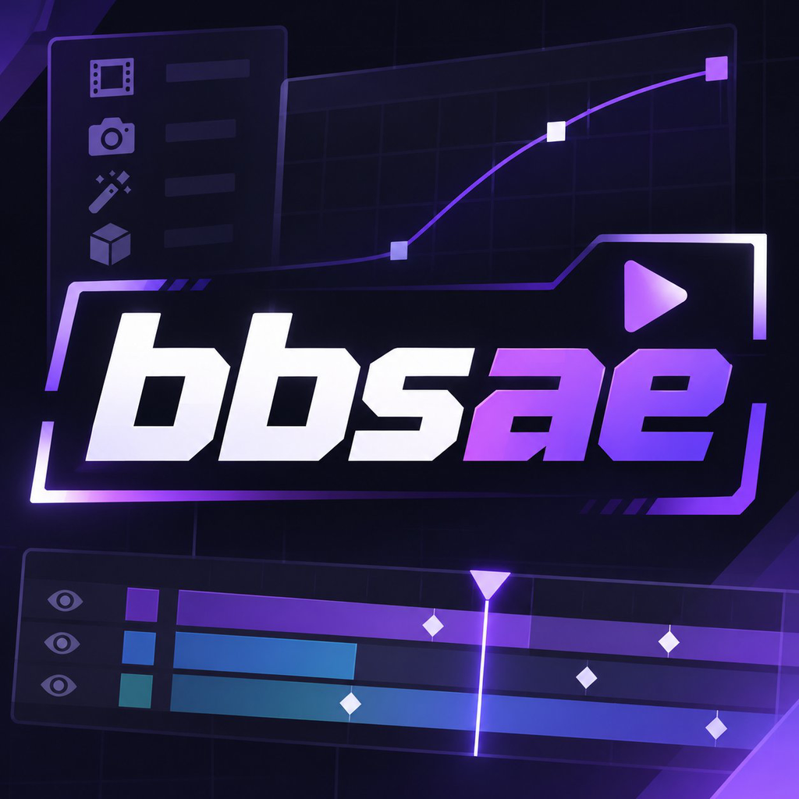
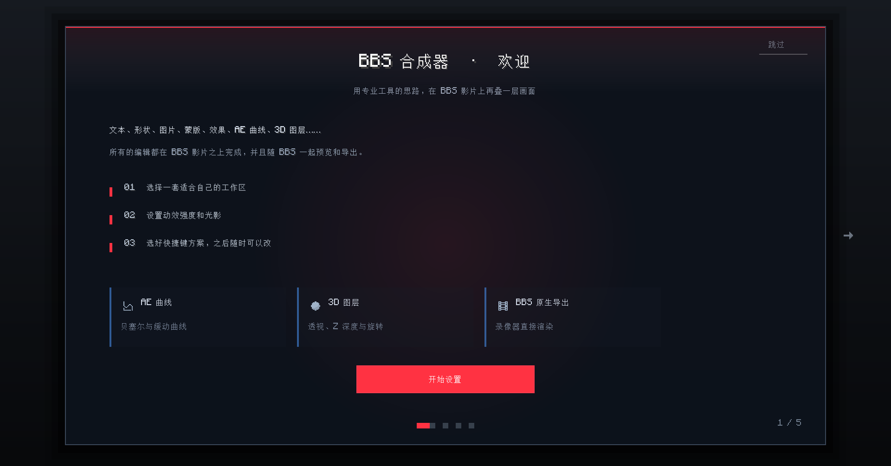
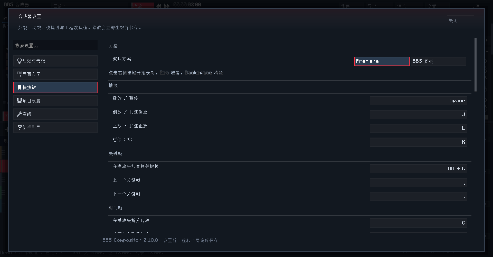

# BBS Compositor 图文介绍

> Minecraft 1.20.1 / Fabric · BBS FS 2.7 客户端 addon  
> 仓库：<https://github.com/zhongend/bbsae> · Release：<https://github.com/zhongend/bbsae/releases/tag/v0.18.0>

  

  作者 <b>终end</b> · <a href="https://github.com/zhongend">@zhongend</a>

## 1. 这是什么

BBS Compositor（`bbsae`）给 BBS FS 影片加了一个**屏幕空间 2D/2.5D 合成器**。

BBS 负责 3D 世界、相机、回放和视频编码；合成器负责在 BBS 已经渲染好的画面上，再叠一层
可编辑的图层：

- 文字、形状、图片、序列帧、纯色、HUD、Null、调整层、预合成；
- 蒙版、轨道遮罩、13 种混合模式、父子关系；
- BBS 原生关键帧、表达式、动画预设；
- 53 个效果、9 个图层样式；
- 每部影片一个工程，每个 replay 一个独立 composition；
- 结果通过 BBS 官方的 `RegisterFrameOverlaysEvent` 绘制，所以**预览和 F6 导出都会包含合成层**，
  不需要修改 `.dat` 影片格式。

## 2. 界面总览

  

合成器是**独立的 BBS dashboard panel**，不是盖在影片编辑器上的透明层。四个区域：

| 编号 | 区域 | 作用 |
| --- | --- | --- |
| 1 | 效果库 / 素材 | 53 个效果按分类/搜索/最近使用；双击应用到选中轨道 |
| 2 | 实时预览 | 自己的 FBO、选择框/手柄、FX / Mask / BBS 世界背景开关 |
| 3 | Effect Controls | 运动、不透明度、混合模式、效果栈、图层样式、蒙版、文字、调色 |
| 4 | 轨道时间轴 | 一层一轨、移动/裁剪/吸附、工作区、标记、BBS 原生关键帧抽屉 |

预览不是 BBS 影片编辑器的截图，也不是透明覆盖：`CompRenderer` 每帧把图层栈渲染到自己的
framebuffer，再按 BBS 的 `customSize`/world 状态合成。这样编辑器里看到的就是最终导出的画面。

## 2.1 新手引导与设置（0.18.0）

  

首次进入时，引导会先问三个真正影响日常使用的问题：

- **工作区布局**：标准、专注、紧凑、宽屏；选择会立即应用，并保存到工程；
- **动效强度**：平衡、电影感、极简；也可以之后在设置里逐项调；
- **快捷键方案**：Premiere 或 BBS 原版；之后每个命令都能单独改。

背景沿用 BBS 原版 landing screen 的视觉语言：深色表面、漂浮灯、跟随鼠标的光晕，以及会被
指针推开的微粒。引导只出现一次，可从「设置 → 新手引导」重新播放。

  

设置改成 BBS 2.7 的「左分类 + 右滚动列表」布局，支持搜索、分区标题、开关、滑杆和分段选择：

- **动效与光效**：开关、强度、速度、辉光、阴影、引导背景亮度；
- **界面布局**：工作区预设、控件密度、安全框/网格、重置布局；
- **快捷键**：点击键帽后按下新组合键，`Backspace` 清除，`Esc` 取消，冲突会在状态栏提示；
- **项目设置 / 高级 / 新手引导**：原有工程默认值、编码器、AE 代理和引导重播都归位。

所有自定义控件共用一层 `UiMotion`：按钮 hover、页签下划线、卡片入场、素材库滚动、轨道选择
和浮层入场都走非线性曲线；设置里可以随时关闭或降低强度。

## 3. 轨道时间轴

  

- 一层一条轨道，轨道头有类型图标、名称、可见、锁定；
- 拖 bar 主体移动整条轨道，拖左右边缘裁剪 in/out；
- 拖动按帧量化，可吸附播放头、0、合成结尾、工作区、标记和其它轨道边缘；
- `Shift` 临时关闭吸附；`Alt+滚轮` 改行高；`Ctrl+滚轮` 以鼠标为锚缩放；
- 拆分保持源画面连续：`startTime` 随拆分推进，裁剪入点不会 slip；
- 右键：重命名、复制、删除、拆分、上下移层、加效果、显示关键帧、隐藏/锁定；
- 关键帧抽屉仍是 BBS 原生 `UIKeyframeEditor`（dope sheet / graph / 插值 / 右键菜单）。

## 4. 53 个效果与 Alight Motion PIXEL 家族

  

第八轮新增七个屏幕/复古效果，全部复用共享的 `PIXEL` shader：

| 效果 | 参数 | 说明 |
| --- | --- | --- |
| 扫描线 Scanlines | 强度、行距、滚动偏移 | 平滑正弦行带，避免硬窗口漏行 |
| 故障 Glitch | 位移、条带数、速度、种子 | 条带横向跳动 + RGB 分离，速度真正驱动 `Phase` |
| VHS | 强度、抖动速度、噪点 | 跟踪抖动、色偏、扫描线、磁带颗粒 |
| 半色调 Halftone | 横向网点数、强度、角度、行相位、网点色、纸张色 | 在网点中心采样亮度，支持交错行和透明纸张 |
| 浮雕 Emboss | 强度、光照角度 | 方向亮度导数 + 中灰，经典灰色浮雕 |
| 镜像 Mirror | 方向、镜像不透明度 | 叠加半透明镜像副本，而不是丢掉一半画面 |
| 万花筒 Kaleidoscope | 分段、旋转 | 层局部极坐标的 N 重镜像折叠 |

关键实现点：**所有效果在层空间执行**。图层移动/缩放时，半色调网点、镜像接缝、Glitch
条带都会跟着层走；层外采样返回透明，不会把边缘拉成拖影。详细公式见
[`ROUND8-02-PIXEL.zh.md`](ROUND8-02-PIXEL.zh.md)。

## 5. 调色

  

- 三个 AE 风格色轮：Lift / Gamma / Gain，中心中性、角度=色相、半径=饱和度；
- 五点主曲线（黑、阴影、中间调、高光、白），与 shader 使用同一 Catmull-Rom 公式；
- 曝光、对比度、饱和度、自然饱和度、色温、色调、色相旋转、褪色；
- 预设：中性 / 电影 / 暖阳 / 冷峻 / 黑白；
- 所有标量参数都可以用 BBS float channel 打关键帧；
- 可以一键创建“调色调整层”，只影响其下已经累积的像素。

## 6. 素材库

  

- 项目 `assets` 目录 + 客户端资源包里的 `textures/item|block|entity|gui`；
- 13 个分类、跨分类搜索、缩略图、翻页；
- 双击插入，或替换当前选中图层的素材；
- 音效库可以试听 vanilla/BBS sound event、复制 ID、打开 BBS 原版音效库。

## 7. 3D 相机、调整层与预合成

  

- 2.5D 图层可以被 3D 相机投影；自由相机支持 X/Y 旋转、滚轮推拉、Alt+滚轮 FOV；
- 3D 图层按深度排序，调整层是排序边界；
- 调整层只影响其下已累积的像素，适合统一调色/发光；
- 预合成会创建真实子合成，空/循环目标会画占位框，不会递归崩溃；
- 相机/Replay/图层锚点都可以做绑定。

## 8. 导出

|  |  |
| :---: | :---: |
| **导出预设**：1280/1920/2560/3840、16:9 / 9:16 / 1:1、24/30/60 fps；写进 BBS 自己的录像设置。 | **真实导出**：1920×1080 @ 60 fps、494 帧、8.23 s；抽帧里可以看到合成层已经烘进 MP4。 |

- 导出走 BBS 原生 recorder，不另写编码管线；
- 合成器自己的渲染队列仍支持 PNG 序列 / H.264 审阅 / ProRes 422 HQ / ProRes 4444 Alpha；
- 每部影片一个工程，每个 replay 一个 composition；
- 外部回放可以通过 `showDuringExternalPlayback` 选择是否显示合成层。

## 9. 验证与测试

- **193 / 193 测试通过**：模型、曲线、相机、效果空间、GLSL 编译、PIXEL 像素、参数死链、覆盖、图标；
- `ShaderPixelTest` 使用真实隐藏窗口 OpenGL 3.2 上下文，断言扫描线亮暗行、镜像层空间、
  半色调 ink/paper、浮雕中灰、Glitch/VHS 恒等性与 Phase、万花筒 4 重对称；
- `PixelPlanTest` 逐个修改七个效果的每个参数，断言参数真的进入 shader；
- 联系表：`verify/round8-pixel-effects.png`；
- 构建：`gradle build` 产出 `bbsae-0.1.0.jar`（396510 字节，SHA-256
  `1CC9F7F8827B5926A2A9C005A9D1FFDC8B946C276C796C8D4415E87EF6DBA00C`）。

## 10. 安装

1. 下载 [`bbsae-0.18.0.jar`](https://github.com/zhongend/bbsae/releases/download/v0.18.0/bbsae-0.18.0.jar)；
2. 安装 Minecraft 1.20.1、Fabric Loader 0.16.14+、Fabric API 0.92.1+1.20.1、BBS FS 2.7-1.20.1；
3. 把 `bbsae-0.18.0.jar` 和 BBS FS jar 放进 `mods/`；
4. 打开 BBS 影片，选择 replay，进入 **Replay properties → Compositor → Open Film Compositor**。

## 11. 文档

- [HANDOFF.zh.md](HANDOFF.zh.md)：架构、已实现功能、关键 bug、构建/重映射流程；
- [features.zh.md](features.zh.md)：功能矩阵和明确限制；
- [ROUND8-01-AUDIT.zh.md](ROUND8-01-AUDIT.zh.md)：第一性原理与 bug 审计；
- [ROUND8-02-PIXEL.zh.md](ROUND8-02-PIXEL.zh.md)：PIXEL 公式与层空间；
- [ROUND8-03-VERIFY.zh.md](ROUND8-03-VERIFY.zh.md)：测试、构建、实机复验清单；
- [ROUND8-04-PUBLISH.zh.md](ROUND8-04-PUBLISH.zh.md)：GitHub 发布记录；
- [ROUND9-EXPORT-SYNC.zh.md](ROUND9-EXPORT-SYNC.zh.md)：导出画面同步、12/20 秒时长根因、BBS 预览层、图标；
- [ROUND28-ASSETS-CURVES-ICON.zh.md](ROUND28-ASSETS-CURVES-ICON.zh.md)：素材库可拖拽滚动条、AE 曲线专业级修复、插件图标。

## 12. 图标与署名

- 合成器图标原作者：**超级大布叮**；
- 项目维护者：**终end**（[@zhongend](https://github.com/zhongend)）；
- 32×32 原图：`docs/gallery/compositor-icon.png`；
- BBS 界面使用的 16×16 版本：`src/main/resources/assets/bbsae/assets/textures/gui/compositor_icon.png`；
- **Mod Menu / 启动器插件图标**：`src/main/resources/assets/bbsae/icon.png`（128×128，同一图标的
  深色圆角底版本，`fabric.mod.json` 的 `icon` 字段指向它）；
- 图标同时用于 BBS dashboard 页签和 `bbsae:composition` 影片 clip。

## 13. 已知限制

- 没有实现完整 3D 图层/灯光/C4D；BBS 提供 3D 世界；
- 没有 Roto Brush、木偶/网格变形、逐字 3D、文字路径；
- 没有 OCIO/线性工作流/LUT，当前 sRGB + straight alpha；
- 预览按合成分辨率全量渲染，4K 重效果会明显变慢；
- 深度效果依赖世界 depth capture，Iris/Sodium 下可能降级；
- 全局 undo 仍是 1 秒工程快照（最多 50 步），不是跨图层命令栈。
