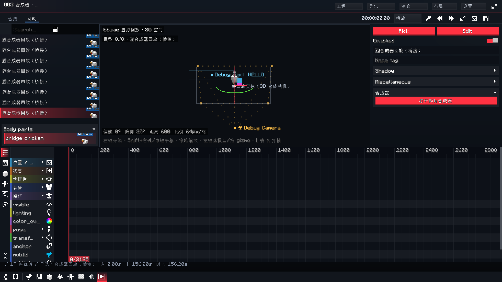
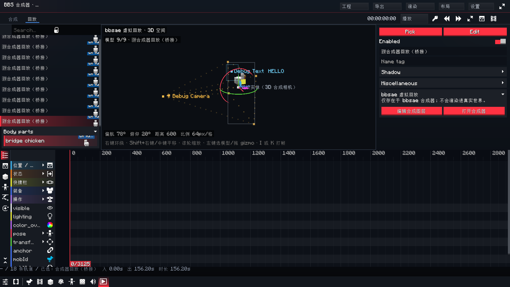

# Round 81 — 回放预览合成参考 / 检查器响应 / 原生图层设置页

> 版本 `0.99-hotfix39`。

## 1. 回放预览显示摄像机与其他合成元素

回放编辑器原先只画虚拟回放模型，画面里看不到合成器中的摄像机、文字、图片/卡片和合成画幅，
无法边看构图边打 K 帧。新增 `ReplayCompositionOverlay`：

- 通过当前选中回放对应的 `CompLayer`（`replayId`）建立坐标映射：
  `ReplaySceneSpace.toComp(layer.replayAnchor*) - layer.xyz`，把合成像素坐标搬进回放世界；
- 画合成画幅四角与边线（橙色）；
- 画所有摄像机：
  - 眼睛位置（`CompCamera.eyeOf`，按 `in/out` 和关键帧采样）；
  - 目标点（`cameraTarget*` 通道）；
  - 当前摄像机视锥的四角连线；
  - 整段运动路径（32 个采样点）；
- 画其他非模型、非相机、可见图层的包围框、中心点、名称；文字层额外显示文字内容；
- 颜色按类型区分（文字青、图片绿、形状橙、预合成紫），并遵守 `guides` 显示开关；
- 全部绘制在视口裁剪区内；包围框用一次 `outline`，路径只画采样点，避免参考层把回放视口拖慢。

因此回放编辑器现在既能看虚拟模型，也能看到合成器中的摄像机和其它元素，便于合成编辑。

## 2. 合成器检查器（轨道右侧编辑区）的响应优化

### 2.1 重建合并

`refreshInspector()` 以前在每个页面切换、图层选择、属性回调里同步重建整棵滚动页；一次点击
可能连续重建多次，页面切换动画第一帧被卡住，看起来“动画特别缓慢”。现在：

- `refreshInspector()` 只设置 `inspectorRefreshQueued`；
- `UICompositorPanel.render()` 每帧最多重建一次，且在绘制前完成；
- 页面切换立即开始过渡，重建在遮罩下进行；
- 检查器页面过渡从 160 ms 缩短到 100 ms，滑动距离 6 px → 3 px；左侧/时间轴过渡同步缩短。

### 2.2 延迟滚动修复

“添加效果”原先先 `refreshInspector()` 再立即 `scrollToEnd()`：同步重建时有效，改成延迟重建后
会在旧内容上滚动、下一帧新内容又回到顶部。现在 `inspectorScrollToEnd` 与重建一起延迟，
`rebuildInspector()` 完成后再滚到底。

### 2.3 图层设置页渐进展开

所有检查器 section 都接入 `UISection.remember(sectionFolds, key, default)`，折叠状态在重建/切换
图层后保持。图层页默认展开“图层 / 运动 / 不透明度”，高级项默认折叠：

- 片段、运动模板、绑定/跟踪、图层标记、动画预设、合成标记等；
- 摄像机页同理；
- 调色、蒙版、文字、形状、输出、合成等页面按需展开。

这样常用参数第一屏可见，页面高度和布局成本下降。

## 3. BBS 原生回放图层设置页

BBS 的 `UIReplayPropertiesPanel`（回放右侧原生属性列）里，bbsae 原来的“打开影片合成器”是一颗
占满宽度的红按钮，信息少、层级不清。现在改成：

- 标题“bbsae 虚拟回放”；
- 一行说明“仅存在于 bbsae 合成器；不会渲染进真实世界”；
- 两个紧凑按钮：
  - “编辑合成图层”：打开合成器，选中与该回放 `replayId` 对应的 CompLayer，并切到「图层」页；
  - “打开合成器”：只打开合成器。

## 4. 逻辑修复

- 回放列表的零宽虚拟标记不再在“当前选中回放”上逐帧重写：用户编辑 label 时不会每帧把标记
  插回字符串导致光标跳动；选中移开后自动补回。
- 合成参考层的路径/边框改为低 draw call 画法，避免为了显示参考线反而拖慢回放预览。
- 检查器延迟重建后，添加效果的滚动位置不再丢失。

## 5. 验证

- 真机回放：`docs/verify/round81-replay-guides.png` 中可见 `Debug Camera` 眼睛标记、橘色路径、
  合成画幅、`Debug Text HELLO` 和模型。
- 原生设置页：`docs/verify/round81-native-layer-settings.png` 中可见“bbsae 虚拟回放”说明和
  “编辑合成图层 / 打开合成器”两个按钮。
- 图层页：`docs/verify/round81-layer-inspector.png` 中默认折叠高级 section。
- 全量测试：152 套件 / 951 项 / 0 failures / 0 errors / 1 skipped。
- 本地候选包：`bbsae-0.99-hotfix39.jar`（3,899,522 bytes，SHA-256 1D5572A4F93F5783332F7255F90F1AD0F0F64B47FFBBBC4D7AEB52BE69901B77）。
