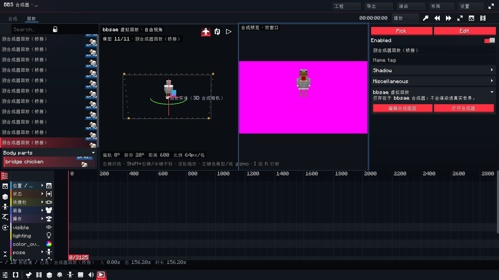

# Round 82 — 虚拟回放光照 / 原版预览按钮 / 关键帧重叠 / 预览模式设置

> 版本 `0.99-hotfix40`。

## 1. 虚拟回放不再受主世界光照影响

### 根因

BBS 的 `FilmEntityRenderer.renderEntity` 在创建 `FormRenderingContext` 前采样：

```java
BlockPos pos = BlockPos.ofFloored(actor.x, actor.y + 0.5, actor.z);
int sky = entity.getWorld().getLightLevel(LightType.SKY, pos);
int torch = entity.getWorld().getLightLevel(LightType.BLOCK, pos);
int light = LightmapTextureManager.pack(torch, sky);
```

这对真实影片演员是正确的；但 bbsae 虚拟回放的“世界坐标”只是合成器里的摆放锚点，可能落在
洞穴、方块内部或完全无关的位置，于是虚拟模型在合成预览/回放编辑里被主世界光照压成黑色。
之前只绑了白色 lightmap 纹理，但这个 `FormRenderingContext.light` 仍然来自世界，所以没有根治。

### 修复

- 新增 `ReplayRenderLight`：可嵌套的 full-bright 计数器；
- `ReplayModelPass`、`ReplayActorPass`（普通/联动/相机）、`ReplayEntityMask` 统一通过
  `ReplayRenderLight.renderEntity(...)` 调用 BBS 渲染器；
- 新增 mixin `FilmEntityRendererLightMixin`，在 `ReplayRenderLight` 活跃时把
  `LightmapTextureManager.pack(...)` 重定向为 `MAX_LIGHT_COORDINATE`；
- 真实 BBS 影片播放、BBS 预览层、主世界 actor 不走这个开关，光照保持原样。

日志验证：`Virtual replay full-bright light override active`。

## 2. 复制 BBS 原版预览视角按钮与逻辑

回放视口右上角新增三个 BBS `UIIcon`（与 BBS 原版预览框同一套图标/高亮/提示）：

- **自由视角**（`Icons.PLANE`）：右键环绕、Shift+右键/中键平移、滚轮缩放；
- **绕对象旋转**（`Icons.ORBIT`）：每帧把 pivot 跟随当前选中的虚拟回放，模型移动时相机仍绕着它；
- **相机视角**（`Icons.FRUSTUM`）：从活动合成相机的 eye/target 反推 `CompViewportCamera` 的
  yaw/pitch/distance/fov，直接看合成相机画面；此模式禁用自由导航，点击其它按钮退出。

按钮在双窗口模式下会贴在左侧 3D 窗口右上角，不会浮到右侧合成预览上。

## 3. 关键帧面板重叠修复

`preferredTimelineHeight()` 原来固定下限 220px。窗口较矮时，时间轴比整个 body 还高，关键帧
编辑器从 body 上方开始，压住回放列表/属性面板。现在：

- 先保留至少 180px 的 body；
- 时间轴高度限制在 body 剩余空间内（最小 80px，最大 480px）；
- 纯函数 `timelineHeightFor(pageHeight, embedded)` 由
  `ReplayTimelineLayoutTest` 覆盖 120–1080px 的窗口高度，断言 timeline 不越过 body。

## 4. 回放合成预览可设置

`CompPrefs` 新增 `replayCompPreview`：

- `0` 关闭：回放视口只显示 3D 世界；
- `1` 子窗口：右上角画中画（默认）；
- `2` 双窗口：左侧 3D 回放、右侧完整合成预览，中间分隔线。

设置入口：设置 → 显示与线索 → **回放编辑器预览 → 合成预览**。三种模式立即生效并写入
`config/bbsae/prefs.json`。子窗口只在暂停时刷新（避免与 actor pass 抢 GPU）；双窗口在播放时
也实时刷新，用户可根据性能选择关闭/子窗口。

双窗口下 3D 相机、gizmo、拾取、HUD 都使用左侧 `viewArea`，右侧只作为合成画面；
子窗口/双窗口的合成预览都跳过含 `bbs` 实时世界层的合成，继续保证回放编辑器的预览属于
bbsae 虚拟世界。



## 5. 验证

- 真机：虚拟回放模型在暗处仍为正常亮度；日志出现 full-bright override active。
- 真机：双窗口截图左侧 3D + 右上角自由/绕对象/相机三个 BBS 图标，右侧完整合成预览。
- 全量测试：153 套件 / 953 项 / 0 failures / 0 errors / 1 skipped。
- 本地候选包：`bbsae-0.99-hotfix40.jar`（3,906,596 bytes，SHA-256 51BBA127827CD5113F69AC2AA70E5A75EE2918A08001434133E4ADBC57825F5C）。
